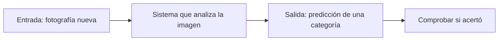
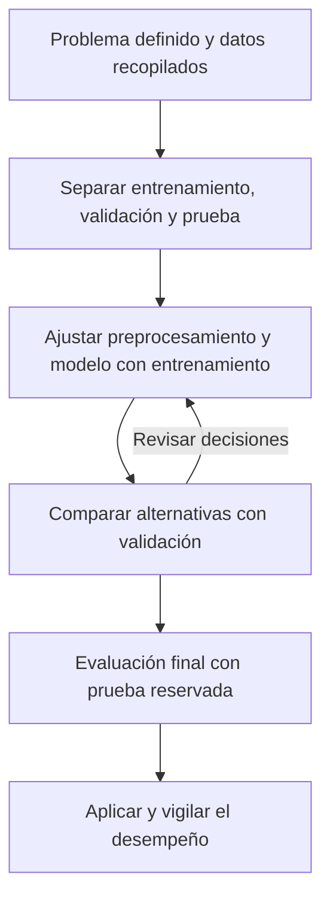

# Capítulo 1 · Unidad 1: Conceptos de inteligencia artificial

## Cómo vamos a trabajar

Esta guía cubre <b>el capítulo 1, unidad 1 completa: subtemas 1.1 al 1.8</b>, siguiendo las diapositivas 5 a 31 del profesor. Las analogías, los ejemplos numéricos y las preguntas de reflexión son material de tutoría.

Nuestro ritmo será: <b>guía de una unidad → evaluación por el chat → explicación de las dudas → comprobación breve → siguiente unidad</b>. Al terminar las unidades del capítulo 1, continuaremos con el capítulo 2. La guía está preparada; la comprensión de esta unidad está pendiente de evaluación.

Puedes leerla en tres bloques: fundamentos (1.1 a 1.4), aplicaciones y procedimiento (1.5 y 1.6), y razones y limitaciones (1.7 y 1.8).

## 1.1. Definición de inteligencia artificial

<i>Diapositivas 5 y 6.</i>

La <b>inteligencia artificial (IA)</b> es un campo de la informática que desarrolla sistemas capaces de realizar tareas como reconocer imágenes, interpretar lenguaje, razonar o elegir acciones para cumplir un objetivo.

La expresión «inteligente» se refiere aquí a capacidades que podemos observar y evaluar en una tarea. Por ejemplo: identificar un animal en una fotografía y comprobar si la respuesta es correcta.

<b>Analogía:</b> una persona puede reconocer un gato nuevo porque encuentra características que ya conoce. Construir un sistema que reconozca fotografías busca resolver esa tarea mediante procedimientos computacionales.



La <b>entrada</b> es la información que recibe el sistema. La <b>salida</b> es el resultado que produce. Una <b>predicción</b> es una respuesta calculada que puede acertar o equivocarse.

<b>Matiz sobre las diapositivas:</b> los sistemas de IA sí tienen código. Algunos emplean reglas y mecanismos de razonamiento diseñados por personas; otros aprenden patrones de los datos. Que un sistema use reglas no basta, por sí solo, para decidir si pertenece a la IA.

## 1.2. Tipos y subconjuntos de inteligencia artificial

<i>Diapositiva 8.</i>

Para esta unidad, la relación central es:

```txt
Inteligencia artificial (IA)
└── Aprendizaje automático (Machine Learning, ML)
    └── Aprendizaje profundo (Deep Learning, DL)
```

- <b>IA:</b> el campo amplio.
- <b>ML:</b> una parte de la IA que aprende patrones a partir de datos.
- <b>DL:</b> una parte del ML basada en redes neuronales con múltiples capas de procesamiento.

<b>Analogía de las cajas:</b> imagina una caja grande llamada IA. Dentro hay una caja ML, y dentro de ML hay otra DL. Estar en la caja pequeña implica estar también en las que la contienen.

En notación matemática:

$$
\mathrm{DL}\subset\mathrm{ML}\subset\mathrm{IA}
$$

El símbolo de inclusión indica que un conjunto está contenido en otro. Un árbol de decisión entrenado con datos es un ejemplo de ML que permite recordar que ML incluye métodos distintos de DL.

Las redes neuronales toman inspiración histórica de ideas sobre neuronas, pero su funcionamiento se describe mediante operaciones matemáticas. La analogía con el cerebro tiene límites.

## 1.3. Definición de Machine Learning

<i>Diapositivas 10 y 11.</i>

El <b>aprendizaje automático</b> estudia métodos que ajustan un modelo utilizando datos o experiencia para mejorar su desempeño en una tarea.

Distingue estos conceptos:

- <b>Algoritmo de aprendizaje:</b> el procedimiento que ajusta el modelo.
- <b>Modelo entrenado:</b> el resultado del aprendizaje, que utilizamos para producir respuestas.
- <b>Entrenamiento:</b> el proceso de ajuste con ejemplos.
- <b>Inferencia:</b> utilizar el modelo ya ajustado con un caso nuevo.
- <b>Generalización:</b> capacidad de funcionar bien con casos nuevos relevantes para el problema.

Un modelo entrenado normalmente no cambia sus parámetros cada vez que hace una predicción. Para adaptarlo puede ser necesario volver a entrenarlo o diseñar un proceso de actualización.

### Tarea, experiencia y desempeño

Las diapositivas presentan la definición mediante <b>T, E y P</b>. Para un reconocedor de animales:

| Elemento | Significado | Ejemplo |
| --- | --- | --- |
| T | Tarea que queremos resolver | Distinguir fotografías de perros y gatos |
| E | Experiencia disponible para aprender | Fotografías de entrenamiento con la categoría correcta |
| P | Medida del desempeño | Proporción de aciertos en imágenes reservadas para evaluación |

Una medida posible es la <b>exactitud</b>:

$$
\text{exactitud}=\frac{\text{predicciones correctas}}{\text{total de casos evaluados}}
$$

Si acierta en 8 de 10 fotografías, su exactitud es 0.8, equivalente al 80 %. La métrica apropiada depende del problema: aquí usamos esta por su sencillez.

### La idea matemática de un modelo

En un problema supervisado podemos escribir:

$$
\hat{y}=f_{\theta}(x)
$$

- <b>x:</b> características de entrada, como la distancia de un recorrido.
- <b>y:</b> valor correcto que conocemos en los ejemplos de entrenamiento.
- <b>ŷ:</b> predicción calculada por el modelo. El sombrero distingue una estimación del valor correcto.
- <b>f:</b> la función que transforma la entrada en una predicción.
- <b>θ:</b> parámetros que se ajustan durante el entrenamiento.

<b>Ejemplo inventado de un modelo ya ajustado:</b>

$$
\hat{y}=4+3x
$$

Si x es la distancia en kilómetros y ŷ es el tiempo estimado en minutos, para 3 km obtenemos 4 + 3 × 3 = 13 minutos. El 4 es un tiempo base y el 3 representa minutos adicionales por kilómetro. Entrenar ese tipo de modelo consiste en ajustar sus coeficientes con datos; aquí los elegimos solo para ilustrarlo.

## 1.4. Disciplinas relacionadas con el aprendizaje automático

<i>Diapositiva 13.</i>

El ML reúne herramientas de varios campos. Imagínalo como un proyecto de ingeniería con especialidades que colaboran.

| Disciplina | Qué aporta |
| --- | --- |
| Probabilidad y estadística | Describir variabilidad, razonar con incertidumbre y evaluar resultados |
| Informática y algoritmos | Implementar métodos y procesar los datos |
| Bases de datos | Organizar, almacenar y consultar la información |
| Reconocimiento de patrones | Identificar regularidades en imágenes, señales u otros datos |
| Ciencia cognitiva y neurociencia computacional | Aportar preguntas y modelos sobre aprendizaje y procesamiento de información |
| Minería de datos | Buscar patrones y relaciones útiles en conjuntos de datos |
| Ciencia de datos | Integrar la pregunta, los datos, el análisis y la comunicación de resultados |

<b>Ejemplo:</b> al estudiar tiempos de transporte, una base de datos guarda recorridos; la estadística ayuda a comprender su variación; un algoritmo aprende relaciones; la ciencia de datos conecta todo con la decisión que queremos apoyar.

Estos campos se relacionan y se solapan. La tabla indica sus aportes en este contexto, sin proponer fronteras rígidas entre ellos.

## 1.5. Tipos y opciones de análisis de datos basados en ML

<i>Diapositivas 15 a 20.</i>

Este apartado combina dos preguntas distintas: <b>cómo se representa la información</b> y <b>qué problema queremos resolver</b>.

### Características y representación

Una <b>característica</b> es una propiedad que el modelo utiliza como entrada. En una tabla de viviendas podría ser la superficie; en una imagen, una representación numérica de su contenido.

Las diapositivas comparan estos esquemas:

```txt
Esquema habitual de ML con características diseñadas:
Datos → extracción de características → modelo → predicción

Esquema habitual de deep learning:
Datos → red que aprende representaciones y predice → predicción
```

En el primer esquema podemos diseñar medidas que describan los objetos. En el segundo, una red puede aprender representaciones progresivamente durante el entrenamiento. Es una comparación introductoria: hay métodos de ML que también aprenden representaciones y los proyectos de DL siguen necesitando preparación de datos.

### Supervisado y no supervisado

En <b>aprendizaje supervisado</b> tenemos ejemplos con una respuesta conocida, llamada <b>etiqueta</b> u <b>objetivo</b>. El entrenamiento utiliza entradas y respuestas para aprender su relación.

En <b>aprendizaje no supervisado</b> buscamos estructura sin utilizar una respuesta objetivo para cada ejemplo. Por ejemplo, podemos formar grupos de personas según sus hábitos sin disponer de categorías correctas previas.

<b>Analogía:</b> en supervisado estudias ejercicios con soluciones; en no supervisado organizas tarjetas por semejanza sin recibir las categorías. «Supervisado» describe la información disponible durante el aprendizaje, no la presencia permanente de una persona mirando la pantalla.

La distinción entre ambos enfoques se desarrolla también en la [introducción oficial de Google al ML](https://developers.google.com/machine-learning/intro-to-ml/what-is-ml).

### Los cuatro problemas de las diapositivas

| Problema | Qué buscamos | Ejemplo de tutoría |
| --- | --- | --- |
| Predicción numérica o regresión | Estimar una cantidad | Estimar minutos de un recorrido |
| Clasificación | Asignar una categoría conocida | Clasificar un correo como spam o legítimo |
| Agrupamiento o clustering | Formar grupos según semejanzas | Agrupar recorridos con patrones similares sin etiquetas previas |
| Reglas de asociación | Encontrar elementos o sucesos que suelen aparecer juntos | Detectar productos que suelen comprarse en la misma cesta |

Para distinguir regresión y clasificación, pregunta <b>qué significa la salida</b>. Si 0 y 1 representan dos categorías, sigue siendo clasificación. Los números pueden funcionar como nombres de clases.

La palabra «predicción» también se usa en sentido amplio: tanto un regresor como un clasificador producen predicciones.

En una asociación, encontrar que dos productos aparecen juntos permite describir un patrón. Por sí solo, ese resultado no demuestra que comprar uno cause la compra del otro. Los grupos descubiertos mediante clustering también requieren interpretación y validación.

## 1.6. Procedimientos para el análisis de datos basado en ML

<i>Diapositiva 22.</i>

El curso presenta seis etapas:

| Etapa | Qué hacemos y por qué |
| --- | --- |
| 1. Entender el contexto y definir el problema | Precisamos qué necesitamos responder y cómo mediremos la utilidad |
| 2. Recopilar datos | Buscamos información relevante y ejemplos de la situación donde se usará el sistema |
| 3. Preprocesar | Investigamos errores, faltantes y representaciones para preparar entradas consistentes |
| 4. Entrenar el modelo | Ajustamos sus parámetros utilizando entrenamiento |
| 5. Evaluar el desempeño | Comprobamos si responde bien a casos reservados, con métricas adecuadas |
| 6. Mejorar y aplicar | Analizamos errores, revisamos el sistema y vigilamos su funcionamiento durante el uso |

<b>Ejemplo:</b> «predecir transporte» es ambiguo. «Estimar la duración de un recorrido al momento de solicitarlo y medir el error en minutos» define mejor la tarea. Una característica tiene que estar disponible cuando se hará la predicción.

### La separación que hace justa la evaluación

Como complemento práctico al esquema del curso, reservamos datos antes de ajustar el preprocesamiento y el modelo:

- <b>Entrenamiento:</b> permite aprender los parámetros.
- <b>Validación:</b> permite comparar alternativas y elegir configuraciones.
- <b>Prueba o test:</b> permite estimar el desempeño final del sistema elegido.



<b>Analogía:</b> practicar con ejercicios, elegir una estrategia con un simulacro y presentar un examen reservado. Ver las respuestas del examen mientras preparas tu estrategia altera lo que ese examen puede demostrar.

<b>Fuga de información:</b> sucede cuando el desarrollo incorpora información que no debería tener disponible. Un ejemplo es calcular una media de preprocesamiento usando también el test. Aprende esa media con entrenamiento y aplica la misma transformación a los otros conjuntos. El test tampoco debe guiar repetidamente la elección del modelo. Estas reglas se explican en la [documentación de scikit-learn sobre errores frecuentes](https://scikit-learn.org/stable/common_pitfalls.html#data-leakage).

La separación debe respetar el contexto: por ejemplo, al predecir el futuro, mezclar información posterior con anterior puede invalidar la evaluación.

El proceso se repite al encontrar problemas, pero cada revisión necesita conservar una evaluación adecuada. <b>Generalizar</b> implica funcionar con ejemplos nuevos de la situación de interés.

## 1.7. Razones para el aprendizaje automático

<i>Diapositiva 24.</i>

El ML puede resultar útil cuando:

- <b>Es difícil escribir todas las reglas:</b> reconocer voces o imágenes involucra muchas variaciones.
- <b>El mantenimiento de reglas manuales se vuelve complicado:</b> un filtro de spam puede necesitar responder a nuevas formas de mensajes.
- <b>Hay muchos datos con patrones que queremos aprovechar:</b> podemos buscar relaciones útiles para una tarea definida.
- <b>El entorno cambia y disponemos de datos nuevos:</b> podemos actualizar y volver a evaluar el sistema.

<b>Ejemplo:</b> una regla que bloquea correos por una palabra concreta puede quedarse corta cuando cambia el texto. Un modelo puede combinar distintas características. Para adaptarse a cambios posteriores necesitará un proceso de actualización y evaluación.

Estos son motivos para considerar ML, junto con la disponibilidad y calidad de datos, el costo de los errores y una comparación con soluciones más sencillas. Una tarea con una regla exacta, conocida y estable puede resolverse directamente programando esa regla.

## 1.8. Limitaciones para el aprendizaje automático

<i>Diapositivas 26 a 31.</i>

### A. Datos insuficientes

Pocos ejemplos pueden dejar variaciones importantes sin cubrir. La cantidad necesaria depende del problema, la diversidad de los casos, el modelo y la posibilidad de reutilizar aprendizaje previo. Las cantidades mencionadas en las diapositivas ilustran esa dificultad; no establecen un mínimo universal.

### B. Datos poco representativos

La muestra de entrenamiento debe reflejar los casos donde utilizaremos el sistema. Hay dos problemas diferentes:

- <b>Ruido de muestreo:</b> una muestra pequeña obtenida al azar puede diferir bastante de la población por casualidad.
- <b>Sesgo de muestreo:</b> el método de selección favorece sistemáticamente ciertos casos. Recoger más datos del mismo origen puede mantener ese problema.

<b>Analogía:</b> para conocer los hábitos de todos los estudiantes, entrevistar únicamente a quienes están en una biblioteca a medianoche deja fuera muchos perfiles. Hacer muchísimas entrevistas allí no elimina el problema de selección.

### C. Mala calidad de los datos

Etiquetas incorrectas, unidades mezcladas, registros erróneos y mediciones ruidosas pueden dificultar el aprendizaje.

Un <b>valor atípico</b> es inusual respecto a los demás. Puede representar un error o un caso real importante. Antes de modificarlo, investiga qué significa y cómo se obtuvo.

<b>Pregunta analítica:</b> si una columna registra una duración extraordinariamente alta, ¿es un error de captura, un cambio de unidades o un recorrido real excepcional? El contexto permite decidir.

### D. Características poco útiles o mal representadas

El modelo necesita información relacionada con la tarea.

- <b>Selección de características:</b> elegir entradas existentes que resulten útiles.
- <b>Extracción de características:</b> transformar los datos en otra representación, por ejemplo combinando mediciones. Puede reducir dimensiones, aunque no toda extracción lo hace.
- <b>Ingeniería de características:</b> diseñar y preparar representaciones útiles con conocimiento del problema.

<b>Ejemplo:</b> un identificador aleatorio puede aportar poco para estimar la duración de un recorrido; distancia, ruta y hora tienen una relación más plausible con esa tarea. Esa utilidad debe comprobarse con una evaluación apropiada.

### E. Sobreajuste

El modelo se adapta demasiado a detalles particulares o ruido del entrenamiento y rinde peor con datos nuevos. La analogía es memorizar las respuestas exactas de una lista de ejercicios y luego fallar en variantes.

Podemos investigar su complejidad, mejorar la representación de datos y usar <b>regularización</b>, que introduce restricciones o penalizaciones para favorecer ciertas soluciones y reducir el riesgo de sobreajuste.

### F. Subajuste

El modelo no logra capturar suficiente estructura, incluso en entrenamiento. La analogía es intentar contestar todos los ejercicios con una regla demasiado limitada.

Podemos investigar si hacen falta mejores características, un modelo con capacidad adecuada, menos restricciones o un ajuste de entrenamiento más apropiado.

| Patrón observado | Qué conviene investigar |
| --- | --- |
| Muy buen resultado en entrenamiento y un resultado mucho peor en validación | Posible sobreajuste; revisar también diferencias entre conjuntos y cómo se evaluó |
| Mal resultado incluso en entrenamiento | Posible subajuste; revisar también datos, representación y entrenamiento |
| Buen resultado en datos nuevos pertinentes para el uso | Evidencia favorable sobre generalización dentro de esas condiciones |

Son señales para investigar, no diagnósticos definitivos basados únicamente en dos porcentajes. La [explicación de Google sobre sobreajuste y subajuste](https://developers.google.com/machine-learning/crash-course/overfitting/overfitting) desarrolla esta comparación.

### La pregunta de arranque que conservamos

Supón que enseñamos a un sistema únicamente fotografías de gatos blancos y después le mostramos un gato negro. ¿Qué dificultad podría tener y qué cambiarías en los ejemplos para ayudarle?

<b>Estado:</b> sin respuesta registrada. Podemos retomarla durante la evaluación.

## Vocabulario para repasar

- <b>Ejemplo o muestra:</b> un caso del conjunto de datos.
- <b>Característica:</b> información de entrada utilizada para una tarea.
- <b>Etiqueta u objetivo:</b> respuesta conocida en un ejemplo supervisado.
- <b>Modelo:</b> función o sistema ajustado para producir respuestas.
- <b>Parámetro:</b> valor que el procedimiento de entrenamiento ajusta.
- <b>Entrenamiento:</b> proceso de aprendizaje con datos.
- <b>Inferencia:</b> uso del modelo para producir una respuesta.
- <b>Generalización:</b> desempeño con casos nuevos pertinentes para el uso.
- <b>Regularización:</b> restricciones o penalizaciones que ayudan a controlar el ajuste.

## Evaluación y siguiente paso

La evaluación se realiza <b>en el chat</b>, con preguntas de explicación y aplicación, sin respuestas anticipadas. Revisaremos cada respuesta, explicaremos las confusiones y usaremos otra pregunta breve para comprobar las correcciones.

- [x] Guía de los ocho subtemas preparada.
- [ ] Responder la evaluación en el chat.
- [ ] Revisar dudas y comprobar lo reforzado.
- [ ] Pasar al capítulo 1, unidad 2: Aplicaciones de la inteligencia artificial.

## Fuentes

<b>Fuente principal:</b> [diapositivas del capítulo 1 en Canvas](https://udem.instructure.com/courses/36648/pages/recursos-didacticos-del-capitulo-1-2?module_item_id=5019816), apartado de la unidad 1, diapositivas 5 a 31. El índice de la unidad 2 aparece en la diapositiva 32.

Los enlaces de Google y scikit-learn se incluyen junto a los conceptos que aclaran. Los ejemplos, las analogías, la notación explicada y el método de estudio son complementos de tutoría.

