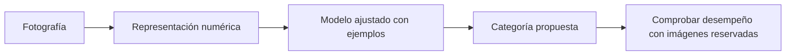
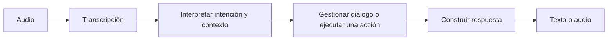

# Unidad 2: Aplicaciones de la inteligencia artificial

## Objetivo y ruta

Podrás convertir una aplicación de IA en una pregunta concreta sobre entradas, salidas y evaluación. Los apartados siguen 2.1–2.4 del curso. Lee primero el mapa de aplicaciones y después los casos de imágenes, visión y habla.

## 2.1. Aplicaciones de la inteligencia artificial

Una aplicación combina una tarea, información disponible y un resultado útil para alguien. «Usar IA» por sí solo no define qué problema resolvemos.

<table header-row="true">
<tr><td>Aplicación</td><td>Entrada posible</td><td>Salida o tarea</td></tr>
<tr><td>Clasificación de texto</td><td>Comentario escrito</td><td>Categoría de comentario</td></tr>
<tr><td>Resumen</td><td>Documento</td><td>Texto más breve que conserve información relevante</td></tr>
<tr><td>Regresión</td><td>Características de un recorrido</td><td>Duración estimada</td></tr>
<tr><td>Detección de anomalías</td><td>Registros de funcionamiento</td><td>Casos inusuales para investigar</td></tr>
<tr><td>Agrupamiento</td><td>Hábitos de uso sin etiquetas previas</td><td>Grupos de observaciones parecidas</td></tr>
<tr><td>Recomendación</td><td>Historial y contexto pertinente</td><td>Elementos ordenados por una estimación de interés</td></tr>
<tr><td>Visualización</td><td>Datos organizados</td><td>Una representación que facilite su análisis</td></tr>
</table>

La visualización ayuda a analizar sistemas de IA y sus datos, aunque muchos gráficos se construyen sin aprendizaje automático.

**Analogía:** para diseñar una herramienta de taller primero decides qué trabajo debe realizar. Después eliges el mecanismo. Con IA también conviene empezar por la necesidad, no por el nombre del algoritmo.

Para cada caso pregunta: ¿qué significa una observación?, ¿qué información tendré al usarlo?, ¿qué error sería costoso?, ¿cómo comprobaré su utilidad en casos nuevos?

## 2.2. Reconocimiento de imágenes

Una computadora procesa una representación numérica de una imagen. Una imagen RGB habitual puede organizarse como alto × ancho × tres canales de color; existen también otras representaciones.

En **clasificación de imágenes**, el sistema recibe una imagen y propone una categoría. Reconocer una categoría nueva para esa fotografía exige utilizar patrones que generalicen, no depender únicamente de detalles particulares de las imágenes de entrenamiento.



En una red convolucional, filtros aprendidos pueden detectar patrones locales y combinar información a través de capas. La arquitectura facilita aprovechar estructura espacial, pero siguen importando los datos, el entrenamiento y la evaluación.

Las diapositivas usan un gráfico histórico de ImageNet para ilustrar avances en un benchmark. Un benchmark es una prueba definida: mejorar en él no demuestra superioridad humana en cualquier tarea visual o situación real.

**Qué investigar:** si cambian la iluminación, el fondo, la cámara o los objetos, ¿el desempeño se conserva? Una sola exactitud global puede ocultar errores concentrados en ciertos grupos o condiciones.

## 2.3. Visión por computadora y visión artificial

La visión por computadora es un campo amplio que obtiene información de imágenes o video. En el material aparecen expresiones cercanas como «visión artificial» y aplicaciones industriales; no necesitas tratarlas como dos cajas completamente separadas.

Distingue las salidas:

- **Clasificación:** qué categoría corresponde a una imagen.
- **Detección:** qué objetos hay y dónde están, frecuentemente mediante cajas.
- **Segmentación:** qué categoría o región corresponde a cada píxel.
- **Seguimiento:** cómo se relaciona un objeto entre fotogramas de un video.

**Ejemplo de tutoría:** una inspección de envases puede necesitar localizar cada envase, identificar una región defectuosa y generar una alerta. Esas salidas corresponden a tareas distintas.

```text
Clasificar: «hay una botella»
Detectar: «la botella está en esta caja»
Segmentar: «estos píxeles forman la botella»
Seguir: «es la misma botella en el siguiente fotograma»
```

También hay aplicaciones en agricultura, robótica, reconstrucción y análisis de escenas. La tarea concreta determina datos y evaluación: una categoría correcta no garantiza una localización correcta.

## 2.4. Inteligencia del habla

Las diapositivas reúnen habla y procesamiento de lenguaje natural, o **PLN/NLP**. Conviene separar los componentes.

### Habla, palabras e identidad

- **Reconocimiento del habla:** transcribir qué se dijo.
- **Reconocimiento o identificación del hablante:** estimar quién habla.
- **Verificación del hablante:** comprobar una identidad declarada a partir de características de voz.
- **Síntesis del habla:** producir audio a partir de texto u otra representación.

En español «reconocimiento de voz» puede usarse de manera ambigua. Pregunta siempre si se trata de reconocer palabras o identidad. Detectar un acento no equivale, por sí solo, a identificar a una persona.

### Procesamiento del lenguaje natural

El PLN trabaja con lenguaje humano en tareas como clasificación, extracción de información, traducción, recuperación, resumen y generación de texto.

Transcribir «no quiero cancelar» conserva palabras; interpretar que se solicita una cancelación sería un error de otra etapa. La negación y el contexto cambian el significado.

Un asistente hablado puede combinar:



Cada etapa puede fallar. Para analizar un error investiga si el problema estuvo en la transcripción, interpretación, información consultada, acción o respuesta final.

### Evaluar según la tarea

La clasificación puede medir aciertos y tipos de error; la transcripción compara palabras; un asistente necesita además comprobar si resolvió correctamente la solicitud. Una respuesta fluida no garantiza que los datos o la acción sean correctos.

## Práctica para cuando revisemos esta unidad

1. Elige una aplicación e identifica entradas, salida y un error importante.
2. Diferencia clasificación, detección y segmentación con un ejemplo propio.
3. ¿Por qué cambiar de cámara puede afectar un reconocedor?
4. ¿Qué demuestra un buen resultado en un benchmark y qué queda por comprobar?
5. Distingue reconocer palabras e identificar al hablante.
6. Si un asistente transcribe bien pero ejecuta otra acción, ¿qué etapas investigarías?
7. Explica por qué un gráfico puede ser útil para IA sin utilizar ML.

**Estado:** guía lista para estudiar; evaluación pendiente. La evaluación actual sigue siendo la de la unidad 1.

## Fuente

[Capítulo 1 en Canvas](https://udem.instructure.com/courses/36648/pages/recursos-didacticos-del-capitulo-1-2?module_item_id=5019816), unidad 2, diapositivas 32–41. Las distinciones, analogías y ejemplos son explicaciones de tutoría.

