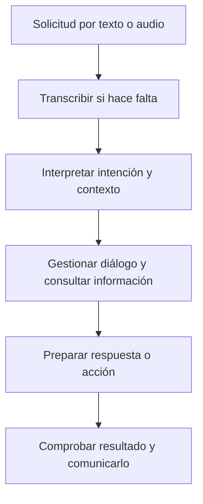

# Unidad 3: Técnicas en inteligencia artificial

## Objetivo y ruta

Relacionarás seis técnicas y contextos de IA con sus datos, decisiones y límites. Sigue 3.1–3.6. Algunas técnicas se presentan de manera introductoria; conocer su propósito no exige implementarlas todas en este curso.

## 3.1. IA en el borde

La **IA en el borde**, o edge AI, realiza procesamiento cerca de donde se generan los datos: un dispositivo, cámara o equipo local.

Un modelo puede entrenarse en servidores y después ejecutar inferencia en un dispositivo. **Dónde se entrena y dónde se utiliza son decisiones distintas.**

**Analogía:** resolver un cálculo junto a la máquina puede evitar esperar la respuesta de una oficina lejana.

Puede reducir latencia y transmisión de datos, y permitir ciertas operaciones sin conexión. A cambio, el dispositivo tiene límites de memoria, energía y cómputo.

El procesamiento local no garantiza privacidad por sí solo: hay que revisar qué se conserva o transmite y cómo se protege. Algunas arquitecturas combinan borde y nube.

## 3.2. Imágenes médicas y datos de diagnóstico

Las diapositivas ilustran apoyo al análisis de imágenes oculares. Para comprender la aplicación, identifica primero la tarea: clasificar una imagen, localizar una región, segmentarla o estimar un indicador.

Una imagen y una etiqueta de entrenamiento provienen de un proceso de medición e interpretación. Importan calidad, población, equipo utilizado y fiabilidad de la referencia.

Dos medidas que ayudan a distinguir errores son:

$$
\text{sensibilidad}=\frac{VP}{VP+FN},
\qquad
\text{especificidad}=\frac{VN}{VN+FP}
$$

VP y VN son positivos y negativos correctamente identificados. FN corresponde a un positivo real que se pasó por alto; FP, a un negativo real señalado como positivo. Los denominadores representan grupos reales diferentes.

Un buen promedio global puede ocultar errores en una población o equipo distintos. La validación debe corresponder al uso previsto y contemplar el proceso completo, incluida la intervención profesional. Aquí estudiamos el diseño y evaluación de una tecnología; los porcentajes de un estudio particular no se trasladan automáticamente a otros contextos.

## 3.3. Vehículo autónomo

Un sistema de conducción combina percepción, localización, predicción, planificación y control. Reconocer un peatón es solo una parte del problema.

La clasificación de automatización distingue qué parte realiza el sistema y qué responsabilidad permanece en la persona:

<table header-row="true">
<tr><td>Nivel</td><td>Idea central</td></tr>
<tr><td>0</td><td>La persona conduce; pueden existir avisos o intervenciones momentáneas</td></tr>
<tr><td>1</td><td>Asistencia sostenida en dirección o aceleración/frenado</td></tr>
<tr><td>2</td><td>Asistencia sostenida en ambas; la persona sigue conduciendo y supervisando</td></tr>
<tr><td>3</td><td>El sistema conduce bajo sus condiciones; la persona debe poder retomar a solicitud</td></tr>
<tr><td>4</td><td>El sistema se encarga de la conducción dentro de un dominio operativo limitado</td></tr>
<tr><td>5</td><td>Automatización completa en todas las condiciones de conducción previstas por esa clasificación</td></tr>
</table>

Esta síntesis sigue la [clasificación de NHTSA](https://www.nhtsa.gov/sites/nhtsa.gov/files/2022-03/Levels_of_Automation_Static_022822-v4-tag.pdf). Los niveles no se definen simplemente por una velocidad ni por expresiones publicitarias como «manos libres». Distingue asistencia de automatización de la conducción.

El **dominio operativo** especifica condiciones como entorno, vías y otras limitaciones. Un sistema que funciona en un entorno restringido no demuestra capacidad universal.

## 3.4. Aprendizaje por refuerzo

En refuerzo, un **agente** elige acciones en un **entorno**, observa consecuencias y recibe una **recompensa**. Busca aprender una política: una regla para decidir qué hacer según la situación.

La recompensa no equivale necesariamente a una etiqueta con la respuesta correcta para cada acción. Las decisiones pueden afectar recompensas futuras.

**Ejemplo inventado:** un robot recibe 1 punto ahora y 10 en el paso siguiente. Si valoramos el siguiente paso con un descuento de 0.9, el retorno de esos dos pasos es 1 + 0.9×10 = 10.

Hay una tensión entre **explorar**, probar acciones para aprender, y **explotar**, usar lo que parece funcionar. Diseñar mal la recompensa puede favorecer comportamientos distintos al objetivo real.

**Refuerzo profundo** utiliza redes profundas como parte del sistema. No todo aprendizaje por refuerzo es profundo. La hoja de ruta presenta este tema como una introducción, fuera de la cobertura principal detallada.

## 3.5. IA conversacional

Un asistente necesita mantener el contexto de una interacción y producir una respuesta o acción coherente con una solicitud.

**Ejemplo:** «Programa una reunión» necesita participantes, fecha y hora. Si el contexto no los determina, el diálogo debe obtenerlos. Producir una frase convincente sobre una reunión no demuestra que se haya creado en el calendario.

La evaluación puede revisar si comprendió la solicitud, utilizó información correcta y ejecutó la acción autorizada. Los errores pueden propagarse de una etapa a otra.

## 3.6. GAN, XAI y datos sintéticos de entrenamiento

Son ideas relacionadas con generación, interpretación y datos, pero cumplen funciones diferentes.

### GAN: redes generativas adversarias

Una GAN entrena dos componentes: un **generador** produce ejemplos y un **discriminador** aprende a distinguir ejemplos generados de ejemplos de referencia. La interacción aporta una señal de aprendizaje.

**Analogía:** un creador intenta mejorar sus imitaciones mientras un evaluador mejora su capacidad para distinguirlas. La analogía explica el entrenamiento, sin garantizar perfección ni ausencia de sesgos.

GAN es una familia de métodos generativos. No toda IA generativa ni todo dato sintético procede de una GAN.

### XAI: inteligencia artificial explicable

XAI busca explicaciones útiles y fieles al funcionamiento o resultado del sistema. Una explicación que suena razonable no garantiza que describa por qué el sistema produjo esa salida.

El [NIST propone principios de explicación, significado para quien la recibe, fidelidad y límites de conocimiento](https://nvlpubs.nist.gov/nistpubs/ir/2021/nist.ir.8312.pdf). Esto ayuda a preguntar cuándo una explicación sirve para examinar errores y límites.

Explicar una predicción tampoco demuestra automáticamente una relación causal.

### Datos sintéticos

Son datos producidos mediante simulación o generación, en vez de observaciones directas del fenómeno de interés. Pueden ampliar escenarios de entrenamiento o apoyar pruebas.

Su utilidad depende de que preserven información pertinente para la tarea. También pueden reproducir sesgos o detalles sensibles del entrenamiento. **Sintético no implica automáticamente anónimo.** Hay que evaluar utilidad, similitud con datos reales y riesgo de exposición.

## Práctica sin resolver

1. Diferencia entrenamiento en nube e inferencia en borde.
2. ¿Por qué una exactitud global podría ocultar errores importantes?
3. ¿Qué distingue principalmente los niveles 2 y 3 de automatización?
4. Identifica agente, entorno, acción y recompensa en un ejemplo propio.
5. ¿Cómo puede una recompensa mal diseñada alejar al agente del objetivo?
6. ¿Qué comprobarías si un asistente afirma haber realizado una acción?
7. Distingue el propósito de GAN, XAI y datos sintéticos.
8. ¿Por qué una explicación plausible o un dato sintético todavía necesitan evaluación?

**Estado:** guía preparada; evaluación pendiente después de la unidad anterior y cuando tú indiques.

## Fuente principal

[Capítulo 1 en Canvas](https://udem.instructure.com/courses/36648/pages/recursos-didacticos-del-capitulo-1-2?module_item_id=5019816), unidad 3, diapositivas 42–56. Los casos de las diapositivas se usan como contexto educativo, sin presentar sus resultados históricos como desempeño universal o actual.

