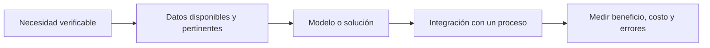
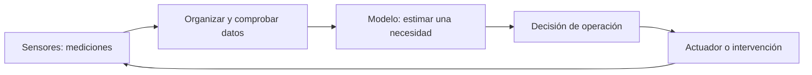

# Unidad 4: Inteligencia artificial: tendencias y mercados

## Objetivo y advertencia de lectura temporal

Comprenderás cómo relacionar capacidades técnicas con necesidades de distintos sectores. Sigue 4.1–4.7.

Las diapositivas incluyen casos, anuncios y cifras de años anteriores. Los usaremos como **ejemplos históricos**, no como descripción comprobada del mercado actual. Una predicción para el futuro debe conservar su fecha, supuestos y significado.

## 4.1. Tendencias de la IA

El mapa del curso combina niveles diferentes:

- **Aplicaciones:** tareas útiles, como reconocimiento visual, procesamiento del lenguaje y predicción.
- **Métodos y enfoques:** maneras de aprender o representar información, como redes profundas, refuerzo y generación.
- **Herramientas:** frameworks y bibliotecas con los que se construyen sistemas.
- **Infraestructura:** dispositivos, chips, redes y servicios que permiten ejecutarlos.

Una aplicación no es lo mismo que una arquitectura o un framework. Para leer una tendencia pregunta qué problema resuelve y qué nivel del sistema modifica.

El mapa menciona también **aprendizaje federado**: varios participantes pueden colaborar en el entrenamiento manteniendo los datos originales distribuidos y compartiendo actualizaciones. No es idéntico a edge AI, que describe dónde se procesa. Ni los datos locales ni las actualizaciones garantizan privacidad automáticamente.

Arquitecturas mencionadas en un mapa histórico, como redes de cápsulas, ilustran líneas de investigación; su presencia en una diapositiva no demuestra adopción predominante actual.

## 4.2. IA en los mercados

La adopción depende de que una capacidad produzca valor en un proceso concreto. Una predicción útil necesita integrarse con personas, decisiones, costos y seguimiento.



**Ejemplo inventado:** estimar demanda puede ayudar a planificar recursos. Para evaluar valor debemos comparar decisiones con una referencia, considerar costos y observar qué ocurre cuando cambia el entorno. Mejorar una métrica del modelo no garantiza por sí solo un beneficio en el proceso.

### Cómo interpretar la cifra de la diapositiva

La lámina menciona **13 billones de dólares para 2030**. Un [estudio de McKinsey Global Institute publicado en 2018](https://www.mckinsey.com/featured-insights/artificial-intelligence/notes-from-the-ai-frontier-modeling-the-impact-of-ai-on-the-world-economy) modeló un potencial aporte adicional aproximado de esa magnitud a la actividad económica global, bajo supuestos de adopción.

Es un escenario histórico, no una medición de ingresos actuales del sector ni un resultado garantizado. En esa cifra, el inglés trillion corresponde al español billón: un millón de millones.

Para estudiar una cifra identifica **qué se mide, período, unidad, fuente y si es observación o proyección**.

## 4.3. La IA en la energía sostenible

Las aplicaciones del material incluyen análisis ambiental y uso de recursos. Conceptualmente, un sistema puede estimar demanda, detectar ineficiencias o apoyar decisiones de operación.

Hay dos preguntas distintas:

1. ¿Puede la aplicación reducir el impacto de otra actividad?
2. ¿Qué recursos consume el propio sistema de IA?

El efecto neto exige comparar beneficios y costos dentro de un límite definido. Entrenamiento, inferencia, infraestructura y origen de energía pueden importar. Menor consumo eléctrico y menores emisiones no son cantidades intercambiables sin conocer el contexto.

**Pregunta de análisis:** ¿medimos energía por predicción, energía total del servicio o impacto del proceso completo? Un ahorro por operación puede coexistir con un crecimiento del consumo total si aumenta mucho el uso.

Las cifras y anuncios ambientales de las diapositivas deben conservar su fecha; no se presentan aquí como porcentajes vigentes.

## 4.4. IA en servicios financieros

El curso utiliza detección de fraude e identidad como ejemplos de clasificación, anomalías y biometría.

Distingue errores:

- **Falso positivo:** una actividad legítima se marca como sospechosa.
- **Falso negativo:** una actividad fraudulenta pasa sin detectar.

Un umbral modifica el equilibrio entre ambos. La pregunta práctica es qué errores aparecen, a quién afectan y cómo se revisan.

Los patrones pueden cambiar con el tiempo y entre poblaciones. Evalúa períodos posteriores y grupos pertinentes, además de la métrica global. La información biométrica necesita protección y una evaluación cuidadosa; detectar una anomalía no demuestra por sí solo fraude.

## 4.5. IA en el gobierno

Las diapositivas muestran procesamiento de documentos para apoyar trámites. Un flujo posible incluye leer documentos, extraer campos, detectar inconsistencias y enviar casos a revisión.

```text
Documento → información extraída → comprobación → revisión cuando corresponde
```

**Human-in-the-loop** significa incorporar intervención humana en etapas definidas. Su utilidad depende de qué revisa la persona, qué información recibe y cómo puede corregir un error.

Extraer correctamente una fecha no justifica automáticamente una decisión sobre un ciudadano. Hay que distinguir procesamiento documental, reglas del procedimiento y responsabilidad por la decisión.

**Preguntas críticas:** ¿cómo se detectan errores?, ¿qué casos quedan fuera de la muestra de entrenamiento?, ¿quién puede revisar la salida?, ¿cómo se conserva una explicación del proceso?

## 4.6. IA en la salud

Las láminas presentan apoyo al análisis de imágenes y señales, junto con discusiones históricas sobre evaluación y seguimiento de sistemas.

Para comprender el ciclo de vida distingue:

- Datos y referencias usados para desarrollar el modelo.
- Evaluación en datos externos pertinentes para el uso.
- Integración con un flujo de trabajo.
- Seguimiento tras cambios en equipos, población o software.

Un buen resultado en un estudio particular no demuestra el mismo desempeño en otro entorno. Sensibilidad y especificidad responden preguntas distintas; tampoco sustituyen la evaluación de utilidad dentro del proceso.

Los ejemplos regulatorios y porcentajes del material son contexto histórico. Esta guía no los convierte en afirmaciones sobre autorizaciones o requisitos actuales.

## 4.7. IoT e IA en la agricultura

**IoT**, o internet de las cosas, conecta dispositivos que pueden medir y transmitir información. Sensores pueden registrar humedad, temperatura o luz; un sistema utiliza esos datos para describir, predecir o apoyar acciones.



Una regla fija de riego puede ser automatización sin ML. Un modelo que aprende de datos realiza otra función. Tener un circuito de retroalimentación tampoco significa automáticamente que utilice aprendizaje por refuerzo.

El material describe agricultura vertical como ejemplo de integración de sensores, control y datos. Para evaluar una propuesta examina producción, agua, energía, espacio y transporte. Reducir uno de esos componentes no demuestra que todos mejoren.

**Pregunta de análisis:** ¿qué se compara, durante cuánto tiempo y bajo qué condiciones? No extrapoles el rendimiento de una instalación a cualquier cultivo o ubicación.

## Guía para comparar aplicaciones entre sectores

Para cualquier caso identifica problema, entrada, salida, decisión, referencia de comparación, costo de los errores y condiciones de uso. Una tendencia tecnológica se vuelve una propuesta evaluable cuando conecta esas piezas.

## Práctica sin resolver

1. Distingue aplicación, método, herramienta e infraestructura con ejemplos.
2. ¿Qué comprobarías antes de citar una cifra de mercado de una diapositiva?
3. Diferencia beneficio ambiental de la aplicación y costo del sistema de IA.
4. Explica falsos positivos y negativos en una alerta de fraude.
5. ¿Qué implica realmente incorporar revisión humana en un trámite?
6. ¿Por qué evaluar en otro hospital o equipo puede aportar información nueva?
7. Diferencia sensor IoT, regla automática y modelo aprendido en agricultura.

**Estado:** guía lista; evaluación pendiente cuando tú indiques.

## Fuente principal

[Capítulo 1 en Canvas](https://udem.instructure.com/courses/36648/pages/recursos-didacticos-del-capitulo-1-2?module_item_id=5019816), unidad 4, diapositivas 57–71. Las cifras históricas se contextualizan; las preguntas, analogías y comparaciones son elaboración de tutoría.

