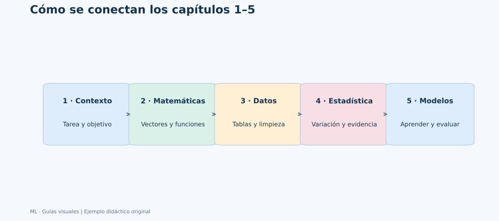
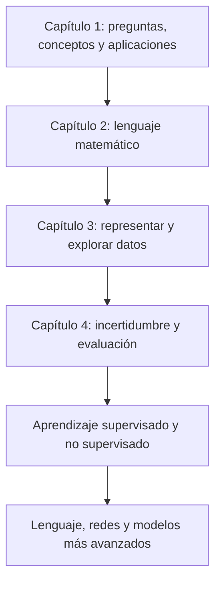

# Unidad 5: Hoja de ruta del curso

## Objetivo

Entenderás cómo se conectan los temas del curso y qué estudiarás con más detalle. Esta unidad tiene un apartado, 5.1. Su propósito es orientarte; no necesitas implementar todas las técnicas mencionadas en el capítulo introductorio.

## 5.1. Hoja de ruta del curso de inteligencia artificial

La presentación señala que el curso se concentra en fundamentos y práctica de programación de IA, especialmente aprendizaje supervisado y no supervisado. El aprendizaje por refuerzo se introduce para conocer el panorama, pero no forma parte de su cobertura principal detallada.

**Analogía:** el capítulo 1 es un mapa. Conocer dónde queda una región ayuda a orientarse, aunque todavía no hayas aprendido a recorrerla.

### Cómo se conectan los fundamentos

**Un mismo ejemplo atraviesa el curso:** en el capítulo 1 definimos “estimar la duración de un recorrido al solicitarlo”. En el 2 escribimos una función como ŷ = 4 + 3x. En el 3 organizamos recorridos en filas y preparamos las columnas. En el 4 estudiamos variación y evidencia. En el 5 ajustamos el modelo y comprobamos sus errores con datos reservados.

Los coeficientes 4 y 3 son inventados para explicar la idea. El curso enseña después a aprenderlos y a comprobar cuándo la relación es útil. Así, las matemáticas describen el cálculo, las bibliotecas lo implementan y la evaluación aporta evidencia sobre su desempeño.

### Qué representa cada herramienta en ese recorrido

| Herramienta o concepto | Papel en el ejemplo |
| --- | --- |
| Vector | Una entrada con distancia, hora u otras características |
| Matriz | Las entradas de muchos recorridos juntas |
| Función | La regla que convierte esas entradas en una estimación |
| pandas | Organizar, revisar y resumir las observaciones |
| NumPy | Expresar operaciones sobre los valores numéricos |
| Estadística | Entender variación, estimación y límites de la evidencia |
| Modelo supervisado | Aprender una relación a partir de entradas y respuestas |
| Métrica de error | Resumir diferencias entre duración real y predicha |

Un programa puede ejecutarse sin errores y contestar una pregunta mal definida. Por eso la ruta empieza por el significado y termina en una evaluación conectada con él.

La dependencia explica el porqué de estudiar las bases. Para entender un modelo necesitas representar sus entradas; para evaluar resultados necesitas comparar con referencias y razonar sobre variación.

### Mapa del curso que compartiste

Esta tabla combina la hoja de ruta de las diapositivas con el índice de capítulos visible en Canvas y en tu captura:

<table header-row="true">
<tr><td>Capítulo</td><td>Pregunta que ayuda a responder</td></tr>
<tr><td>0. Entorno de trabajo</td><td>¿Cómo preparo y ejecuto mis herramientas?</td></tr>
<tr><td>1. Introducción a la IA</td><td>¿Qué tareas resuelve la IA y qué límites debemos considerar?</td></tr>
<tr><td>2. Matemáticas para Ciencia de Datos</td><td>¿Cómo describo datos, transformaciones y cambios con símbolos?</td></tr>
<tr><td>3. Análisis Exploratorio de Datos</td><td>¿Cómo represento, reviso y preparo los datos?</td></tr>
<tr><td>4. Probabilidad y Estadística</td><td>¿Cómo razono con incertidumbre y evalúo evidencia?</td></tr>
<tr><td>5. Aprendizaje supervisado</td><td>¿Cómo aprendo relaciones a partir de ejemplos con respuestas conocidas?</td></tr>
<tr><td>6. Aprendizaje no supervisado</td><td>¿Cómo busco estructura sin etiquetas objetivo para cada ejemplo?</td></tr>
<tr><td>7. Lenguaje natural y modelos de lenguaje para minería de textos</td><td>¿Cómo represento y proceso información de lenguaje?</td></tr>
<tr><td>8. Redes neuronales y aprendizaje profundo</td><td>¿Cómo aprenden representaciones los modelos de varias capas?</td></tr>
<tr><td>9. Otros tipos de redes neuronales</td><td>¿Qué arquitecturas responden a distintas estructuras de datos?</td></tr>
<tr><td>10. GenAI</td><td>¿Cómo se construyen y evalúan sistemas que generan contenido?</td></tr>
</table>

Los nombres del índice sirven para orientarte. Los detalles y actividades de cada capítulo se revisarán con sus propios materiales.

### Ruta de lectura

Lee cada apartado en orden, sigue el diagrama y después recorre el ejemplo explicado. Cuando aparezca un símbolo nuevo, relaciónalo con las entradas, salidas y unidades del ejemplo. Los capítulos 1–4 construyen las bases del capítulo 5; las guías permiten volver a ellas sin depender de una evaluación en el chat.

### Qué significa avanzar

Avanzar incluye poder explicar entrada, salida, objetivo y límites de un ejemplo, justificar un paso de cálculo y reconocer qué evidencia falta. Ejecutar código es una parte de ese aprendizaje.

En los ejercicios trabajaremos con pistas y revisión de tus intentos. Las copias de archivos del curso y tus notas locales se conservan dentro de **workspace/**.

## Conexión con el capítulo 5

El siguiente tramo reúne los fundamentos: **datos disponibles al predecir → preparación aprendida con entrenamiento → modelo → predicción → comparación con resultados reales**. Al estudiar cada algoritmo conviene seguir esa misma ruta. Cambia el mecanismo del modelo, pero se mantiene la necesidad de definir entradas, salida y evaluación.

## Fuente

[Capítulo 1 en Canvas](https://udem.instructure.com/courses/36648/pages/recursos-didacticos-del-capitulo-1-2?module_item_id=5019816), unidad 5, diapositivas 72–73. La tabla de capítulos se apoya también en el índice del curso que compartiste. La ruta de lectura se adapta al estudio detallado del contenido.

