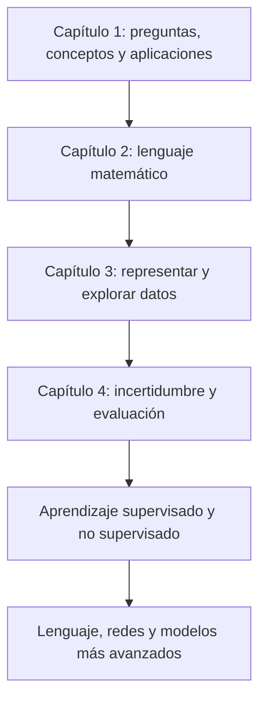

# Unidad 5: Hoja de ruta del curso

## Objetivo

Entenderás cómo se conectan los temas del curso y qué estudiarás con más detalle. Esta unidad tiene un apartado, 5.1. Su propósito es orientarte; no necesitas implementar todas las técnicas mencionadas en el capítulo introductorio.

## 5.1. Hoja de ruta del curso de inteligencia artificial

La presentación señala que el curso se concentra en fundamentos y práctica de programación de IA, especialmente aprendizaje supervisado y no supervisado. El aprendizaje por refuerzo se introduce para conocer el panorama, pero no forma parte de su cobertura principal detallada.

**Analogía:** el capítulo 1 es un mapa. Conocer dónde queda una región ayuda a orientarse, aunque todavía no hayas aprendido a recorrerla.

### Cómo se conectan los fundamentos

La dependencia explica el porqué de estudiar las bases. Para entender un modelo necesitas representar sus entradas; para evaluar resultados necesitas comparar con referencias y razonar sobre variación.

### Mapa del curso que compartiste

Esta tabla combina la hoja de ruta de las diapositivas con el índice de capítulos visible en Canvas y en tu captura:

<table header-row="true">
<tr><td>Capítulo</td><td>Pregunta que ayuda a responder</td></tr>
<tr><td>0. Entorno de trabajo</td><td>¿Cómo preparo y ejecuto mis herramientas?</td></tr>
<tr><td>1. Introducción a la IA</td><td>¿Qué tareas resuelve la IA y qué límites debemos considerar?</td></tr>
<tr><td>2. Matemáticas para Ciencia de Datos</td><td>¿Cómo describo datos, transformaciones y cambios con símbolos?</td></tr>
<tr><td>3. Análisis Exploratorio de Datos</td><td>¿Cómo represento, reviso y preparo los datos?</td></tr>
<tr><td>4. Probabilidad y Estadística</td><td>¿Cómo razono con incertidumbre y evalúo evidencia?</td></tr>
<tr><td>5. Aprendizaje supervisado</td><td>¿Cómo aprendo relaciones a partir de ejemplos con respuestas conocidas?</td></tr>
<tr><td>6. Aprendizaje no supervisado</td><td>¿Cómo busco estructura sin etiquetas objetivo para cada ejemplo?</td></tr>
<tr><td>7. Lenguaje natural y modelos de lenguaje para minería de textos</td><td>¿Cómo represento y proceso información de lenguaje?</td></tr>
<tr><td>8. Redes neuronales y aprendizaje profundo</td><td>¿Cómo aprenden representaciones los modelos de varias capas?</td></tr>
<tr><td>9. Otros tipos de redes neuronales</td><td>¿Qué arquitecturas responden a distintas estructuras de datos?</td></tr>
<tr><td>10. GenAI</td><td>¿Cómo se construyen y evalúan sistemas que generan contenido?</td></tr>
</table>

Los nombres del índice sirven para orientarte. Los detalles y actividades de cada capítulo se revisarán con sus propios materiales.

### Método de estudio acordado

1. Lee una guía completa de la unidad que estés estudiando.
2. Explica las ideas con tus palabras y rehace los ejemplos sin copiarlos.
3. Anota el símbolo, paso o supuesto donde aparezca una duda.
4. Responde las preguntas en el chat cuando estés listo.
5. Recibe calificación y explicación de los errores.
6. Comprueba lo reforzado con una pregunta breve.
7. Tú indicas cuándo pasar a la siguiente unidad.

Las guías de los capítulos posteriores están preparadas para tus ratos libres. Eso no cambia la evaluación pendiente: seguimos en la **unidad 1 del capítulo 1**, con las ocho preguntas ya enviadas.

### Qué significa avanzar

Avanzar incluye poder explicar entrada, salida, objetivo y límites de un ejemplo, justificar un paso de cálculo y reconocer qué evidencia falta. Ejecutar código es una parte de ese aprendizaje.

En los ejercicios trabajaremos con pistas y revisión de tus intentos. Las copias de archivos del curso y tus notas locales se conservan dentro de **workspace/**.

## Preguntas de cierre

1. ¿Qué aporta cada uno de los capítulos 2, 3 y 4 al estudio de un modelo?
2. ¿Qué diferencia hay entre conocer una técnica del panorama e implementarla en profundidad?
3. ¿Qué tema queda como introducción fuera de la cobertura principal detallada?
4. ¿Cómo comprobarías que entendiste un ejemplo sin limitarte a repetir su código?
5. ¿Qué harás cuando identifiques una duda antes de pasar de unidad?

**Estado:** guía lista; evaluación pendiente después de las unidades anteriores.

## Fuente

[Capítulo 1 en Canvas](https://udem.instructure.com/courses/36648/pages/recursos-didacticos-del-capitulo-1-2?module_item_id=5019816), unidad 5, diapositivas 72–73. La tabla de capítulos se apoya también en el índice del curso que compartiste. El método de estudio corresponde a tus instrucciones para la tutoría.

