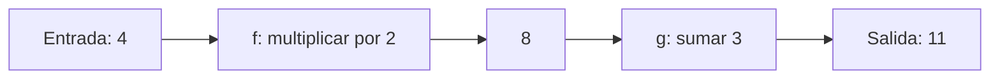

# Unidad 1: Matemáticas básicas para la ciencia de datos

## Objetivo y ruta de lectura

Podrás leer expresiones matemáticas, interpretar funciones y explicar cómo una entrada se transforma en una salida. Lee 1.1–1.4 primero, 1.5–1.7 después y las curvas de 1.8–1.9 al final. Los ejemplos son de tutoría y no resuelven tareas del curso.

## 1.1. Álgebra

El álgebra expresa relaciones mediante símbolos. En y = 3x + 2, x es una entrada, y la salida, y 3 y 2 son coeficientes constantes. Si x representa horas y y una cantidad producida, el 3 indica cuánto cambia y por cada hora adicional.

Una **expresión** como 3x + 2 representa una cantidad. Una **ecuación** como 3x + 2 = 14 afirma una igualdad. Resolverla significa encontrar los valores que la hacen verdadera:

$$
3x+2=14 \quad\Rightarrow\quad 3x=12 \quad\Rightarrow\quad x=4
$$

Restamos 2 en ambos lados y después dividimos ambos lados entre 3. Mantener ese equilibrio justifica cada paso.

Un **polinomio** suma términos con potencias enteras no negativas de la variable. Su grado es el mayor exponente con coeficiente no nulo. En ax + b, con a distinto de cero, el grado es 1. En ax² + bx + c, con a distinto de cero, es 2.

Para y = ax + b, a es la pendiente y b el corte con el eje vertical. Para y = ax² + bx + c, a > 0 produce una parábola abierta hacia arriba y a < 0 una abierta hacia abajo. Esta descripción evita las traducciones ambiguas de convexidad en las diapositivas.

## 1.2. Secuencia

Una secuencia es una colección **ordenada**: a₁, a₂, …, aₙ. El subíndice indica la posición. En aᵢ = 2i, los primeros términos son 2, 4, 6 y 8. Aquí comenzamos en 1; Python suele comenzar sus índices en 0.

Sigma indica suma y pi indica producto:

$$
\sum_{i=1}^{4}a_i=a_1+a_2+a_3+a_4
\qquad
\prod_{i=1}^{4}a_i=a_1a_2a_3a_4
$$

Para esos términos, la suma es 20 y el producto es 384. i recorre las posiciones desde el límite inferior hasta el superior, incluidos ambos. Esta notación permite describir promedios y errores sobre muchos datos.

## 1.3. Valor absoluto y distancia euclidiana

El **valor absoluto** mide distancia al cero: |−5| = 5 y |5| = 5. Por ello, la distancia entre dos números es |a − b|. Entre −2 y 4 hay 6 unidades.

En dos dimensiones, Pitágoras combina diferencias de coordenadas:

$$
d(a,b)=\sqrt{(a_1-b_1)^2+(a_2-b_2)^2}
$$

Entre a = (1, 2) y b = (4, 6), las diferencias tienen magnitudes 3 y 4. La distancia es √(9 + 16) = 5. En n dimensiones:

$$
d(a,b)=\sqrt{\sum_{j=1}^{n}(a_j-b_j)^2}
$$

j recorre las coordenadas. Una distancia es no negativa. En datos hay que atender las **unidades**: mezclar metros e ingresos sin preparar sus escalas puede hacer que una variable domine la comparación.

## 1.4. Conjuntos

Un conjunto reúne elementos sin que el orden o las repeticiones cambien su identidad. La secuencia (1, 1, 2) conserva posiciones y repeticiones; el conjunto correspondiente es {1, 2}.

Con A = {1, 2, 3}, B = {3, 4} y universo U = {1, 2, 3, 4, 5}:

- **Pertenencia:** 2 ∈ A significa que 2 pertenece a A.
- **Unión:** A ∪ B = {1, 2, 3, 4}; reúne los presentes en al menos uno.
- **Intersección:** A ∩ B = {3}; conserva los presentes en ambos.
- **Complemento:** Aᶜ = {4, 5}; contiene los de U que quedan fuera de A.
- **Subconjunto:** {1, 2} ⊆ A indica que todos sus elementos pertenecen a A.

El complemento depende del universo. En probabilidad representaremos eventos mediante conjuntos.

## 1.5. Concepto de funciones

Una función asigna a **cada entrada permitida exactamente una salida**. Dos entradas distintas sí pueden compartir una salida.

- **Dominio:** entradas permitidas.
- **Codominio:** conjunto declarado donde estarán las salidas.
- **Imagen o rango efectivo:** salidas que realmente alcanza la función.

Para f(x) = x² sobre los reales, el dominio es ℝ y su imagen es [0, ∞). Tanto −2 como 2 producen 4. Para f(x) = 1/x excluimos x = 0.

La **composición** conecta funciones. Si f(x) = 2x y g(x) = x + 3, entonces g(f(4)) = 11: primero multiplicamos por 2 y después sumamos 3.



Una **función inversa** deshace la transformación, cuando la función es invertible entre los conjuntos elegidos. Para f(x) = 2x + 3, su inversa es f⁻¹(y) = (y − 3)/2. f⁻¹ no significa 1/f. La función x² necesita restringir su dominio, por ejemplo a x ≥ 0, para tener una inversa que sea función.

## 1.6. Funciones exponencial y logarítmica

En aˣ, la base a es constante y el exponente x cambia. Para una exponencial real usual, a > 0 y a ≠ 1. Si a > 1 aumenta con x; si 0 < a < 1 disminuye.

El logaritmo responde: **¿a qué exponente elevamos la base para obtener este número?**

$$
\log_a(b)=c \quad\Longleftrightarrow\quad a^c=b
$$

Así, log₂(8) = 3 porque 2³ = 8. En los reales necesitamos b > 0. Para argumentos positivos:

$$
\log_a(uv)=\log_a(u)+\log_a(v)
\qquad
\log_a(u^r)=r\log_a(u)
$$

En general, log(u + v) no equivale a log(u) + log(v). Los logaritmos permiten trabajar con escalas amplias; transformar una variable exige comprobar antes su dominio.

## 1.7. Logaritmo natural

**e ≈ 2.71828** es una constante. ln(x) es el logaritmo en base e y la inversa de eˣ:

$$
\ln(e^x)=x,\qquad e^{\ln(x)}=x\;(x>0),\qquad \ln(1)=0
$$

ln(x) crece lentamente para valores grandes. Multiplicar x por e incrementa ln(x) en 1.

En NumPy, **np.log(x)** calcula ln(x). **np.log1p(x)** calcula ln(1 + x), cuyo dominio real es x > −1. En datos no negativos puede resultar útil, pero después debemos examinar cómo cambió la distribución.

## 1.8. Funciones sigmoides

«Sigmoide» describe una familia de curvas con forma de S. La **logística** es un ejemplo central:

$$
\sigma(z)=\frac{1}{1+e^{-z}}
$$

Para entradas reales finitas su salida está entre 0 y 1, sin alcanzar esos extremos. En z = 0 devuelve 0.5. Si z crece mucho se aproxima a 1; si es muy negativo se aproxima a 0.

```text
salida
1   |                 ______
0.5 |          ______/
0   |_________/
    +------------------------ entrada
```

En ciertos modelos sirve para obtener valores interpretables como probabilidades. Esa interpretación depende del modelo y de su evaluación: estar entre 0 y 1 por sí solo no garantiza una probabilidad bien calibrada.

## 1.9. Funciones trigonométricas

En el círculo unitario, un ángulo θ determina un punto:

$$
(x,y)=(\cos\theta,\sin\theta)
$$

Coseno es la coordenada horizontal y seno la vertical. Ambos varían entre −1 y 1 y repiten su patrón cada 2π radianes. Un giro completo equivale a 360° = 2π radianes.

$$
\sin^2\theta+\cos^2\theta=1
\qquad
\tan\theta=\frac{\sin\theta}{\cos\theta}\quad(\cos\theta\ne0)
$$

Describen fenómenos periódicos, como horas del día. Para un reloj de 24 horas podemos usar seno y coseno de 2πh/24: representan que 23:00 y 00:00 están próximas en el ciclo.

## Errores frecuentes

Confundir x² con 2x; tratar una inversa como recíproco; tomar un logaritmo fuera de su dominio; distribuir el logaritmo sobre una suma; y mezclar grados con radianes. Antes de calcular, identifica entrada, salida, unidades y restricciones.

## Práctica para responder después

1. Resuelve 5x − 4 = 16 y justifica cada paso.
2. Si aᵢ = i + 1, escribe cuatro términos y su suma.
3. ¿Por qué la distancia euclidiana no es negativa?
4. Construye una unión y una intersección distintas a las del ejemplo.
5. ¿Por qué x² necesita restricciones para tener inversa?
6. Interpreta log₃(27) y explica el dominio de ln(x).
7. ¿Qué límites tiene la logística y qué devuelve en cero?
8. ¿Por qué seno y coseno pueden describir horarios?

**Estado:** lista para estudiar; evaluación pendiente en el chat cuando tú indiques.

## Fuente

[Capítulo 2 en Canvas](https://udem.instructure.com/courses/36648/pages/recursos-didacticos-del-capitulo-2-2?module_item_id=5019819), unidad 1, diapositivas 4–38. Las explicaciones, diagramas y ejemplos son elaboración de tutoría.

