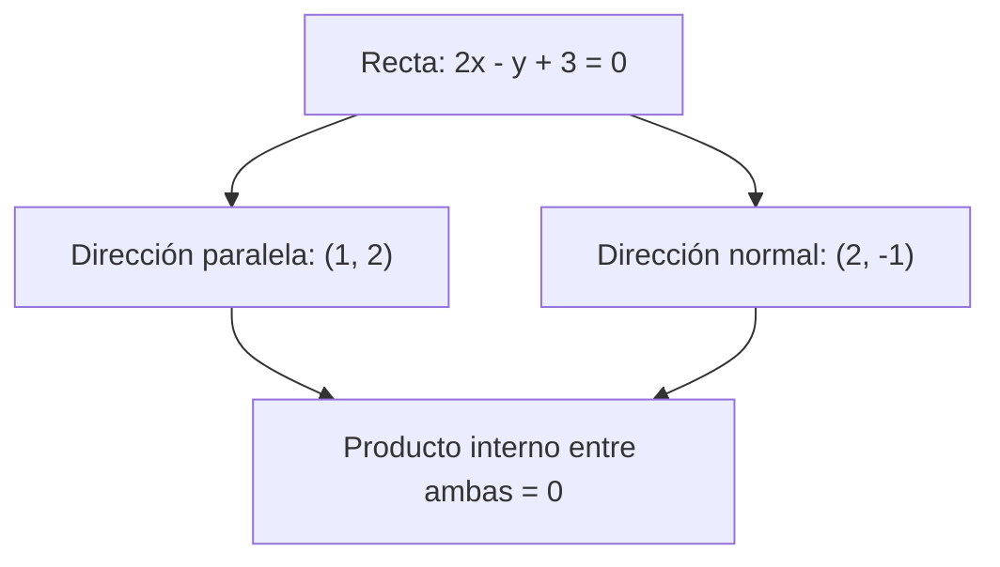

# Unidad 2: Vectores

## Objetivo

Entenderás cómo una fila de datos puede verse como un vector y cómo medir su tamaño, compararlo con otro y describir direcciones perpendiculares. Los apartados siguen 2.1–2.5 del curso.

## 2.1. Vector

Un **vector** es una colección ordenada de componentes. En geometría puede representar un desplazamiento con magnitud y dirección. En datos puede representar las características de una observación:

$$
x=(\text{distancia},\text{duración},\text{costo})
$$

El orden importa: intercambiar distancia y duración cambia el significado. La dimensión es el número de componentes, no el número de observaciones.

Para a = (1, 2) y b = (3, 4), a + b = (4, 6). Multiplicar por un escalar significa multiplicar cada componente: 3a = (3, 6). Una combinación como 2a − b se llama **combinación lineal**.

Un **espacio vectorial** permite sumar sus vectores y multiplicarlos por escalares conservando las propiedades algebraicas correspondientes. El conjunto ℝ², con las operaciones usuales, es un ejemplo. La colección de combinaciones lineales de algunos vectores se llama su espacio generado.

```text
Un ejemplo de datos:
Recorrido A → (3 km, 12 min)
Recorrido B → (5 km, 18 min)

Dos componentes por recorrido
Dos observaciones en este ejemplo
```

Conserva las unidades y el orden al construir los vectores.

## 2.2. Norma de un vector

Una **norma** mide el tamaño de un vector. La norma euclidiana es:

$$
\|v\|_2=\sqrt{\sum_{j=1}^{d}v_j^2}
$$

Para v = (3, 4), su norma es √(9 + 16) = 5. d es la cantidad de componentes y j su posición.

La norma es no negativa, vale cero solo en el vector cero, escala según el valor absoluto del escalar y cumple la desigualdad triangular:

$$
\|\alpha v\|=|\alpha|\|v\|,\qquad
\|u+v\|\le\|u\|+\|v\|
$$

Otras normas útiles son L1, suma de valores absolutos, y L∞, máximo valor absoluto. Para (3, 4), son 7 y 4 respectivamente.

**Distancia y norma se conectan:** la distancia euclidiana entre a y b es la norma de su diferencia, ||a − b||₂. La norma mide el vector desde el origen; la distancia compara dos puntos.

## 2.3. Producto interno o escalar

Para vectores reales de igual dimensión:

$$
a\cdot b=\sum_{j=1}^{d}a_jb_j
$$

Multiplicamos componentes correspondientes y sumamos. Con a = (1, 2) y b = (3, 4), obtenemos 1×3 + 2×4 = 11. El resultado es un número, llamado **escalar**.

Para vectores no nulos:

$$
a\cdot b=\|a\|_2\|b\|_2\cos\theta
$$

θ es el ángulo entre ellos. El signo del producto refleja si el ángulo es agudo, recto u obtuso. Un valor grande depende también de las magnitudes; para comparar solo dirección podemos usar coseno:

$$
\cos\theta=\frac{a\cdot b}{\|a\|_2\|b\|_2}
$$

Un modelo lineal puede calcular una suma ponderada w·x + b: cada peso multiplica una característica y después se suman las contribuciones.

## 2.4. Condición de ortogonalidad

Dos vectores son **ortogonales** si su producto interno es cero. Para vectores no nulos, geométricamente corresponde a un ángulo de 90°.

Con u = (1, 2) y v = (2, −1):

$$
u\cdot v=1(2)+2(-1)=0
$$

La condición sirve para comprobar perpendicularidad sin dibujar con precisión. El vector cero tiene producto cero con cualquier vector, aunque su dirección y el ángulo usual no están definidos.

**Analogía:** caminar al este y caminar al norte son movimientos perpendiculares. En más dimensiones ya no podemos dibujar todo, pero el cálculo del producto sigue funcionando.

## 2.5. Vector normal

Un **vector normal** es perpendicular a una recta o superficie. Para una recta:

$$
ax+by+c=0
$$

un vector normal es n = (a, b), siempre que a y b no sean ambos cero. En 2x − y + 3 = 0, n = (2, −1). El vector (1, 2) es una dirección paralela a la recta porque su producto con n vale cero.



**Normal y unitario son conceptos diferentes.** Normal indica perpendicularidad; unitario indica norma igual a 1. Para convertir un vector no nulo en unitario:

$$
\hat v=\frac{v}{\|v\|}
$$

Así, n/√5 es una normal unitaria de la recta anterior.

## Errores frecuentes

Confundir dimensión con cantidad de filas; comparar magnitudes sin considerar unidades; pensar que un producto interno devuelve un vector; y suponer que toda normal mide 1.

## Práctica sin resolver

1. Representa una observación con tres características y explica el orden y las unidades.
2. Calcula las normas L1 y L2 de (−6, 8).
3. Compara ||a|| y ||a − b||: ¿qué mide cada una?
4. Comprueba si (2, 3) y (3, −2) son ortogonales.
5. Encuentra una normal de 4x + 2y − 7 = 0 y explica cómo la harías unitaria.
6. ¿Por qué dos vectores de la misma dirección pueden tener productos internos diferentes con un tercer vector?

**Estado:** guía lista; comprensión y evaluación pendientes.

## Fuente

[Capítulo 2 en Canvas](https://udem.instructure.com/courses/36648/pages/recursos-didacticos-del-capitulo-2-2?module_item_id=5019819), unidad 2, diapositivas 39–51. Numeración normalizada según el índice de la unidad.

