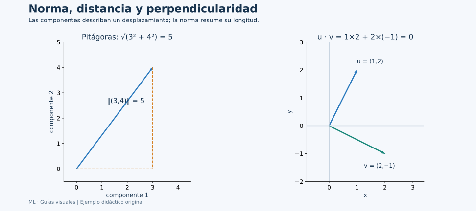
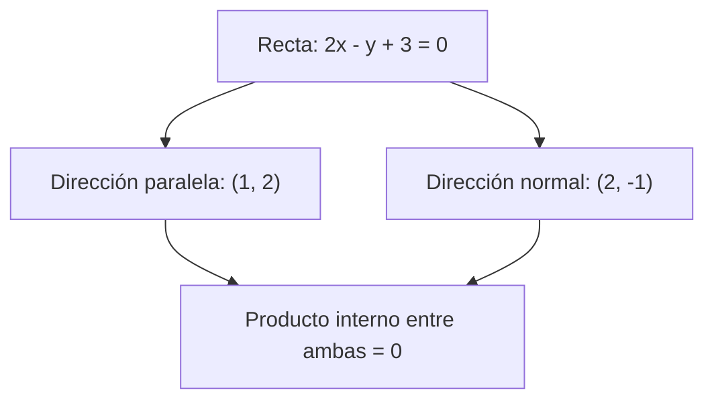

# Unidad 2: Vectores

## Objetivo

Entenderás cómo una fila de datos puede verse como un vector y cómo medir su tamaño, compararlo con otro y describir direcciones perpendiculares. Los apartados siguen 2.1–2.5 del curso.

## 2.1. Vector

Un **vector** es una colección ordenada de componentes. En geometría puede representar un desplazamiento con magnitud y dirección. En datos puede representar las características de una observación:

$$
x=(\text{distancia},\text{duración},\text{costo})
$$

El orden importa: intercambiar distancia y duración cambia el significado. La dimensión es el número de componentes, no el número de observaciones.

Para a = (1, 2) y b = (3, 4), a + b = (4, 6). Multiplicar por un escalar significa multiplicar cada componente: 3a = (3, 6). Una combinación como 2a − b se llama **combinación lineal**.

Un **espacio vectorial** permite sumar sus vectores y multiplicarlos por escalares conservando las propiedades algebraicas correspondientes. El conjunto ℝ², con las operaciones usuales, es un ejemplo. La colección de combinaciones lineales de algunos vectores se llama su espacio generado.

```text
Un ejemplo de datos:
Recorrido A → (3 km, 12 min)
Recorrido B → (5 km, 18 min)

Dos componentes por recorrido
Dos observaciones en este ejemplo
```

Conserva las unidades y el orden al construir los vectores.

## 2.2. Norma de un vector



**Lectura del panel izquierdo:** el vector (3,4) desplaza 3 unidades en una dirección y 4 en la otra. Los dos desplazamientos forman catetos perpendiculares y la flecha mide 5. La norma mide la flecha completa; no suma simplemente 3+4. El panel derecho muestra direcciones cuyo producto interno se anula.

### Cálculo completo y significado de normalizar

Para v = (−6,8), la norma L1 es |−6|+|8|=14; la L2 es √(36+64)=10; la L∞ es max(6,8)=8. Son tres reglas distintas para resumir el mismo vector y no deberían coincidir necesariamente.

Normalizar con la norma L2 divide cada componente entre 10: v/10 = (−0.6,0.8). Su norma es √(0.36+0.64)=1. Conserva dirección y sentido, y cambia longitud. El vector cero no se puede normalizar de esta manera porque dividiríamos entre cero.

### Del producto interno a una predicción

Si x = (3,2) representa distancia en kilómetros y número de paradas, y w = (4,1.5) contiene minutos por kilómetro y minutos por parada, el producto es 4×3 + 1.5×2 = 15 minutos. Añadir un tiempo base b = 2 da 17 minutos. Multiplicar cada característica por su peso y después sumar es una operación con significado, no solo una regla de álgebra.

En una tabla real, el orden de las columnas debe coincidir con el orden de los pesos. Intercambiar las entradas daría otra cuenta aunque ambas fueran números válidos. Además, comparar distancias entre observaciones requiere escalas apropiadas: cambiar kilómetros por metros no debería cambiar arbitrariamente qué recorridos consideramos similares.

**Normal y normalizado:** una normal indica perpendicularidad respecto de una superficie. Normalizar indica cambiar una longitud mediante una regla. Una normal puede medir 10; convertirla en unitaria exige un paso adicional.

Una **norma** mide el tamaño de un vector. La norma euclidiana es:

$$
\|v\|_2=\sqrt{\sum_{j=1}^{d}v_j^2}
$$

Para v = (3, 4), su norma es √(9 + 16) = 5. d es la cantidad de componentes y j su posición.

La norma es no negativa, vale cero solo en el vector cero, escala según el valor absoluto del escalar y cumple la desigualdad triangular:

$$
\|\alpha v\|=|\alpha|\|v\|,\qquad
\|u+v\|\le\|u\|+\|v\|
$$

Otras normas útiles son L1, suma de valores absolutos, y L∞, máximo valor absoluto. Para (3, 4), son 7 y 4 respectivamente.

**Distancia y norma se conectan:** la distancia euclidiana entre a y b es la norma de su diferencia, ||a − b||₂. La norma mide el vector desde el origen; la distancia compara dos puntos.

## 2.3. Producto interno o escalar

Para vectores reales de igual dimensión:

$$
a\cdot b=\sum_{j=1}^{d}a_jb_j
$$

Multiplicamos componentes correspondientes y sumamos. Con a = (1, 2) y b = (3, 4), obtenemos 1×3 + 2×4 = 11. El resultado es un número, llamado **escalar**.

Para vectores no nulos:

$$
a\cdot b=\|a\|_2\|b\|_2\cos\theta
$$

θ es el ángulo entre ellos. El signo del producto refleja si el ángulo es agudo, recto u obtuso. Un valor grande depende también de las magnitudes; para comparar solo dirección podemos usar coseno:

$$
\cos\theta=\frac{a\cdot b}{\|a\|_2\|b\|_2}
$$

Un modelo lineal puede calcular una suma ponderada w·x + b: cada peso multiplica una característica y después se suman las contribuciones.

## 2.4. Condición de ortogonalidad

Dos vectores son **ortogonales** si su producto interno es cero. Para vectores no nulos, geométricamente corresponde a un ángulo de 90°.

Con u = (1, 2) y v = (2, −1):

$$
u\cdot v=1(2)+2(-1)=0
$$

La condición sirve para comprobar perpendicularidad sin dibujar con precisión. El vector cero tiene producto cero con cualquier vector, aunque su dirección y el ángulo usual no están definidos.

**Analogía:** caminar al este y caminar al norte son movimientos perpendiculares. En más dimensiones ya no podemos dibujar todo, pero el cálculo del producto sigue funcionando.

## 2.5. Vector normal

Un **vector normal** es perpendicular a una recta o superficie. Para una recta:

$$
ax+by+c=0
$$

un vector normal es n = (a, b), siempre que a y b no sean ambos cero. En 2x − y + 3 = 0, n = (2, −1). El vector (1, 2) es una dirección paralela a la recta porque su producto con n vale cero.



**Normal y unitario son conceptos diferentes.** Normal indica perpendicularidad; unitario indica norma igual a 1. Para convertir un vector no nulo en unitario:

$$
\hat v=\frac{v}{\|v\|}
$$

Así, n/√5 es una normal unitaria de la recta anterior.

## Errores frecuentes

Confundir dimensión con cantidad de filas; comparar magnitudes sin considerar unidades; pensar que un producto interno devuelve un vector; y suponer que toda normal mide 1.

## Conexión de las ideas

El vector representa un caso; la norma mide su tamaño; la norma de una diferencia mide distancia entre casos; el producto interno combina características con pesos o compara direcciones. Una normal describe la orientación de una frontera. Estas piezas reaparecen en KNN, regresión y SVM.

## Fuente

[Capítulo 2 en Canvas](https://udem.instructure.com/courses/36648/pages/recursos-didacticos-del-capitulo-2-2?module_item_id=5019819), unidad 2, diapositivas 39–51. Numeración normalizada según el índice de la unidad.

