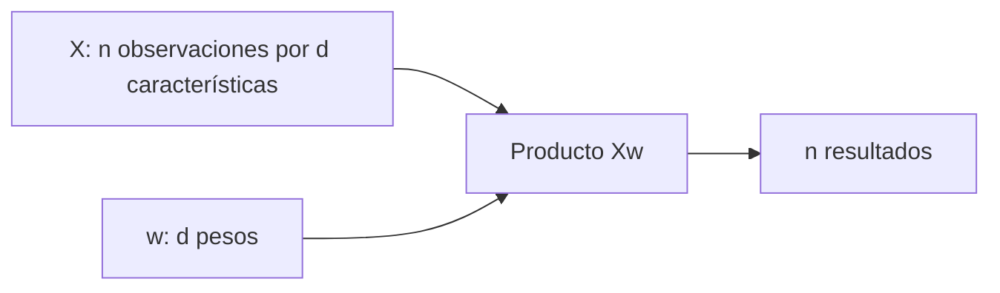

# Unidad 3: Matrices

## Objetivo

Podrás interpretar una matriz de datos, comprobar dimensiones antes de operar y explicar cuándo existe una inversa. Los apartados corresponden a 3.1–3.2.

## 3.1. Cálculo de matrices

Una **matriz** organiza componentes en filas y columnas. Si tiene m filas y n columnas, su forma es m × n. El elemento aᵢⱼ está en la fila i y columna j.

En una matriz de diseño X, habitualmente una fila representa una observación y una columna una característica. Si tenemos 20 recorridos y 3 características por recorrido, X tiene forma 20 × 3.

### Transpuesta y matrices especiales

La **transpuesta** Aᵀ intercambia filas y columnas. Una matriz de 2 × 3 pasa a 3 × 2.

- **Cuadrada:** igual número de filas y columnas.
- **Diagonal:** cuadrada con ceros fuera de la diagonal principal.
- **Identidad I:** diagonal con unos en la diagonal principal.
- **Simétrica:** Aᵀ = A.

La identidad cumple AI = A e IA = A cuando las dimensiones permiten los productos.

### Suma y multiplicación por un escalar

Para sumar o restar matrices componente a componente necesitamos la misma forma. Multiplicar por un escalar multiplica cada entrada.

Con:

$$
A=\begin{pmatrix}1&2\\0&1\end{pmatrix},
\qquad
B=\begin{pmatrix}2&0\\1&3\end{pmatrix}
$$

obtenemos:

$$
A+B=\begin{pmatrix}3&2\\1&4\end{pmatrix},
\qquad
2A=\begin{pmatrix}2&4\\0&2\end{pmatrix}
$$

### Producto matricial

Si A tiene forma m × n y B tiene forma n × p, AB tendrá forma m × p. Las dimensiones interiores deben coincidir.

Cada entrada es un producto interno entre una fila de A y una columna de B:

$$
(AB)_{ij}=\sum_{k=1}^{n}a_{ik}b_{kj}
$$

k recorre la dimensión compartida. En el ejemplo anterior:

$$
AB=\begin{pmatrix}4&6\\1&3\end{pmatrix},
\qquad
BA=\begin{pmatrix}2&4\\1&5\end{pmatrix}
$$

Por ejemplo, la entrada superior izquierda de AB es 1×2 + 2×1 = 4. Observa que **el orden cambia el resultado**.

En NumPy, para arreglos bidimensionales, A * B multiplica componente a componente y A @ B realiza el producto matricial. Elegir la operación requiere entender el objetivo.

### Por qué aparece en modelos

Si X es n × d y w contiene d pesos, Xw produce una predicción por fila:

Una expresión como Xw + b resume muchas sumas ponderadas. La matriz permite describirlas y calcularlas de forma organizada.

## 3.2. Matriz inversa

La inversa de una matriz cuadrada A es otra matriz A⁻¹ que satisface:

$$
AA^{-1}=A^{-1}A=I
$$

**Analogía:** multiplicar por A transforma un vector; aplicar A⁻¹ permite recuperar el original cuando esa transformación conserva la información necesaria.

No toda matriz cuadrada tiene inversa. Una matriz sin inversa se llama **singular**. Si una fila es múltiplo de otra, las ecuaciones no aportan información independiente y la matriz es singular.

### Determinante e inversa de una matriz 2 × 2

Para:

$$
A=\begin{pmatrix}a&b\\c&d\end{pmatrix},
\qquad \det(A)=ad-bc
$$

la inversa existe si y solo si ad − bc ≠ 0, y entonces:

$$
A^{-1}=\frac{1}{ad-bc}
\begin{pmatrix}d&-b\\-c&a\end{pmatrix}
$$

Con A = [[2, 1], [1, 1]], su determinante es 1 y su inversa es [[1, −1], [−1, 2]]. Puedes comprobarlo multiplicándolas: obtendrás la identidad.

La notación |A| puede denotar determinante; no significa tomar el valor absoluto de cada entrada.

### Sistemas de ecuaciones

Un sistema puede escribirse Ax = b. Si A es invertible, matemáticamente su solución es x = A⁻¹b.

En un programa suele ser preferible resolver el sistema directamente, por ejemplo con **np.linalg.solve(A, b)**, en vez de formar explícitamente la inversa. Si A es casi singular, pequeños errores de medición o redondeo pueden alterar mucho la solución: existencia de inversa y estabilidad numérica son asuntos distintos.

## Ejemplo de lectura de dimensiones

Si X tiene forma 5 × 2 y W tiene forma 2 × 3, XW tiene forma 5 × 3. El producto WX no está definido porque las dimensiones interiores serían 3 y 5. Comprueba esta condición antes de calcular entradas.

## Errores frecuentes

Multiplicar matrices como si fueran números conmutativos; confundir transpuesta con inversa; intentar sumar formas incompatibles; y pensar que una inversa es el recíproco de cada entrada.

## Práctica sin resolver

1. ¿Qué representan filas y columnas en una matriz de datos de 40 estudiantes y 6 mediciones?
2. Si A es 3 × 4 y B es 4 × 2, ¿qué forma tiene AB? ¿Se puede calcular BA?
3. Construye una matriz 2 × 2 y su transpuesta.
4. Calcula el determinante de [[3, 2], [6, 4]] y explica qué implica.
5. Comprueba la inversa del ejemplo mediante un producto.
6. Explica la diferencia entre multiplicación componente a componente y producto matricial.

**Estado:** guía lista; evaluación pendiente en el chat.

## Fuente

[Capítulo 2 en Canvas](https://udem.instructure.com/courses/36648/pages/recursos-didacticos-del-capitulo-2-2?module_item_id=5019819), unidad 3, diapositivas 52–65. Ejemplos creados para la tutoría.

