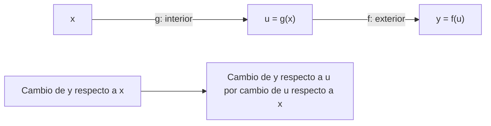

# Unidad 4: Derivadas

## Objetivo y ruta

Entenderás una derivada como cambio local y usarás reglas para calcularla. Sigue 4.1–4.3 primero; después 4.4–4.5 y finalmente 4.6–4.7. Esta unidad explica una herramienta central del ajuste de modelos.

## 4.1. Límites

Un **límite** describe a qué valor se acerca una función cuando su entrada se aproxima a cierto punto. La aproximación puede analizarse aunque la función no esté definida en ese punto.

Para x ≠ 1:

$$
\frac{x^2-1}{x-1}=x+1
\qquad\Rightarrow\qquad
\lim_{x\to1}\frac{x^2-1}{x-1}=2
$$

Factorizamos x² − 1 = (x − 1)(x + 1) y simplificamos fuera de x = 1. La expresión original no permite sustituir directamente x = 1, pero el comportamiento cercano determina el límite.

Para que exista el límite bilateral, la aproximación desde ambos lados debe coincidir. Un límite no equivale necesariamente al valor de la función en el punto.

## 4.2. Coeficiente diferencial y derivadas

La **tasa media de cambio** entre x y x + h es:

$$
\frac{f(x+h)-f(x)}{h}
$$

El numerador es cambio en salida; el denominador, cambio en entrada. Al hacer h cada vez más pequeño obtenemos, si existe, la derivada:

$$
f'(x)=\lim_{h\to0}\frac{f(x+h)-f(x)}{h}
$$

**Analogía:** la velocidad media resume un recorrido; la velocidad instantánea describe lo que ocurre en un instante. Geométricamente, la derivada es la pendiente de la tangente.

### Deducción con f(x) = x²

$$
\frac{(x+h)^2-x^2}{h}
=\frac{2xh+h^2}{h}=2x+h
$$

Al aproximar h a 0 queda f′(x) = 2x. En x = 3 la pendiente es 6. Una aproximación local útil es:

$$
f(x+h)\approx f(x)+f'(x)h
$$

Con h = 0.01, el cambio estimado en x² cerca de 3 es 0.06. El cambio exacto es 0.0601. La aproximación mejora cuando el incremento es suficientemente pequeño y la función se comporta bien.

Una derivada positiva señala aumento local, una negativa disminución y una derivada cero una tangente horizontal. Una derivada cero por sí sola no garantiza un mínimo.

## 4.3. Método diferencial

Las reglas de derivación evitan rehacer el límite en cada cálculo. c es constante; f y g son funciones diferenciables.

$$
\frac{d}{dx}c=0,\qquad
\frac{d}{dx}x^n=nx^{n-1}
$$

La regla de potencias se aplica donde la función y su derivada están definidas. También:

$$
(cf+g)'=cf'+g'
$$

$$
(fg)'=f'g+fg',
\qquad
\left(\frac fg\right)'=\frac{f'g-fg'}{g^2}\quad(g\ne0)
$$

**Ejemplo:** para f(x) = 3x² − 5x + 4, derivamos término por término y obtenemos f′(x) = 6x − 5. El término constante desaparece porque no cambia al variar x.

En y = f(x), la notación diferencial **dy = f′(x) dx** expresa el cambio lineal asociado a un pequeño cambio de entrada.

## 4.4. Diferencia entre logaritmo y exponencial

El índice usa este título; en las diapositivas se estudian sus **derivadas**:

$$
\frac{d}{dx}e^x=e^x,\qquad
\frac{d}{dx}\ln(x)=\frac1x\quad(x>0)
$$

Para a > 0, a ≠ 1:

$$
\frac{d}{dx}a^x=a^x\ln(a),\qquad
\frac{d}{dx}\log_a(x)=\frac{1}{x\ln(a)}\quad(x>0)
$$

La exponencial natural mantiene su forma al derivarse. La pendiente del logaritmo disminuye al crecer x. Recuerda revisar el dominio antes de aplicar una fórmula.

## 4.5. Derivada de la composición de funciones

La **regla de la cadena** describe cambios encadenados:

$$
\frac{d}{dx}f(g(x))=f'(g(x))\,g'(x)
$$

Derivamos la función exterior evaluada en la interior y multiplicamos por la derivada de la interior.

Con h(x) = (2x + 1)³, la exterior es u³ y la interior es 2x + 1:

$$
h'(x)=3(2x+1)^2\cdot2=6(2x+1)^2
$$

La regla evita olvidar el factor 2. También permite obtener la derivada de ln(3x + 2): es 3/(3x + 2), en el dominio 3x + 2 > 0.

## 4.6. Derivadas de orden superior y derivadas parciales

La **segunda derivada** deriva nuevamente la primera. Describe cómo cambia la pendiente. Si f(x) = x³, entonces f′(x) = 3x² y f″(x) = 6x.

En una función de varias entradas, una **derivada parcial** estudia una variable manteniendo las demás constantes.

Para L(w, b) = w² + 3wb + 2b²:

$$
\frac{\partial L}{\partial w}=2w+3b,\qquad
\frac{\partial L}{\partial b}=3w+4b
$$

Al derivar respecto a w, b actúa como constante; al derivar respecto a b, ocurre lo contrario. El **gradiente** reúne las derivadas parciales:

$$
\nabla L=\left(\frac{\partial L}{\partial w},\frac{\partial L}{\partial b}\right)
$$

Como conexión con ML, un paso básico de descenso por gradiente actualiza parámetros en dirección opuesta al gradiente:

$$
\theta_{\mathrm{nuevo}}=\theta_{\mathrm{actual}}-\eta\nabla L
$$

η > 0 es el tamaño del paso. Un paso demasiado grande puede empeorar la pérdida. Esta fórmula es una conexión de tutoría; los detalles de optimización se desarrollarán después.

## 4.7. Derivada de la función sigmoide

Para la logística σ(x) = (1 + e⁻ˣ)⁻¹, usamos la regla de la cadena:

$$
\sigma'(x)=-(1+e^{-x})^{-2}(-e^{-x})
=\frac{e^{-x}}{(1+e^{-x})^2}
$$

Como σ(x) = 1/(1 + e⁻ˣ) y 1 − σ(x) = e⁻ˣ/(1 + e⁻ˣ):

$$
\sigma'(x)=\sigma(x)\bigl(1-\sigma(x)\bigr)
$$

En x = 0, σ(0) = 0.5 y σ′(0) = 0.25. Cerca de los extremos de la S la pendiente es pequeña. Esto ayuda a entender por qué ciertas redes pueden tener cambios muy débiles al propagar gradientes.

## Errores frecuentes

Usar Δx/Δy cuando buscamos Δy/Δx; confundir f con f′; olvidar la derivada de la función interior; derivar todas las variables en una parcial; y asumir que toda pendiente cero es un mínimo.

## Práctica sin resolver

1. Explica con palabras la diferencia entre valor de función, límite y derivada.
2. Deriva 4x³ − 2x + 7.
3. Identifica interior y exterior en (x² + 1)⁴ y aplica la cadena.
4. Deriva e²ˣ y ln(5x), indicando el dominio de la segunda.
5. Calcula las dos parciales de F(x, y) = x²y + y².
6. ¿Qué significa una pendiente negativa en un punto?
7. Explica por qué la derivada logística es pequeña cuando su salida se aproxima a 0 o 1.

**Estado:** guía lista; práctica y evaluación pendientes en el chat.

## Fuente

[Capítulo 2 en Canvas](https://udem.instructure.com/courses/36648/pages/recursos-didacticos-del-capitulo-2-2?module_item_id=5019819), unidad 4, diapositivas 66–87. Se sigue la numeración del índice, corrigiendo los encabezados aislados que indican otra unidad.

