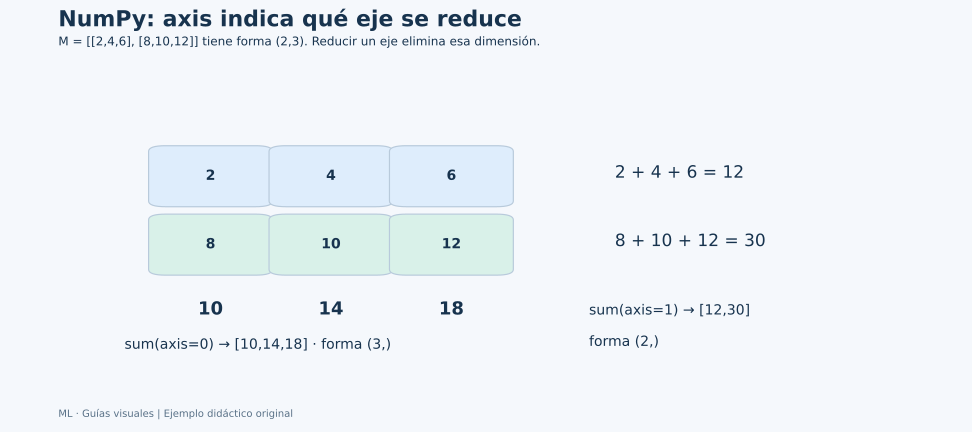

# Unidad 1: Estructuras de datos con NumPy

## Objetivo y conexión con matemáticas

NumPy permite representar vectores y matrices del capítulo 2 y operar con ellos mediante código. Sigue los apartados 1.1–1.4. Antes de ejecutar cada ejemplo, predice la forma y el resultado.

## 1.1. Matrices de NumPy

NumPy trabaja principalmente con **ndarray**, arreglos de una o varias dimensiones. Un arreglo unidimensional puede representar un vector; uno bidimensional, una matriz.

Sus elementos comparten un **dtype**. Esto permite almacenar y procesar bloques de datos de forma eficiente. Las operaciones vectorizadas expresan cálculos sobre muchos elementos sin escribir explícitamente un bucle por cada valor.

Una lista de Python multiplicada por 2 se repite. Un arreglo numérico multiplicado por 2 duplica cada componente. No debemos trasladar automáticamente la interpretación de los operadores entre estructuras.

```python
import numpy as np

values = [2, 5, 8]
array = np.array(values)
print(values * 2)  # [2, 5, 8, 2, 5, 8]
print(array * 2)   # [4, 10, 16]
```

Usaremos ndarray para los ejemplos. No hace falta recurrir a la clase antigua np.matrix.

## 1.2. Fundamentos de arreglos de NumPy

### Forma, dimensión y tipo

```python
a = np.array([[2, 4, 6], [8, 10, 12]])
print(a.shape)  # (2, 3): dos filas y tres columnas
print(a.ndim)   # 2 ejes
print(a.size)   # 6 elementos en total
print(a.dtype)
print(a.itemsize)
```

**shape** dice cuánto mide cada eje; **ndim**, cuántos ejes hay; **size**, cuántos elementos hay; **itemsize**, cuántos bytes ocupa cada elemento. El dtype entero exacto puede depender de la plataforma.

Un arreglo de forma (6,) tiene un eje; uno de forma (2, 3), dos. Ambos contienen seis elementos.

### Crear y reorganizar

```python
sequence = np.arange(6)             # 0, 1, 2, 3, 4, 5
grid = np.linspace(0, 1, 5)         # incluye ambos extremos
zeros = np.zeros((2, 3))
matrix = sequence.reshape(2, 3)
transposed = matrix.T
print(matrix)
print(transposed.shape)             # (3, 2)
```

**reshape** cambia la organización conservando la cantidad de elementos. Para pasar de 6 valores a una forma (2, 3), el producto 2×3 debe ser 6. **T** intercambia filas y columnas de un arreglo bidimensional.

## 1.3. Operaciones de matriz de NumPy

### Operaciones elemento a elemento y broadcasting

Con formas compatibles, +, −, * y / operan componente a componente. El **broadcasting** permite expandir lógicamente ciertas formas, sin que eso implique copiar físicamente todos los valores.

```python
offsets = np.array([1, 10, 100])
print(a + offsets)  # suma esos tres valores a cada fila
print(a ** 2)
```

NumPy compara las dimensiones desde la derecha: son compatibles si son iguales o alguna es 1. Un vector de longitud 3 se alinea con las tres columnas de a. No cualquier par de formas es compatible.

### Agregar y entender axis



**Cómo seguir el dibujo:** con axis=0 se reúnen las entradas que están una encima de otra: 2+8, 4+10 y 6+12. Desaparecen las dos filas y quedan tres resultados. Con axis=1 se reúnen las entradas de cada fila: 2+4+6 y 8+10+12. Desaparecen las tres columnas y quedan dos resultados.

### Leer operación, resultado y forma juntos

| Expresión sobre a | Resultado | Forma |
| --- | --- | --- |
| a.sum() | 42 | Escalar |
| a.sum(axis=0) | [10,14,18] | (3,) |
| a.sum(axis=1) | [12,30] | (2,) |
| a[:,1] | [4,10] | (2,) |
| a[:,1:2] | [[4],[10]] | (2,1) |

Los dos últimos casos seleccionan la misma columna, pero el índice entero elimina un eje y el corte lo conserva. Esta diferencia explica muchos errores al pasar una sola característica a scikit-learn: se espera una tabla de forma (n,1), incluso si contiene una sola columna.

### Broadcasting, alineado desde la derecha

Para sumar una matriz (2,3) y un vector (3,), imagina este último como (1,3). Las columnas coinciden: 3 con 3. Las filas son compatibles: 2 con 1. El vector se usa para cada fila. Un vector (2,) no encaja con (2,3), porque la comparación empieza por las dimensiones finales: 3 y 2 son incompatibles.

Si quieres un ajuste por fila, una columna (2,1) sí se alinea con (2,3). La dimensión 1 se extiende conceptualmente a las tres columnas. No basta con que “haya dos números”: su orientación forma parte de la instrucción.

Una máscara, en cambio, selecciona elementos o filas según verdaderos y falsos. La suma de una máscara cuenta cuántos cumplen; no suma las mediciones originales.

```python
print(a.sum())         # 42: suma todos los elementos
print(a.sum(axis=0))   # [10, 14, 18]: queda un resultado por columna
print(a.sum(axis=1))   # [12, 30]: queda un resultado por fila
print(a.mean(axis=0))  # [5, 7, 9]
print(a.cumsum())      # suma acumulada, aplanando por defecto
print(a.min(), a.max())
print(a.argmin(), a.argmax())
```

**axis** indica el eje que se reduce. En 2D, reducir el eje 0 deja las columnas; reducir el eje 1 deja las filas. **argmin/argmax** devuelven posiciones, no los valores mínimo/máximo.

La desviación estándar de NumPy usa ddof = 0 por defecto. Para una desviación muestral habitual usa ddof = 1. Veremos el porqué en el capítulo 4.

### Producto matricial y álgebra lineal

```python
left = np.array([[2., 1.], [1., 1.]])
right = np.array([[1., 0.], [2., 3.]])
print(left * right)               # producto componente a componente
print(left @ right)               # producto matricial
print(np.linalg.det(left))
print(np.linalg.inv(left))
print(np.linalg.solve(left, np.array([5., 3.])))
```

Antes de @ comprueba las dimensiones interiores. Una inversa requiere una matriz cuadrada no singular.

### Aleatoriedad reproducible

```python
rng = np.random.default_rng(42)
sample = rng.normal(loc=0, scale=1, size=5)
print(sample)
```

La semilla fija hace reproducible una secuencia de llamadas con la misma configuración. El generador avanza: dos llamadas consecutivas producen, en general, resultados distintos.

## 1.4. Indexación y extracción de NumPy

Los índices comienzan en cero. En una matriz escribimos [fila, columna].

```python
print(a[0, 2])      # 6
print(a[:, 1])      # segunda columna: [4, 10]
print(a[0, :2])     # primera fila, posiciones 0 y 1
print(a[-1])        # última fila
print(a[a > 6])     # selecciona los elementos que cumplen la condición
print(a[(a > 2) & (a < 10)])
```

Un corte inicio:fin incluye inicio y excluye fin. Para combinar condiciones sobre arreglos utiliza & y | con paréntesis, en vez de and y or.

Muchos cortes básicos producen una **vista** que comparte memoria con el arreglo original. Si necesitas modificar una selección de forma independiente, crea una copia explícita con **.copy()**. La indexación avanzada, incluida la booleana, devuelve copias.


## Conexión de las ideas

La secuencia más útil es **significado de ejes → selección → operación → forma del resultado**. Un promedio global ya eliminó ambos ejes; para promediar una parte, primero selecciona esa parte. Una semilla fija permite reproducir ejemplos, mientras que una copia explícita evita que una modificación afecte datos compartidos cuando utilizas vistas.

## Fuentes y conexión con tus apuntes

[Capítulo 3 en Canvas](https://udem.instructure.com/courses/36648/pages/recursos-didacticos-del-capitulo-3-2?module_item_id=5019822), unidad 1, diapositivas 4–34. Complemento: notebook **notebooks/lectures/chapter_03/01_numpy.ipynb**.

Referencia técnica para consultar atributos, operaciones y vistas: [guía oficial de NumPy](https://numpy.org/doc/stable/user/quickstart.html). Los ejemplos de esta guía son propios.

