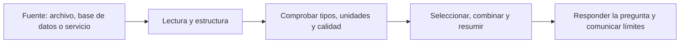

# Unidad 2: Exploración de datos con pandas

## Objetivo y forma de estudiar

Aprenderás a leer una tabla, seleccionar información, combinar fuentes y resumirla. Los apartados son 2.1–2.4. En una exploración real comenzaremos con preguntas antes de concluir qué dicen los datos.

## 2.1. Pipelines: estructura de datos según el tipo de datos

Una **canalización de datos** organiza etapas de trabajo: obtener, interpretar, transformar y utilizar información.



Un CSV guarda texto separado por delimitadores; el programa interpreta ese contenido para construir columnas con tipos. Una base de datos puede entregar tablas; una fuente de texto o imágenes requiere otra representación.

El término pipeline aquí describe el flujo general de datos. La clase Pipeline de scikit-learn implementa una forma específica de encadenar transformaciones y modelos, que conectaremos con la unidad 3.

**Antes de cargar:** ¿qué representa una fila?, ¿qué columna identifica un registro?, ¿qué unidades y tipos esperamos?

## 2.2. Series de pandas y DataFrames

Una **Series** es una estructura de una dimensión con etiquetas. Un **DataFrame** organiza columnas, cada una con su tipo, y comparte un índice de filas.

```python
import pandas as pd

trips = pd.DataFrame({
    "trip_id": [1, 2, 3, 4],
    "zone": ["norte", "sur", "norte", "sur"],
    "distance": [2., 5., 3., 7.],
    "minutes": [9., 18., 12., 24.],
}, index=["a", "b", "c", "d"])

print(type(trips["minutes"]))       # Series
print(type(trips[["minutes"]]))     # DataFrame
print(trips.head())
print(trips.shape)
print(trips.dtypes)
```

Una selección con una cadena devuelve una Series; con una lista de columnas conserva el DataFrame. El índice etiqueta filas; no implica que esas etiquetas sean una característica útil para un modelo.

### Selección por etiqueta, posición y condición

```python
print(trips.loc["b", "minutes"])       # etiqueta: 18
print(trips.iloc[1, 3])                # posición: 18
print(trips.loc["a":"c", ["zone", "minutes"]])
print(trips.iloc[:2])                  # primeras dos posiciones
mask = (trips["zone"] == "norte") & (trips["minutes"] > 10)
selected = trips.loc[mask, ["trip_id", "minutes"]].copy()
print(selected)
```

**loc** utiliza etiquetas y sus cortes pueden incluir ambos extremos. **iloc** usa posiciones y excluye el límite final del corte. Las máscaras guardan una decisión verdadera/falsa por fila.

Al modificar datos utiliza una asignación explícita como **trips.loc[condicion, "minutes"] = valor**. Evita encadenar selecciones para escribir.

### Operaciones y eliminación

```python
trips["minutes_per_km"] = trips["minutes"] / trips["distance"]
without_zone = trips.drop(columns=["zone"])
ordered = trips.sort_values("minutes", ascending=False)
print(trips["minutes"] + 2)
```

La división se aplica fila por fila porque las Series se alinean por índice. Comprueba denominadores cero y unidades antes de crear una razón. **drop** devuelve por defecto un resultado nuevo: asigna el resultado si deseas conservarlo.

**Alineación:** al operar entre dos Series, pandas alinea sus etiquetas, no solo sus posiciones. Etiquetas sin pareja pueden originar faltantes.

## 2.3. Fusión y vinculación de DataFrames

**merge** relaciona registros por una clave. **concat** apila o coloca estructuras juntas según un eje.

Imagina una tabla de recorridos y otra de zonas. Antes de unirlas, comprueba qué significa la clave y si es única en la tabla de referencia.

```python
zones = pd.DataFrame({
    "zone": ["norte", "sur", "este"],
    "manager": ["Ana", "Luis", "Sol"],
})
joined = trips.merge(zones, on="zone", how="left", validate="many_to_one")
print(joined)
```

- **inner:** conserva claves con coincidencia en ambas tablas.
- **left:** conserva las filas de la izquierda y añade coincidencias.
- **right:** conserva las de la derecha.
- **outer:** conserva claves presentes en cualquiera de las dos.

Si una clave aparece varias veces en ambas tablas, una unión puede multiplicar filas. **validate** permite comprobar la relación esperada. Compara el número de filas antes y después.

**concat** con axis = 0 apila filas y con axis = 1 alinea columnas por índice. Unir por índice o por clave son decisiones distintas.

## 2.4. Estadísticas descriptivas y muestras de datos

Antes de interpretar una tabla, investiga:

1. ¿Qué significa cada columna y qué representa cada fila?
2. ¿Cuántas observaciones hay? ¿Faltan valores en alguna variable?
3. ¿Las unidades, tipos y rangos tienen sentido?
4. ¿Los grupos tienen tamaños comparables?
5. ¿Qué muestra un gráfico que un promedio podría ocultar?

Herramientas para obtener evidencia:

```python
print(trips.info())
print(trips.describe())
print(trips["zone"].value_counts(dropna=False))
print(trips.isna().sum())
print(trips.groupby("zone")["minutes"].agg(["count", "mean", "median"]))
print(trips[["distance", "minutes"]].corr())
print(trips.sample(n=2, random_state=42))
```

**describe** resume variables, pero no sustituye su interpretación. La media puede cambiar mucho por extremos; la mediana describe otra característica. **groupby** separa grupos, aplica una operación y combina resultados.

**count** cuenta valores no faltantes; **size** cuenta filas de un grupo. Correlación describe asociación, no demuestra causalidad. Una muestra pequeña o las primeras filas no garantizan representar toda la tabla.

Los datos del ejemplo fueron inventados para practicar herramientas. No constituyen evidencia sobre recorridos reales.

## Errores frecuentes

Confundir etiquetas con posiciones; crear una columna y olvidar sus unidades; asumir que cualquier unión conserva filas; interpretar códigos como cantidades; y saltar de un resumen a una conclusión sin revisar faltantes y distribución.

## Preguntas para revisar después

1. ¿En qué se diferencian Series y DataFrame?
2. Si el índice es ["a", "b", "c"], ¿qué selecciona loc y qué selecciona iloc?
3. Formula una pregunta sobre nulos antes de elegir qué hacer con ellos.
4. ¿Qué unión conserva todos los registros de tu tabla principal?
5. ¿Qué podría causar que un merge duplique el número de filas?
6. ¿Por qué la media sola podría ocultar información?
7. ¿Qué diferencia hay entre count y size?

**Estado:** guía lista; evaluación pendiente.

## Fuentes

[Capítulo 3 en Canvas](https://udem.instructure.com/courses/36648/pages/recursos-didacticos-del-capitulo-3-2?module_item_id=5019822), unidad 2, diapositivas 35–75. Complemento: **notebooks/lectures/chapter_03/02_pandas.ipynb**.

Para consultar diferencias entre selección por etiqueta y posición: [documentación oficial de pandas](https://pandas.pydata.org/docs/user_guide/indexing.html).

