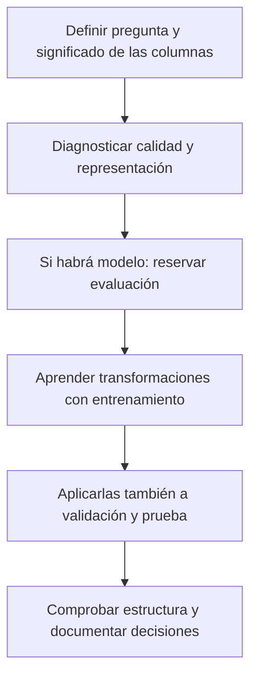

# Unidad 3: Preprocesamiento de datos

## Objetivo y ruta

Sabrás diagnosticar calidad, tratar faltantes y duplicados y preparar características con una justificación. Sigue 3.1–3.5. Antes de transformar un dataset real te haré preguntas sobre su significado y sobre el problema que buscamos resolver.

## 3.1. Preprocesamiento de datos

Preprocesar significa preparar la representación y calidad de la información para el análisis o el modelo. Puede incluir limpieza, integración de fuentes, imputación, codificación y escalado.



Cada transformación responde a una necesidad. Un algoritmo basado en distancias puede ser sensible a las escalas; un árbol no tiene exactamente las mismas necesidades. No existe una receta que mejore todos los modelos y datasets.

**Preguntas previas:** ¿qué significa una fila?, ¿qué representa un nulo?, ¿qué variable queremos predecir?, ¿qué información estará disponible al utilizar el modelo?

## 3.2. Identificación de las propiedades de los datos

El dtype informático y el significado estadístico pueden ser diferentes. Un código postal puede almacenarse como entero y seguir siendo una categoría.

<table header-row="true">
<tr><td>Escala</td><td>Interpretación</td><td>Ejemplo</td></tr>
<tr><td>Nominal</td><td>Categorías sin orden intrínseco</td><td>Zona de reparto</td></tr>
<tr><td>Ordinal</td><td>Categorías con orden; sus distancias no necesariamente son iguales</td><td>Prioridad baja, media, alta</td></tr>
<tr><td>Intervalo</td><td>Diferencias comparables; el cero no representa ausencia</td><td>Temperatura en °C</td></tr>
<tr><td>Razón</td><td>Diferencias y proporciones interpretables; cero con significado de ausencia</td><td>Distancia recorrida</td></tr>
</table>

Decir que 20 °C es «el doble de temperatura» que 10 °C no es una comparación válida de razón sobre esa escala. También distinguimos cantidades discretas, como número de paquetes, y continuas, como duración.

Examina nombres, unidades, rangos, cardinalidad y categorías. Una fecha en texto necesita interpretación antes de extraer año o mes.

## 3.3. Comprobación de datos faltantes

Un faltante representa información ausente. **No equivale automáticamente a cero.** Puede surgir por errores de captura, una pregunta que no aplica o un proceso relacionado con el propio valor.

Preguntas de diagnóstico: ¿en qué columnas faltan datos?, ¿cuánto falta?, ¿se concentra en grupos?, ¿qué pudo causar la ausencia?

Ejemplo inventado y reproducible; los imports de toda la unidad están al principio:

```python
import numpy as np
import pandas as pd
from sklearn.compose import ColumnTransformer
from sklearn.impute import SimpleImputer
from sklearn.pipeline import Pipeline
from sklearn.preprocessing import OneHotEncoder, StandardScaler

records = pd.DataFrame({
    "record_id": [1, 2, 2, 3],
    "hour": [1, 2, 2, 3],
    "reading": [10., np.nan, np.nan, 15.],
})
print(records.isna().sum())
print(records.isna().mean() * 100)
```

Usa **isna** o **notna** para detectar ausencia. Comparar con igualdad contra np.nan no funciona como una prueba de faltantes.

Opciones que debemos justificar:

- **Eliminar:** puede tener sentido si el registro no sirve para la pregunta, considerando cuánto perderemos y qué sesgo introducimos.
- **Imputar:** reemplazar con una regla, como mediana, moda o un método específico.
- **Conservar un indicador:** registrar que hubo ausencia cuando sea pertinente.

La media es sensible a extremos; la mediana suele ser más resistente. Imputar con una constante reduce o altera variación y relaciones, por lo que debemos evaluar sus consecuencias.

**Corrección importante de lectura:** en pandas, dropna(thresh=k) exige **al menos k valores no faltantes** en el eje considerado. No significa «eliminar cuando hay k nulos». Antes de usar thresh identifica qué se cuenta.

## 3.4. Comprobación y procesamiento de datos duplicados

Dos filas iguales pueden ser una repetición accidental o dos eventos legítimos. La decisión depende de qué representa un registro.

```python
print(records.duplicated())
clean = records.drop_duplicates().copy()
clean["reading_missing"] = clean["reading"].isna()
median_reading = clean["reading"].median()
clean["reading"] = clean["reading"].fillna(median_reading)
print(clean)
```

Aquí definimos que record_id identifica un registro único y la fila repetida es accidental. Se conserva una copia de cada fila. Es una demostración de limpieza, no un entrenamiento de modelo.

**duplicated(subset=...)** y **drop_duplicates(subset=...)** limitan la comparación a ciertas columnas. No elimines observaciones únicamente porque comparten cliente o sensor: esos identificadores pueden tener muchos eventos reales.

Revisa también espacios, mayúsculas y unidades. Normalizar texto solo es apropiado si esas diferencias no tienen significado para el problema.

## 3.5. Ingeniería de atributos de datos

### Crear información derivada

Podemos extraer mes de una fecha, calcular distancia con coordenadas o construir una razón como minutos/kilómetro. Explica qué significa cada característica y qué información necesita.

Comprueba denominadores cero y evita usar información posterior al momento de predicción. Una columna que revela la respuesta puede producir fuga de información.

### Codificar categorías

**One-hot** crea indicadores por categoría. **Ordinal** usa un orden explícito cuando ese orden existe. Asignar 0, 1, 2 a categorías nominales puede introducir distancias u orden artificiales en ciertos modelos.

```python
zones = pd.DataFrame({"zone": ["norte", "sur", "norte"]})
print(pd.get_dummies(zones, columns=["zone"], dtype=int))
```

En datos nuevos necesitamos las mismas columnas y el mismo significado. Para un modelo conviene un codificador ajustado con entrenamiento que gestione categorías desconocidas.

### Escalar y transformar

Estandarización y escalado min-max:

$$
z=\frac{x-\mu_{\mathrm{train}}}{s_{\mathrm{train}}},
\qquad
x'=\frac{x-\min_{\mathrm{train}}}{\max_{\mathrm{train}}-\min_{\mathrm{train}}}
$$

En StandardScaler la desviación usada corresponde a ddof = 0. Los parámetros se aprenden con entrenamiento. El test no tiene por qué quedar con media cero ni dentro de [0, 1] tras min-max. Una columna constante requiere el tratamiento que implemente la herramienta.

Una transformación logarítmica puede cambiar la forma de una distribución; escalar linealmente cambia unidades y centro, pero no elimina una cola asimétrica.

### Valores atípicos

Podemos localizar casos inusuales con gráficos, reglas de dominio y cercas IQR:

$$
IQR=Q_3-Q_1,\quad
\text{cerca inferior}=Q_1-1.5\,IQR,\quad
\text{cerca superior}=Q_3+1.5\,IQR
$$

Son señales para investigar, no una orden de borrar. Un extremo puede ser un evento real importante. Recortar valores o eliminarlos cambia los datos y exige una justificación.

### Preparar entrenamiento y datos nuevos de manera consistente

```python
train = pd.DataFrame({
    "distance": [2., 4., np.nan, 8.],
    "zone": ["norte", "sur", "norte", "sur"],
})
new = pd.DataFrame({"distance": [5.], "zone": ["este"]})

numeric = Pipeline([
    ("impute", SimpleImputer(strategy="median")),
    ("scale", StandardScaler()),
])
categorical = Pipeline([
    ("impute", SimpleImputer(strategy="most_frequent")),
    ("encode", OneHotEncoder(handle_unknown="ignore", sparse_output=False)),
])
preprocessor = ColumnTransformer([
    ("numeric", numeric, ["distance"]),
    ("categorical", categorical, ["zone"]),
])
train_ready = preprocessor.fit_transform(train)
new_ready = preprocessor.transform(new)
print(train_ready.shape, new_ready.shape)  # (4, 3) y (1, 3)
```

**fit** aprende referencias; **transform** las reutiliza. Con handle_unknown="ignore", la categoría nueva no se vuelve una categoría conocida: sus indicadores quedan en cero. El ejemplo prepara entradas, sin entrenar ni evaluar un predictor.

## Práctica para el chat

1. ¿Qué investigarías antes de reemplazar un nulo por cero?
2. ¿Por qué un número guardado como entero puede ser una categoría?
3. Explica qué hace dropna(thresh=3).
4. ¿Cuándo dos registros del mismo cliente no son duplicados?
5. ¿Cuándo usarías one-hot y cuándo un orden explícito?
6. ¿Qué aprende fit y por qué no debe aprenderlo del test?
7. ¿Por qué un extremo de un boxplot no debe borrarse automáticamente?

**Estado:** lista para estudiar; decisiones y respuestas se revisarán cuando tú indiques.

## Fuentes

[Capítulo 3 en Canvas](https://udem.instructure.com/courses/36648/pages/recursos-didacticos-del-capitulo-3-2?module_item_id=5019822), unidad 3, diapositivas 76–108. Complementos del repositorio: **04_limpieza_y_outliers.ipynb** y **05_transformacion_y_escalado.ipynb**, en **notebooks/lectures/chapter_03/**.

Consulta técnica de detección y tratamiento de ausencia: [pandas, datos faltantes](https://pandas.pydata.org/docs/user_guide/missing_data.html). La separación entre ajuste y aplicación conecta con [las prácticas de scikit-learn](https://scikit-learn.org/stable/common_pitfalls.html#data-leakage).

