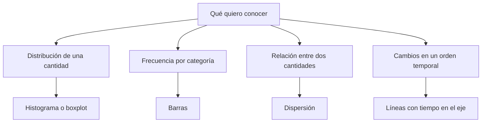

# Unidad 4: Visualización de datos

## Objetivo

Elegirás un gráfico a partir de una pregunta y del tipo de variables, y aprenderás a leerlo antes de concluir. Los apartados siguen 4.1–4.4.

## 4.1. Introducción a la visualización de datos

Un gráfico muestra patrones y límites que un solo promedio puede ocultar. Primero plantea una pregunta; después elige qué representar.

- **Univariante:** estudiar una variable, como la distribución de duración.
- **Bivariante:** relacionar dos variables, como distancia y duración.
- **Multivariante:** examinar varias variables, con color, grupos o paneles y cuidando la legibilidad.



**Preguntas de lectura:** ¿qué representa cada punto o barra?, ¿cuáles son las unidades?, ¿qué se omitió?, ¿cuántos casos hay?, ¿los grupos son comparables?

## 4.2. Gráficos para resumen de datos continuos

### Histograma

Agrupa una variable numérica en intervalos y muestra cuántas observaciones caen en cada uno. El número y ancho de los intervalos afectan la apariencia.

Investiga centro, dispersión, asimetría, huecos, varias concentraciones y extremos. Compara diferentes particiones antes de atribuir una forma a los datos.

En un histograma de **conteos**, las alturas representan frecuencias. En uno de **densidad**, se normaliza el área total a 1: la altura por sí sola no representa la probabilidad del intervalo si su ancho no es 1.

### Diagrama de caja

La caja resume Q1, mediana y Q3. Su longitud es el IQR. En la convención usual, los bigotes alcanzan los valores observados más extremos dentro de las cercas de 1.5×IQR; los puntos exteriores se señalan por separado.

Un punto exterior puede ser un error o un caso real. Dos distribuciones diferentes pueden tener cajas muy parecidas: complementa con otros gráficos y tamaños de muestra.

### Dispersión

Cada punto corresponde a una observación con dos coordenadas. Permite explorar tendencias, curvas, grupos y valores inusuales. Una correlación lineal cercana a cero puede coexistir con una relación curva.

### Otras vistas del temario

Una **curva de densidad por kernel (KDE)** suaviza la distribución; su forma depende del ancho de banda y puede sugerir valores fuera de límites naturales. Un **violín** combina una forma de densidad con información de resumen. Compara sus supuestos y tamaños muestrales antes de interpretar detalles.

## 4.3. Gráficos para resumen de datos categóricos

Las **barras** comparan conteos, proporciones o un resumen definido por categoría. Especifica cuál de esas cantidades se representa.

Un **gráfico circular** muestra partes de un total, aunque las barras suelen facilitar comparaciones cercanas. Un **mosaico** organiza frecuencias de combinaciones de categorías. Para comparar una cantidad entre categorías, utiliza cajas por grupo o vistas equivalentes.

**Cuidado con la escala:** las barras codifican cantidades mediante longitud. Un eje recortado puede exagerar visualmente diferencias pequeñas. Para barras es habitual iniciar en cero; en otros gráficos, como líneas, la elección debe justificarse y etiquetarse claramente.

Compara proporciones cuando los grupos tienen diferentes tamaños y la pregunta se refiere a tasas. Un grupo grande puede tener más eventos y, al mismo tiempo, una proporción menor.

## 4.4. Visualización con Matplotlib y pandas

En Matplotlib, **Figure** es la figura completa y **Axes** una zona de gráfico. La interfaz fig, ax permite controlar explícitamente cada panel.

Ejemplo inventado; todos los imports están al principio:

```python
import matplotlib.pyplot as plt
import pandas as pd
import seaborn as sns

trips = pd.DataFrame({
    "distance": [1., 2., 2., 4., 5., 7., 8., 9.],
    "minutes": [6., 9., 10., 14., 18., 23., 25., 29.],
    "zone": ["norte", "sur", "norte", "sur", "norte", "sur", "norte", "sur"],
})

fig, axes = plt.subplots(1, 2, figsize=(10, 4))
axes[0].hist(trips["minutes"], bins=4, edgecolor="black")
axes[0].set(xlabel="Duración (min)", ylabel="Frecuencia",
            title="Distribución de la duración")
axes[1].scatter(trips["distance"], trips["minutes"])
axes[1].set(xlabel="Distancia (km)", ylabel="Duración (min)",
            title="Relación entre distancia y duración")
fig.tight_layout()
plt.show()
```

Antes de ejecutar, anticipa: ¿qué variable aparece en cada eje y qué representa una barra o punto? Después comprueba si el gráfico permite contestar tu pregunta.

### Categorías, grupos y pandas

```python
counts = trips["zone"].value_counts()
fig, axes = plt.subplots(1, 2, figsize=(10, 4))
counts.plot.bar(ax=axes[0])
axes[0].set(xlabel="Zona", ylabel="Recorridos", title="Conteo por zona")
sns.boxplot(data=trips, x="zone", y="minutes", ax=axes[1])
axes[1].set(xlabel="Zona", ylabel="Duración (min)", title="Duración por zona")
fig.tight_layout()
plt.show()
```

Este ejemplo usa datos pequeños construidos para mostrar sintaxis. Sus cajas no son evidencia de diferencias en una población real.

### Líneas, estilo y guardado

Para una secuencia temporal, ordena primero por tiempo. Conecta puntos si la conexión tiene significado. Personaliza títulos, etiquetas, límites, leyendas, color y marcadores según lo que quieras comunicar.

Los patrones de línea habituales son "-", "--", "-." y ":". Para escalones utiliza una opción apropiada como drawstyle="steps-post" o el método step, en lugar de tratar "steps" como un linestyle común.

Para guardar, utiliza fig.savefig con una ruta dentro de tu espacio de trabajo. En ejercicios del curso, trabaja con copias dentro de **workspace/**.

## Lista de lectura crítica

Comprueba tipo de variable, unidades, escalas, intervalos, denominadores, tamaños por grupo y significado del color. Describe qué ves, plantea explicaciones posibles y busca más evidencia antes de afirmar una causa.

## Práctica sin resolver

1. Elige un gráfico para estudiar una variable numérica y explica por qué.
2. ¿Qué cambia al modificar bins en un histograma?
3. ¿Qué representan la línea central de la caja y los bigotes?
4. ¿Por qué cero correlación lineal no descarta una relación?
5. ¿Cómo podría un eje de barras exagerar una diferencia?
6. ¿Cuándo compararías conteos y cuándo proporciones?
7. Explica la diferencia entre Figure y Axes.

**Estado:** guía preparada; interpretación y evaluación pendientes.

## Fuentes

[Capítulo 3 en Canvas](https://udem.instructure.com/courses/36648/pages/recursos-didacticos-del-capitulo-3-2?module_item_id=5019822), unidad 4, diapositivas 109–136. Complemento: **notebooks/lectures/chapter_03/03_matplotlib.ipynb**. Los ejemplos y preguntas son de tutoría.

