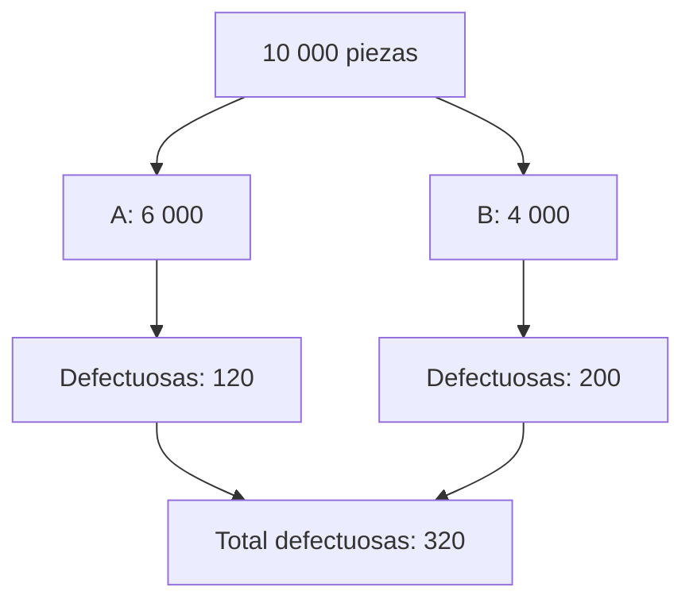

# Unidad 1: Comprensión de la probabilidad

## Objetivo y ruta

Aprenderás a describir incertidumbre, combinar eventos e interpretar variables aleatorias y distribuciones discretas. Lee 1.1–1.2 primero y 1.3–1.4 después. Todos los ejemplos numéricos de esta guía son inventados.

## 1.1. Teoría de la probabilidad

Un **experimento aleatorio** tiene resultados posibles definidos, aunque no sabemos cuál ocurrirá en una realización. El **espacio muestral Ω** contiene los resultados posibles y un **evento A** es un subconjunto de Ω.

Ejemplo: elegir una pieza de una bolsa que contiene cuatro piezas azules y una roja. El resultado puede describirse por pieza individual o por color; debes especificar cuál es tu espacio muestral.

La probabilidad cumple:

$$
0\le P(A)\le1,\qquad P(\Omega)=1
$$

Para un espacio finito con resultados **equiprobables**:

$$
P(A)=\frac{\text{resultados favorables}}{\text{resultados posibles}}
$$

Si cada pieza tiene la misma posibilidad de ser elegida, P(azul) = 4/5. Los dos colores no son equiprobables solo porque sus nombres sean dos.

Una **frecuencia relativa** estima probabilidad mediante observaciones: si un evento ocurre 18 veces en 100 repeticiones, su frecuencia es 0.18. En un conjunto finito de observaciones puede diferir de la probabilidad teórica; repetir el experimento no hace que cada estimación mejore de manera monótona.

## 1.2. Reglas de probabilidad

### Unión, intersección y complemento

P(A ∪ B) corresponde a que ocurra A, B o ambos. P(A ∩ B) corresponde a que ocurran ambos.

$$
P(A\cup B)=P(A)+P(B)-P(A\cap B)
$$

Restamos la intersección porque al sumar ambas probabilidades la contamos dos veces. El complemento reúne los resultados donde A no ocurre:

$$
P(A^c)=1-P(A)
$$

Dos eventos **mutuamente excluyentes** no pueden ocurrir juntos. Su intersección es vacía y la regla de suma se simplifica.

### Probabilidad condicional e independencia

$$
P(A\mid B)=\frac{P(A\cap B)}{P(B)}
\quad\text{si }P(B)>0
$$

La barra significa «dado que ocurrió B». Cambia el universo de referencia: dentro de los casos B, ¿qué proporción también cumple A?

La regla de multiplicación general es:

$$
P(A\cap B)=P(A\mid B)P(B)
$$

Si son **independientes**, saber B no cambia la probabilidad de A, y P(A ∩ B) = P(A)P(B). Independencia y exclusión mutua son conceptos diferentes.

En la bolsa de cuatro piezas azules y una roja, al sacar dos sin reemplazo:

$$
P(\text{ambas azules})=\frac45\cdot\frac34=\frac35
$$

La segunda probabilidad cambia porque la primera extracción modifica la bolsa.

### Bayes y probabilidad total

Bayes permite cambiar el sentido de una condición:

$$
P(B\mid D)=\frac{P(D\mid B)P(B)}{P(D)}
$$

Si A y B forman una partición de la población:

$$
P(D)=P(D\mid A)P(A)+P(D\mid B)P(B)
$$

**Ejemplo de tutoría:** la máquina A produce 60 % de las piezas y tiene 2 % de defectos; B produce 40 % y tiene 5 % de defectos. Si tomamos una pieza al azar del conjunto, P(defecto) = 0.6×0.02 + 0.4×0.05 = 0.032.

Para visualizarlo, imaginemos 10 000 piezas con esas proporciones:

Entre las defectuosas, 200/320 = 0.625 proceden de B. Por tanto, P(B | defecto) = 62.5 %. Esa probabilidad es distinta del 5 % de defectos dentro de B. El tamaño relativo de los grupos importa.

## 1.3. Variable aleatoria

Una **variable aleatoria X** asigna un número a cada resultado del experimento. Usamos X para la variable y x para un valor que puede tomar.

- **Discreta:** valores finitos o contables, como cantidad de alertas.
- **Continua:** se modela sobre intervalos, como tiempo de espera.

Discreto no significa necesariamente «solo un número finito de valores»: hay variables discretas con soporte infinito contable.

Una población es el conjunto de interés; una muestra contiene observaciones de esa población. Un parámetro describe una población o distribución y un estadístico se calcula con una muestra.

Para una variable discreta con masa p(x):

$$
E[X]=\sum_x x\,p(x)
$$

La esperanza es un promedio ponderado por probabilidades. La varianza mide dispersión respecto a esa media:

$$
\operatorname{Var}(X)=E[(X-\mu)^2]=E[X^2]-\mu^2
$$

μ = E[X]. La desviación estándar es la raíz de la varianza y recupera las unidades originales. La varianza tiene unidades al cuadrado.

## 1.4. Distribución de probabilidad discreta

La **función de masa** p(x) = P(X = x) asigna probabilidad a cada valor posible. Debe ser no negativa y sumar 1. En la presentación, estos conceptos aparecen también dentro de las diapositivas de variable aleatoria.

Ejemplo: X es el número de alertas en una revisión, según esta distribución hipotética:

<table header-row="true">
<tr><td>x</td><td>0</td><td>1</td><td>2</td></tr>
<tr><td>p(x)</td><td>0.5</td><td>0.3</td><td>0.2</td></tr>
</table>

Las probabilidades suman 1. E[X] = 0×0.5 + 1×0.3 + 2×0.2 = 0.7. La esperanza puede ser fraccionaria aunque un resultado concreto sea entero.

E[X²] = 1.1 y Var(X) = 1.1 − 0.7² = 0.61.

La **función acumulada F(t) = P(X ≤ t)** suma las masas hasta t. Aquí F(1) = 0.8.

### Dos modelos discretos para concretar la idea

**Bernoulli** representa una prueba con resultado 1 o 0 y probabilidad p de obtener 1. Su esperanza es p y su varianza p(1 − p).

**Binomial** cuenta éxitos en n pruebas independientes con la misma probabilidad p:

$$
P(X=k)=\binom nk p^k(1-p)^{n-k}
$$

El coeficiente combina cuántas posiciones pueden ocupar los k éxitos. Para n = 3, p = 0.2 y k = 1, la probabilidad es 3×0.2×0.8² = 0.384. Son ejemplos complementarios de distribuciones; los supuestos de independencia y p constante deben justificarse.

## Errores frecuentes

Contar resultados sin comprobar equiprobabilidad; intercambiar P(A | B) con P(B | A); confundir independencia con exclusión; y creer que un promedio tiene que ser un resultado posible individual.

## Práctica para revisar después

1. Define espacio muestral y evento con un ejemplo propio.
2. ¿Cuándo es válida la razón «favorables/posibles»?
3. Explica por qué se resta la intersección en la suma.
4. ¿Qué cambia al condicionar una probabilidad?
5. Construye un ejemplo donde dos eventos no sean independientes.
6. ¿Por qué Bayes necesita la proporción de cada grupo?
7. Diseña una distribución discreta de tres valores y comprueba su suma.
8. ¿Qué diferencia hay entre X, un valor x y E[X]?

**Estado:** guía preparada; respuestas pendientes.

## Fuente

[Capítulo 4 en Canvas](https://udem.instructure.com/courses/36648/pages/recursos-didacticos-del-capitulo-4-2?module_item_id=5019826), unidad 1, diapositivas 4–32. Los ejemplos, el árbol de Bayes y las aclaraciones son de tutoría.

