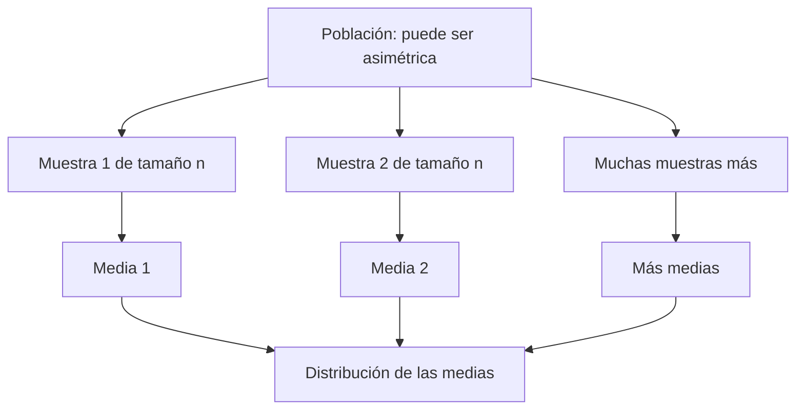

# Unidad 3: Comprensión de la estadística II

## Objetivo y ruta

Aprenderás a distinguir describir una muestra de inferir sobre una población, comprenderás por qué varía una media muestral e interpretarás estimaciones e intervalos. Sigue los apartados 3.1–3.3.

## 3.1. Estadísticas descriptivas

La **población** es el conjunto de interés y una **muestra** es un subconjunto observado. Un parámetro describe la población y un estadístico se calcula con una muestra.

La **estadística descriptiva** resume los datos observados. La **inferencia** utiliza un diseño de muestreo y supuestos para razonar sobre la población. Tener muchos registros no garantiza representatividad.

### Centro y posición

Para valores x₁,…,xₙ:

$$
\bar x=\frac1n\sum_{i=1}^n x_i
$$

La media reparte el total entre n observaciones. La **mediana** es el centro de los valores ordenados; la **moda**, un valor de frecuencia máxima. Cuantiles y percentiles describen posiciones en el orden.

Con [2, 4, 6, 8, 50], la media es 14 y la mediana 6. Son resúmenes diferentes: el 50 influye especialmente en la media. No existe una elección universal; depende de qué queremos describir.

Los métodos para calcular cuantiles muestrales pueden variar entre herramientas. Comprueba la convención cuando necesites reproducir un resultado exacto.

### Dispersión

La varianza poblacional de N valores y la varianza muestral habitual son:

$$
\sigma^2=\frac1N\sum_{i=1}^{N}(x_i-\mu)^2,
\qquad
s^2=\frac1{n-1}\sum_{i=1}^{n}(x_i-\bar x)^2
$$

La primera describe esa población finita. La segunda es un estimador insesgado de la varianza poblacional bajo un muestreo independiente de la misma distribución con varianza finita.

Al estimar la media con la misma muestra, las desviaciones suman cero y queda una restricción: esto se conecta con los n − 1 grados de libertad.

La **desviación estándar** es la raíz de la varianza y tiene las mismas unidades que los datos. Para [2, 4, 6], la media es 4, la suma de desviaciones cuadradas es 8, la varianza muestral es 8/2 = 4 y la desviación muestral es 2.

En NumPy, std usa ddof = 0 por defecto; pandas Series.std usa ddof = 1. La diferencia de resultados puede deberse a esa elección y no a un error de datos.

### Asociación y forma

La covarianza y correlación describen variación conjunta, como vimos en la unidad 2. En una muestra, la covarianza habitual utiliza el divisor n − 1.

La **asimetría** caracteriza desequilibrios de forma: una cola derecha prolongada suele asociarse a asimetría positiva. La **curtosis**, basada en un cuarto momento estandarizado, es sensible a colas y valores extremos. No debe interpretarse únicamente como «qué tan puntiaguda es la campana».

La curtosis de una normal es 3; su **exceso de curtosis** es 0. Las herramientas pueden reportar una u otra convención y distintos ajustes muestrales. Para comprender una distribución, acompaña estos números con gráficos y contexto.

## 3.2. Teorema del límite central

Distingue tres objetos:

1. La distribución de valores individuales en la población.
2. Los datos de una muestra particular.
3. La distribución que tendría una estadística al repetir el muestreo.

El **teorema del límite central (TLC)**, en su versión clásica, considera observaciones independientes, con la misma distribución, media μ y varianza finita σ².

Para un tamaño suficientemente grande, la distribución de la media muestral puede aproximarse por:

$$
\bar X\approx\mathcal N\left(\mu,\frac{\sigma^2}{n}\right)
$$

Equivalentemente, la media estandarizada se aproxima a la normal estándar:

$$
\frac{\bar X-\mu}{\sigma/\sqrt n}\approx\mathcal N(0,1)
$$

**Qué significa:** al repetir muchas veces el muestreo y calcular una media en cada muestra, esas medias tienden a formar una distribución aproximadamente normal bajo las condiciones del teorema.

El TLC **no transforma los datos originales en normales**. Tampoco garantiza que cualquier estadística tenga la misma distribución ni que n = 30 sea suficiente para todo problema. Dependencia, colas extremas y sesgos de muestreo requieren cuidado.

La referencia del [NIST sobre el TLC](https://csrc.nist.gov/glossary/term/Central_Limit_Theorem) resume la distribución de las medias y su varianza σ²/n.

### Desviación estándar frente a error estándar

La desviación estándar describe variabilidad de observaciones. El **error estándar de la media** describe cuánto varía la media entre muestras:

$$
SE(\bar X)=\frac{\sigma}{\sqrt n}
\qquad\text{y suele estimarse con}\qquad
\frac{s}{\sqrt n}
$$

Si σ = 12, con n = 36 el error estándar es 2. Con n = 144 es 1. Cuadruplicar n reduce el error estándar a la mitad, bajo las condiciones consideradas. No elimina un sesgo del método de selección.

## 3.3. Teoría de la estimación

Una **estimación puntual** propone un valor para un parámetro, como usar la media observada para estimar μ. La regla de cálculo es un estimador; su valor en una muestra concreta es una estimación.

Un **intervalo de confianza** incorpora variación muestral:

$$
\text{estimación}\ \pm\ \text{valor crítico}\times\text{error estándar}
$$

### Media con desviación poblacional conocida

Para una población normal, o con una aproximación adecuada de la media:

$$
\bar x\pm z_{1-\alpha/2}\frac{\sigma}{\sqrt n}
$$

α es la proporción de no cobertura del procedimiento; 1 − α es el nivel de confianza. En un intervalo bilateral del 95 %, α = 0.05 y el cuantil normal es aproximadamente 1.96.

**Ejemplo inventado:** con media 50, σ = 12 y n = 36, el error estándar es 2. El margen es 1.96×2 = 3.92, y el intervalo es [46.08, 53.92].

### Media con desviación poblacional desconocida

Si estimamos σ con s, el intervalo t usual es:

$$
\bar x\pm t_{1-\alpha/2,n-1}\frac{s}{\sqrt n}
$$

La validez exacta se obtiene con observaciones independientes de una población normal. En otros contextos se requieren aproximaciones o métodos adecuados a los datos.

### Interpretación del nivel de confianza

En el enfoque frecuentista, repetir el procedimiento muchas veces produce una proporción aproximada del 95 % de intervalos que contienen al parámetro fijo, cuando se cumplen los supuestos.

No significa que el 95 % de las observaciones esté dentro del intervalo de la media ni que el parámetro tenga una probabilidad del 95 % después de fijar ese intervalo. Esta interpretación se desarrolla en [NIST: límites de confianza para la media](https://www.itl.nist.gov/div898/handbook/eda/section3/eda352.htm).

Con los mismos datos y método, pedir mayor confianza amplía el intervalo. Más tamaño muestral suele estrecharlo; más variabilidad suele ampliarlo. Mayor ancho representa menor precisión de esa estimación, sin que eso cambie la variabilidad de los datos ya observados.

## Errores frecuentes

Confundir parámetro con estadístico; usar el TLC para declarar normales los datos originales; confundir s con s/√n; interpretar confianza como porcentaje de datos dentro del intervalo; y creer que aumentar n repara cualquier muestra sesgada.

## Práctica sin resolver

1. Identifica población, muestra, parámetro y estadístico en una encuesta de tu universidad.
2. ¿Cuándo investigarías la mediana además de la media?
3. Explica la diferencia entre varianza y desviación estándar.
4. ¿Qué distribución se aproxima a una normal en el TLC?
5. Si cuadruplicamos n, ¿qué pasa con el error estándar bajo los mismos supuestos?
6. Explica un intervalo del 95 % sin asignar una probabilidad al parámetro fijo.
7. ¿Qué cambiaría al pasar del 95 % al 99 % de confianza?
8. ¿Qué información necesitas para elegir entre un intervalo z y uno t?

**Estado:** guía lista; evaluación pendiente.

## Fuente principal

[Capítulo 4 en Canvas](https://udem.instructure.com/courses/36648/pages/recursos-didacticos-del-capitulo-4-2?module_item_id=5019826), unidad 3, diapositivas 54–76. Las aclaraciones del TLC y los intervalos precisan las simplificaciones del material; los ejemplos son de tutoría.

