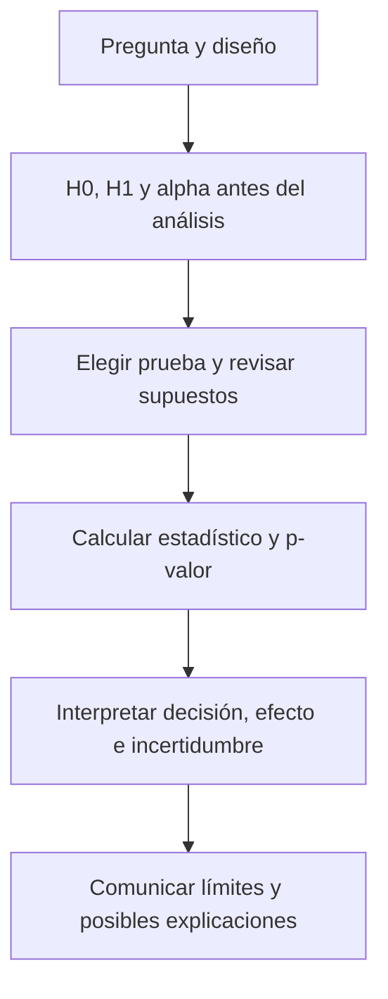

# Unidad 4: Pruebas de hipótesis estadísticas

## Objetivo y ruta

Comprenderás la lógica de una prueba y elegirás entre las familias del temario: pruebas t, ANOVA y chi-cuadrada. Estudia 4.1 antes de las fórmulas de 4.2. La elección comienza por la pregunta, el diseño y el tipo de datos.

## 4.1. Principios de la prueba de hipótesis

Una prueba compara los datos con lo que esperaríamos bajo una **hipótesis nula H₀** y un modelo estadístico.

- **H₀:** afirmación concreta que usamos como referencia.
- **H₁:** alternativa que delimita qué desviación queremos detectar.
- **Estadístico de prueba:** resumen calculado con la muestra.
- **Distribución bajo H₀:** referencia para interpretar qué tan extremo es ese resumen.
- **Nivel α:** regla de decisión fijada antes de observar el resultado.

Ejemplo: H₀: μ = 60 minutos frente a H₁: μ ≠ 60 minutos. La pregunta es sobre la media poblacional, no sobre que cada observación deba valer 60.

### Qué significa el p-valor

Es la probabilidad, bajo H₀ y los supuestos del modelo, de obtener un estadístico **tan extremo como el observado o más**, según la alternativa elegida.

Un p-valor pequeño señala incompatibilidad entre datos y modelo nulo. No representa la probabilidad de que H₀ sea verdadera, ni mide el tamaño o importancia práctica del efecto. Estas distinciones coinciden con la [declaración de la American Statistical Association](https://www.amstat.org/asa/files/pdfs/p-valuestatement.pdf).

Con una regla habitual, rechazamos H₀ si p ≤ α. Si no se cumple, decimos **«no rechazamos H₀»**. La ausencia de rechazo no demuestra igualdad ni confirma automáticamente H₀: puede faltar información o potencia.

### Colas, errores y potencia

Una alternativa bilateral busca diferencias en ambos sentidos. Una unilateral busca un sentido definido previamente:

$$
H_1:\mu\ne\mu_0,\qquad H_1:\mu>\mu_0,\qquad H_1:\mu<\mu_0
$$

No elijas la cola después de mirar qué dirección favorece el resultado.

<table header-row="true">
<tr><td>Decisión</td><td>H₀ verdadera</td><td>H₀ falsa</td></tr>
<tr><td>Rechazar H₀</td><td>Error tipo I</td><td>Detección correcta</td></tr>
<tr><td>No rechazar H₀</td><td>Decisión compatible con H₀</td><td>Error tipo II</td></tr>
</table>

α controla la tasa de error tipo I bajo los supuestos de una prueba válida. β describe error tipo II para una alternativa especificada; **potencia = 1 − β**. La potencia depende del efecto real, variabilidad, tamaño muestral y diseño.

## 4.2. Prueba de hipótesis en acción

### Mapa para elegir

<table header-row="true">
<tr><td>Pregunta y datos</td><td>Familia del temario</td></tr>
<tr><td>Comparar una media con un valor de referencia</td><td>t de una muestra</td></tr>
<tr><td>Comparar medias de dos grupos independientes</td><td>t independiente, considerando Welch o varianza común</td></tr>
<tr><td>Comparar dos mediciones emparejadas</td><td>t sobre las diferencias de cada pareja</td></tr>
<tr><td>Comparar medias de varios grupos independientes</td><td>ANOVA</td></tr>
<tr><td>Comparar conteos con proporciones de referencia</td><td>Chi-cuadrada de bondad de ajuste</td></tr>
<tr><td>Examinar asociación entre dos variables categóricas</td><td>Chi-cuadrada de independencia</td></tr>
</table>

### A. t de una muestra

Cuando σ es desconocida, un estadístico usual es:

$$
t=\frac{\bar x-\mu_0}{s/\sqrt n}
$$

La diferencia entre media observada y referencia se expresa en unidades de error estándar. Con observaciones independientes de una población normal, la referencia exacta es t con n − 1 grados de libertad. En muestras grandes existen aproximaciones, pero hay que revisar dependencia y valores extremos.

**Ejemplo inventado:** n = 16, media = 66, s = 12 y referencia = 60. El error estándar es 12/4 = 3, por lo que t = (66 − 60)/3 = 2. Para dos colas y 15 grados de libertad, p ≈ 0.064. Con α = 0.05 no rechazamos H₀. Esto no demuestra que la media sea exactamente 60.

### B. t de dos muestras independientes

Los grupos deben ser independientes; no basta con que tengan nombres diferentes. Para comparar medias sin suponer varianzas iguales, el estadístico de Welch es:

$$
t=\frac{(\bar x_1-\bar x_2)-\Delta_0}
{\sqrt{s_1^2/n_1+s_2^2/n_2}}
$$

Δ₀ es la diferencia planteada por H₀, frecuentemente 0. La referencia t usa una aproximación de grados de libertad.

Si se justifica una varianza poblacional común, la versión agrupada usa:

$$
s_p^2=\frac{(n_1-1)s_1^2+(n_2-1)s_2^2}{n_1+n_2-2}
$$

y el denominador se vuelve sₚ√(1/n₁ + 1/n₂), con n₁ + n₂ − 2 grados de libertad. Revisa cuál versión exige la actividad y qué supuesto introduce. El [NIST distingue las variantes de dos muestras](https://www.itl.nist.gov/div898/handbook/eda/section3/eda353.htm).

### C. t pareada

Cuando cada observación tiene una pareja natural, trabajamos con las **diferencias**: dᵢ = despuésᵢ − antesᵢ.

$$
t=\frac{\bar d-d_0}{s_d/\sqrt n}
$$

n cuenta parejas y s_d es la desviación de sus diferencias. Para el resultado exacto, las diferencias deben proceder de una población normal y las parejas ser independientes entre sí. Las dos mediciones de una misma pareja no tienen que ser independientes.

**Ejemplo de diseño:** medir tiempo de ejecución antes y después en los mismos equipos. Tratar esos registros como dos grupos sin emparejar descarta la estructura del diseño.

### D. ANOVA

El ANOVA clásico de un factor contrasta:

$$
H_0:\mu_1=\mu_2=\cdots=\mu_k
$$

La alternativa es que **no todas las medias son iguales**. Compara variación entre grupos con variación dentro de grupos:

$$
F=\frac{MS_{\mathrm{entre}}}{MS_{\mathrm{dentro}}}
$$

Cada MS es una suma de cuadrados dividida por sus grados de libertad. Con k grupos y N observaciones, son k − 1 y N − k.

Sus supuestos clásicos incluyen independencia, varianza común y errores normalmente distribuidos dentro de los grupos. Examina residuos, tamaños y diseño. No requiere que todas las observaciones juntas formen una sola normal.

Un resultado significativo no identifica por sí solo qué pares difieren. Para comparaciones posteriores se necesitan procedimientos apropiados con control de comparaciones múltiples.

### E. Chi-cuadrada de bondad de ajuste

Compara **conteos observados Oᵢ** con **esperados Eᵢ** bajo un modelo de proporciones:

$$
\chi^2=\sum_{i=1}^{k}\frac{(O_i-E_i)^2}{E_i}
$$

Si las probabilidades están fijadas de antemano, Eᵢ = n pᵢ y los grados de libertad habituales son k − 1. Si estimamos parámetros del modelo con los mismos datos, los grados de libertad deben ajustarse.

**Ejemplo inventado:** para 40 casos y cuatro categorías equiprobables, los esperados son 10 por categoría. Con observados [8, 12, 9, 11], el estadístico es 4/10 + 4/10 + 1/10 + 1/10 = 1.

### F. Chi-cuadrada de independencia

Una tabla de contingencia cruza dos variables categóricas. Bajo H₀ de independencia:

$$
E_{ij}=\frac{(\text{total fila }i)(\text{total columna }j)}
{\text{total general}}
$$

Se aplica el mismo principio de sumar (observado − esperado)²/esperado. Los grados de libertad usuales son (r − 1)(c − 1).

Utiliza conteos, categorías bien definidas y observaciones independientes. Frecuencias esperadas pequeñas pueden invalidar la aproximación chi-cuadrada y requerir otro método o un cálculo específico. Una asociación detectada no establece causalidad.

## Cómo comunicar una conclusión

Indica pregunta, diseño, tamaño muestral, prueba, supuestos, estimación del efecto, incertidumbre y p-valor. Relaciona la decisión con el contexto. Cambios minúsculos pueden resultar estadísticamente detectables con muestras grandes y seguir siendo poco relevantes en la práctica.

**Significativo** es una calificación de una regla estadística; no garantiza una explicación causal ni una decisión útil por sí sola.

## Práctica sin resolver

1. Escribe H₀ y H₁ para un tiempo medio de referencia de 30 minutos.
2. Explica un p-valor de 0.03 sin atribuir una probabilidad a H₀.
3. ¿Qué diferencia hay entre no rechazar H₀ y demostrar que es verdadera?
4. Describe errores tipo I y II con un ejemplo cotidiano.
5. ¿Cuándo dos muestras deben analizarse como pareadas?
6. ¿Qué permite concluir un ANOVA significativo y qué no identifica?
7. Diferencia chi-cuadrada de ajuste e independencia.
8. ¿Por qué una decisión no debería depender solo de pasar 0.05?

**Estado:** guía lista; evaluación pendiente cuando tú indiques.

## Fuente principal

[Capítulo 4 en Canvas](https://udem.instructure.com/courses/36648/pages/recursos-didacticos-del-capitulo-4-2?module_item_id=5019826), unidad 4, diapositivas 77–97. Se precisan la interpretación de p, la ausencia de rechazo y los supuestos de las pruebas. Los ejemplos son de tutoría.

