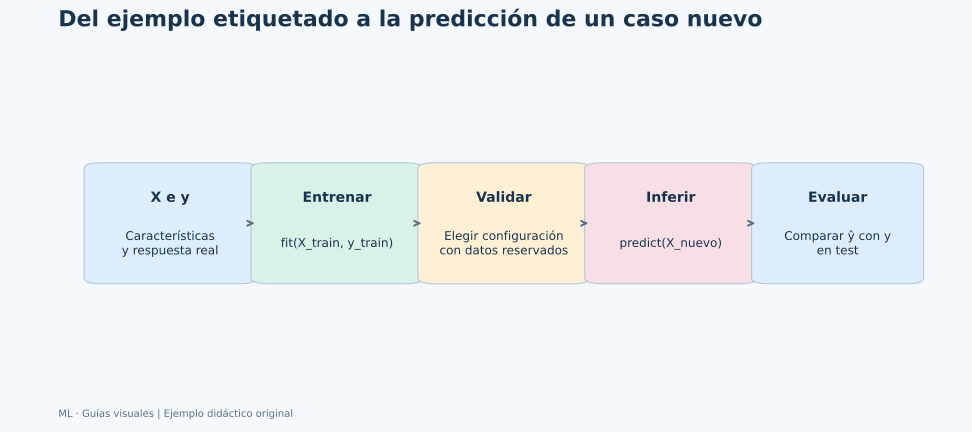
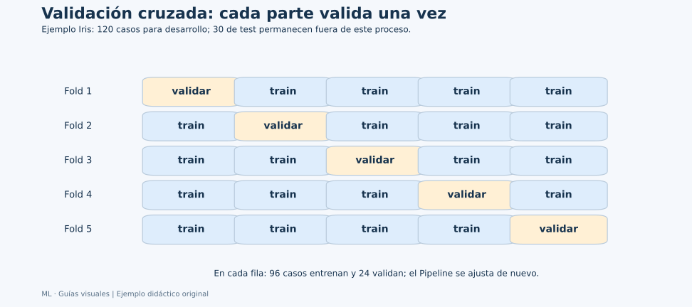
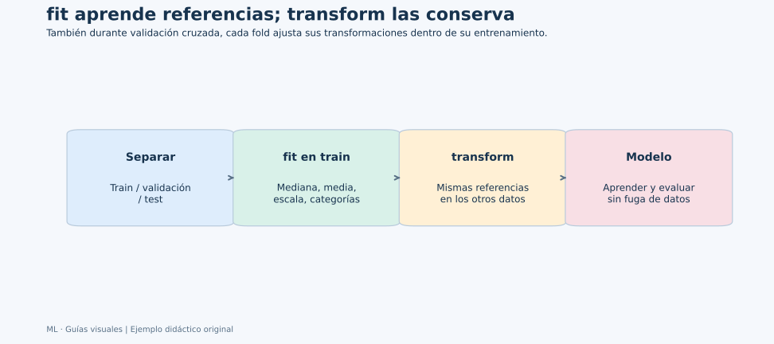
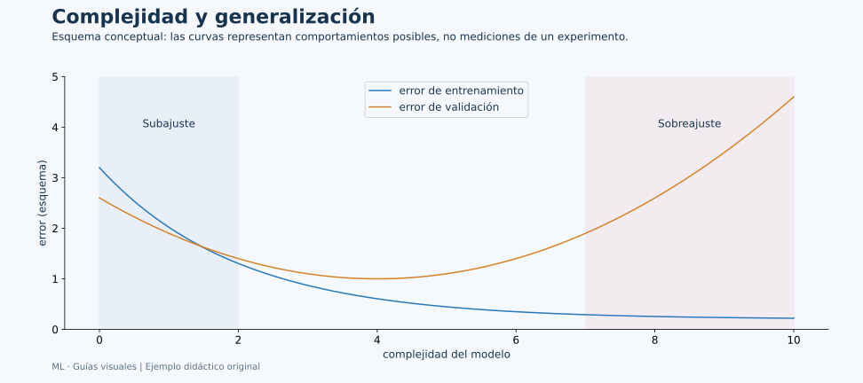

# Unidad 1: Análisis de datos basado en aprendizaje automático

## Objetivo y ruta

Esta unidad conecta los capítulos anteriores con un flujo completo de aprendizaje supervisado. Conserva los apartados 1.1–1.5 de la presentación. Primero definimos qué aprende un modelo; después organizamos datos, preprocesamiento y evaluación. Los ejemplos son explicativos y no añaden ejercicios de autoevaluación.



**Cómo leerlo:** al entrenar tenemos características X y respuestas y. El modelo produce predicciones ŷ para entradas nuevas. Solo cuando conocemos sus respuestas reales podemos comparar y con ŷ. La validación elige configuraciones y el test estima el desempeño final del procedimiento elegido.

## 1.1. ¿Qué es el aprendizaje automático?

Un algoritmo de aprendizaje utiliza ejemplos para ajustar una relación útil para una tarea. En supervisado cada ejemplo de entrenamiento contiene una entrada y una respuesta conocida. “Supervisado” describe esa información, no que una persona corrija manualmente cada predicción durante su uso.

| Símbolo | Qué contiene | Ejemplo |
| --- | --- | --- |
| X | Matriz de características | Una fila por flor y cuatro medidas por fila |
| xᵢ | Características de un caso | Longitud y anchura de sépalo y pétalo de una flor |
| y | Respuestas conocidas | Especie de cada flor |
| yᵢ | Respuesta de un caso | La especie de la flor i |
| ŷᵢ | Predicción | Especie propuesta para ese caso |
| θ | Parámetros aprendidos | Pesos de un modelo lineal |
| Hiperparámetro | Configuración elegida durante el desarrollo | Número de vecinos k o profundidad máxima |

El índice i recorre observaciones; j suele recorrer características. Si hay n casos y d medidas por caso, X tiene forma (n,d). El objetivo tiene normalmente n entradas alineadas con esas filas. Ordenar X e y por separado destruye esa correspondencia aunque sus tamaños coincidan.

**Regresión** estima una cantidad, por ejemplo duración. **Clasificación** asigna una clase de un conjunto definido. Usar 0,1,2 para especies no convierte la tarea en regresión: esos números son códigos, no cantidades de especie.

Iris contiene tres especies y cada flor tiene una sola etiqueta: es **multiclase**. En **multietiqueta**, un caso puede tener varias etiquetas simultáneas, como una imagen marcada “exterior” y “montaña”. Algunas láminas mezclan ambos términos; aquí los distinguimos.

Entrenar ajusta el modelo con ejemplos conocidos. Inferir utiliza el modelo ajustado. Generalizar significa funcionar con nuevos casos pertinentes para el uso. Una buena puntuación sobre los mismos ejemplos usados para aprender aporta información sobre ajuste, pero evidencia limitada sobre generalización.

## 1.2. Biblioteca Python scikit-learn

scikit-learn organiza muchos métodos mediante una interfaz común. Un **estimador** es un objeto que puede ajustarse; un **transformador** cambia la representación de entradas; un **predictor** produce respuestas.

| Método | Qué hace | Ejemplo |
| --- | --- | --- |
| fit(X,y) | Aprende parámetros de un predictor | Ajustar un clasificador con flores etiquetadas |
| fit(X) | Aprende referencias de un transformador | Media y desviación de un escalador |
| transform(X) | Aplica una transformación aprendida | Expresar nuevas medidas en la escala de train |
| fit_transform(X) | Aprende y transforma | Preparar entrenamiento |
| predict(X) | Produce respuestas | Una clase por flor |
| predict_proba(X) | Estima probabilidades cuando el método lo permite | Una columna por clase |
| score(X,y) | Calcula la medida predeterminada del estimador | Habitualmente accuracy en clasificadores y R² en regresores |

No todos los objetos implementan todos los métodos. Un escalador no predice una especie. SVC no ofrece predict_proba por defecto. El significado de score depende del estimador; no debe llamarse siempre “porcentaje de aciertos”.

Un Pipeline encadena transformaciones y un predictor. Al ejecutar fit, ajusta las transformaciones con esos datos y después el predictor. Al ejecutar predict, reutiliza las transformaciones y produce respuestas. Esta unidad usa esa estructura para que el escalado forme parte del procedimiento evaluado.

Los imports del ejemplo completo se reúnen al principio:

```python
import pandas as pd
from sklearn.datasets import load_iris
from sklearn.impute import SimpleImputer
from sklearn.linear_model import LogisticRegression
from sklearn.metrics import accuracy_score, classification_report
from sklearn.model_selection import GridSearchCV, StratifiedKFold, train_test_split
from sklearn.pipeline import Pipeline
from sklearn.preprocessing import StandardScaler
```

Los bloques de Python de esta guía se ejecutan en orden en un notebook de trabajo. El dataset Iris viene con scikit-learn y este ejemplo no requiere descargar archivos.

## 1.3. Preparación y división del conjunto de datos

Primero definimos qué constituye un caso y qué estará disponible al predecir. Después separamos los datos para no evaluar decisiones sobre los mismos casos que las determinaron.

- **Entrenamiento:** ajusta parámetros.
- **Validación:** compara algoritmos o hiperparámetros.
- **Test:** se reserva para evaluar al final el procedimiento elegido.

Un reparto aleatorio es adecuado para el ejemplo de flores. En series temporales hay que respetar el tiempo; si una persona aparece varias veces, puede ser necesario separar por persona para evitar que el mismo individuo aparezca en desarrollo y evaluación.

**Estratificar** procura conservar proporciones de clases. No elimina sesgos de muestreo ni arregla una definición equivocada de la tarea. **random_state=42** permite reproducir el reparto; no garantiza que sea el único reparto representativo.

```python
iris = load_iris(as_frame=True)
X = iris.data
y = iris.target

X_train, X_test, y_train, y_test = train_test_split(
    X, y, test_size=0.20, stratify=y, random_state=42
)
print("Entrenamiento:", X_train.shape, "Test:", X_test.shape)
print(y_train.value_counts().sort_index())
```

Se obtienen 120 casos para desarrollo y 30 para test. En entrenamiento hay 40 de cada clase; en test, 10 de cada una. Esas proporciones corresponden a este dataset equilibrado y este reparto.

### Validación cruzada

En validación cruzada dividimos los datos de desarrollo en k partes. Cada vez entrenamos con k−1 y validamos con la restante. Agregamos los resultados para comparar configuraciones. Los modelos se ajustan de nuevo en cada vuelta.



Con 120 casos y cinco folds, cada vuelta usa 96 para entrenar y 24 para validar. Los 30 de test no participan. Una media de cinco puntuaciones resume desempeño en esas particiones; su dispersión muestra variación entre ellas. La desviación entre folds no es automáticamente un intervalo de confianza de la generalización.

## 1.4. Preprocesamiento para construir entrenamiento útil

La limpieza revisa unidades, tipos, duplicados, ausencias y datos imposibles. No existe una instrucción universal de borrar cualquier fila con un nulo o cualquier punto exterior del boxplot.

Una regla de formato conocida, como convertir metros a kilómetros, no necesita aprender una media. Una imputación por mediana, una selección basada en correlaciones o un escalado sí utiliza información del conjunto. Esas decisiones deben aprenderse dentro de entrenamiento.



En el ejemplo, SimpleImputer aprende medianas; StandardScaler aprende centro y escala; LogisticRegression aprende coeficientes. Iris no contiene nulos, pero mantener el imputador hace explícito dónde iría ese tratamiento si fuera necesario. No se está rellenando información inexistente en este dataset.

**Fuga de información** significa usar información indebida durante el desarrollo. Escalar toda X antes de separar filtra al modelo información del test. Ajustar un escalador una sola vez antes de validación cruzada filtra información entre folds. Incluir una columna derivada del objetivo puede revelar la respuesta directamente.

## 1.5. Ejemplo explicado de selección y evaluación

La elección de C controla la intensidad de regularización de la regresión logística: valores menores implican mayor regularización en este estimador. Aquí comparamos tres alternativas usando solo desarrollo.

```python
pipeline = Pipeline([
    ("imputar", SimpleImputer(strategy="median")),
    ("escalar", StandardScaler()),
    ("modelo", LogisticRegression(max_iter=2000, random_state=42)),
])
cv = StratifiedKFold(n_splits=5, shuffle=True, random_state=42)
search = GridSearchCV(
    pipeline,
    param_grid={"modelo__C": [0.1, 1.0, 10.0]},
    scoring="accuracy",
    cv=cv,
)
search.fit(X_train, y_train)

print("Configuración seleccionada:", search.best_params_)
print("Accuracy media en validación:", round(search.best_score_, 3))
final_model = search.best_estimator_
predictions = final_model.predict(X_test)
print("Accuracy en test:", round(accuracy_score(y_test, predictions), 3))
print(classification_report(
    y_test, predictions, target_names=iris.target_names, zero_division=0
))
print(pd.DataFrame({
    "real": y_test.to_numpy(),
    "prediccion": predictions,
}).head())
```

**Lectura del código:** modelo__C identifica el parámetro C del paso modelo. GridSearchCV crea ajustes separados para las configuraciones y folds. Con refit=True, su valor predeterminado, vuelve a ajustar la configuración seleccionada sobre los 120 casos de desarrollo. El objeto final_model ya está ajustado y se utiliza sobre los 30 reservados.

El promedio de validación y el resultado de test son números distintos porque representan particiones y funciones diferentes. Si cambiamos repetidamente C después de mirar el test, deja de ser una evaluación final independiente. Para seguir mejorando, las decisiones vuelven a desarrollo.



En la zona de subajuste el modelo no captura suficiente estructura. Al aumentar capacidad puede mejorar. Si después se ajusta a detalles particulares, entrenamiento sigue mejorando mientras validación empeora. La figura es conceptual: no son puntuaciones del código anterior ni una garantía de que todas las curvas tengan esa forma.

### Resultado comprobado del ejemplo

Con las versiones instaladas en el proyecto, la búsqueda seleccionó C=10. La exactitud media de validación fue aproximadamente 0.967 y el test obtuvo 30 aciertos de 30. Ese 1.0 describe solo esos 30 casos: no demuestra que el sistema acierte cualquier flor futura. El reporte muestra 10 ejemplos por especie y permite comprobar qué grupos se evaluaron.

## Conexión con las siguientes unidades

El flujo de evaluación se conserva cuando cambia el algoritmo. La unidad 2 modifica la salida para predecir cantidades; la 3 explica probabilidades y clasificación; las posteriores cambian el mecanismo de predicción. Comparar modelos requiere mantener una pregunta, datos y evaluación coherentes.

## Fuentes y alcance

[Recursos del capítulo 5 en Canvas](https://udem.instructure.com/courses/36648/pages/recursos-didacticos-del-capitulo-5-2?module_item_id=5019830), unidad 1, diapositivas 4–91. Se consultaron el índice y secciones de desarrollo; los ejemplos, diagramas y explicaciones son originales, no una transcripción ni soluciones de las actividades oficiales.

Referencias para la implementación: [Pipeline](https://scikit-learn.org/stable/modules/compose.html), [validación cruzada](https://scikit-learn.org/stable/modules/cross_validation.html), [GridSearchCV](https://scikit-learn.org/stable/modules/generated/sklearn.model_selection.GridSearchCV.html) y [fuga de información](https://scikit-learn.org/stable/common_pitfalls.html#data-leakage).
