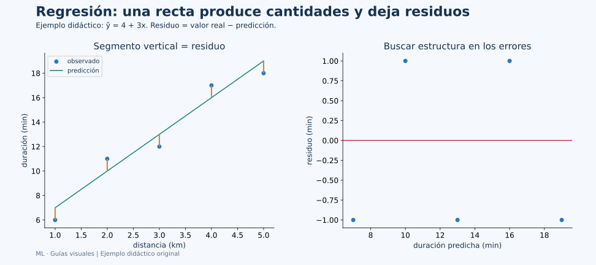

# Unidad 2: Modelos para predicción numérica

## Objetivo y ruta

Comprenderás qué ajusta una regresión, cómo se interpretan sus coeficientes y cómo se diagnostican sus errores. Los apartados 2.1–2.5 siguen la presentación. La salida es una cantidad; en los ejemplos principales, una duración en minutos.



**Panel izquierdo:** cada punto es una observación, la línea es una regla de predicción y el segmento vertical muestra su diferencia. **Panel derecho:** esa diferencia se coloca en el eje vertical para investigar si los errores conservan un patrón.

## 2.1. Entrenamiento y prueba

Entrenar una regresión significa encontrar parámetros que hagan pequeñas ciertas diferencias entre respuestas observadas y predichas. Evaluar significa calcular esas diferencias en casos que no determinaron el ajuste.

Una referencia inicial o **baseline** permite interpretar el esfuerzo. Un modelo que siempre predice la media de entrenamiento es sencillo, pero puede ser difícil de mejorar si las entradas aportan poca señal. En una evaluación de error cuadrático, esa media es la mejor constante ajustada sobre entrenamiento. Para error absoluto, la mediana es la constante que minimiza ese criterio.

La elección de la métrica expresa qué consideramos un error costoso. No es equivalente minimizar errores absolutos a penalizar sus cuadrados: estos últimos dan mucho más peso a diferencias grandes.

Imports del ejemplo reproducible, reunidos antes de su ejecución:

```python
import matplotlib.pyplot as plt
import numpy as np
import pandas as pd
from sklearn.dummy import DummyRegressor
from sklearn.linear_model import Ridge
from sklearn.metrics import mean_absolute_error, r2_score, root_mean_squared_error
from sklearn.model_selection import GridSearchCV, KFold, train_test_split
from sklearn.pipeline import Pipeline
from sklearn.preprocessing import StandardScaler
```

## 2.2. Fundamentos de regresión lineal

En una regresión con una característica:

$$
\hat y=b+wx
$$

b es el intercepto: la predicción cuando x=0. w es la pendiente: cuánto cambia la predicción por cada unidad adicional de x. Si x está en kilómetros y ŷ en minutos, w se expresa en minutos por kilómetro.

Para la regla didáctica ŷ=4+3x, un recorrido de 3 km tiene predicción 13 minutos. El 4 es un tiempo base y el 3 añade minutos por kilómetro. Interpretar el intercepto solo resulta útil si x=0 tiene sentido en el contexto y el modelo es razonable allí.

### De una característica a varias

$$
\hat y_i=b+\sum_{j=1}^{d}w_j x_{ij}
$$

i identifica un caso y j una característica. Una fila se combina con los mismos pesos que las demás. En forma matricial, ŷ=Xw+b. Con distancia y paradas podríamos usar ŷ=2+4×distancia+1.5×paradas.

En regresión múltiple, un coeficiente describe el cambio de la predicción al aumentar esa variable manteniendo las otras fijas. No demuestra causalidad. Si las variables se mueven juntas, esa interpretación puede ser inestable o corresponder a combinaciones poco habituales en los datos.

### Qué minimizan los mínimos cuadrados

Una función de pérdida habitual es:

$$
J(w,b)=\frac1n\sum_{i=1}^{n}(y_i-\hat y_i)^2
$$

Primero predecimos, después restamos, elevamos al cuadrado y promediamos. El cuadrado evita que errores de signos opuestos se cancelen, aunque también aumenta la influencia de errores grandes.

| Distancia | Duración observada | Predicción 4+3x | Residuo y−ŷ |
| --- | ---: | ---: | ---: |
| 1 km | 6 min | 7 min | −1 min |
| 2 km | 11 min | 10 min | +1 min |
| 3 km | 12 min | 13 min | −1 min |
| 4 km | 17 min | 16 min | +1 min |
| 5 km | 18 min | 19 min | −1 min |

La regla fue elegida para explicar la cuenta, no ajustada a esos cinco puntos. Los residuos positivos indican subestimación; los negativos, sobreestimación. Aquí el error absoluto medio y el error cuadrático medio valen 1; el RMSE también vale 1 minuto.

Para aprender parámetros hay métodos de álgebra lineal y métodos iterativos. El descenso por gradiente utiliza derivadas de la pérdida para actualizar pesos; una implementación de mínimos cuadrados no tiene que utilizar necesariamente ese algoritmo.

## 2.3. Diagnóstico de regresión lineal

### Métricas de error y sus unidades

$$
MAE=\frac1n\sum_i|y_i-\hat y_i|,\qquad
MSE=\frac1n\sum_i(y_i-\hat y_i)^2,\qquad
RMSE=\sqrt{MSE}
$$

MAE y RMSE conservan las unidades de y. MSE tiene unidades al cuadrado. Menor valor implica menor error según cada criterio, al comparar sobre los mismos casos.

Para errores de magnitud [1,1,10], MAE=4, MSE=34 y RMSE≈5.831. El error grande pesa especialmente en RMSE. Elegir una medida depende de si esa penalización corresponde al problema.

**MAPE** promedia errores relativos absolutos. Se interpreta en relación con la magnitud del objetivo, pero un valor real cero hace problemática la división y valores cercanos a cero pueden dominar el resultado. Las bibliotecas pueden introducir convenciones numéricas; eso no elimina la dificultad conceptual. No debe aplicarse automáticamente a cualquier objetivo.

### R² y la comparación con una referencia

$$
R^2=1-\frac{\sum_i(y_i-\hat y_i)^2}{\sum_i(y_i-\bar y)^2}
$$

En esta fórmula, ȳ es la media de los valores reales del conjunto evaluado. R²=1 representa predicciones perfectas. R²=0 corresponde al error cuadrático de esa referencia constante; puede ser negativo cuando el error es mayor. No es porcentaje de aciertos ni tiene siempre que estar entre 0 y 1. Si todos los valores reales son iguales, el denominador se anula y hacen falta convenciones especiales.

Una predicción puede tener correlación alta con y y estar sistemáticamente desplazada. Por ejemplo, ŷ=y+10 conserva correlación perfecta cuando y varía, pero se equivoca en 10 unidades en cada caso. La correlación no sustituye una métrica de error.

### Qué buscar en los residuos

- Una curva puede indicar estructura no capturada por la relación lineal.
- Un abanico puede indicar variabilidad del error que cambia con la predicción.
- Un patrón temporal puede revelar dependencia.
- Un punto muy alejado puede influir en el ajuste o señalar un caso diferente.

**Apalancamiento** describe posiciones poco habituales en las entradas X; un residuo grande describe desacuerdo en y. Un caso influyente modifica apreciablemente el ajuste al retirarlo. Son conceptos relacionados, pero diferentes.

Para inferencia clásica sobre coeficientes se necesitan supuestos adicionales del modelo y del diseño. La prueba **t** contrasta un coeficiente respecto de una referencia; la **F** compara modelos anidados o contrasta el aporte conjunto de ciertos coeficientes. Significación estadística no garantiza buen desempeño fuera de muestra.

El **VIF** investiga cuánto se relaciona linealmente un predictor con los otros: VIFⱼ=1/(1−Rⱼ²). Un valor alto puede señalar inestabilidad en estimaciones de coeficientes. No decide por sí solo qué variable borrar.

**AIC y BIC** combinan ajuste y penalización por complejidad bajo un modelo probabilístico. Sirven para comparar modelos compatibles ajustados sobre la misma respuesta y datos; valores menores son preferibles dentro de esa comparación. No son porcentajes ni sustituyen automáticamente la validación predictiva. scikit-learn se centra aquí en predicción y no entrega por defecto todas las pruebas inferenciales de una regresión clásica.

## 2.4. Otros tipos de regresión

### Regularización: Ridge, Lasso y Elastic Net

La regularización introduce preferencias sobre los coeficientes:

| Método | Penalización conceptual sobre pesos | Efecto habitual |
| --- | --- | --- |
| Ridge | λ Σwⱼ², norma L2 al cuadrado | Reduce magnitudes y estabiliza ajustes |
| Lasso | λ Σ abs(wⱼ), norma L1 | Puede dejar algunos coeficientes exactamente en cero |
| Elastic Net | Combinación de L1 y L2 | Combina reducción y selección de coeficientes |

El tamaño exacto de λ depende de la normalización utilizada por cada estimador. En Ridge y Lasso de scikit-learn se configura mediante alpha. No confundas ese alpha con el nivel de significación de una prueba de hipótesis.

**Corrección del material:** Lasso sí puede generar coeficientes cero. Ridge no es, en general, un mecanismo de selección de variables por ceros exactos, aunque pueden darse ceros en casos particulares. Aumentar la penalización puede reducir variación y también producir subajuste.

La penalización compara pesos, cuyas magnitudes dependen de las unidades. Por eso normalmente escalamos las características numéricas dentro del Pipeline. La elección de intensidad se hace con validación.

### Regresión polinómica y sesgo–varianza

Añadir x² o x³ permite curvas manteniendo una combinación lineal de coeficientes. “Lineal” puede referirse a los parámetros aunque la curva respecto a x no sea recta. Un grado muy alto puede ajustar ruido y extrapolar de forma poco razonable.

En la descomposición clásica del error cuadrático aparecen **sesgo al cuadrado, varianza y ruido irreducible**, bajo sus supuestos. No todo error puede eliminarse añadiendo complejidad. Las curvas de validación ayudan a estudiar ese equilibrio empíricamente.

## 2.5. Ejemplo completo y lectura del resultado

Creamos observaciones simuladas con una relación conocida y ruido. Conocer la regla generadora ayuda a comprender el ejemplo; el modelo solo recibe los casos de entrenamiento.

```python
rng = np.random.default_rng(42)
distance = rng.uniform(0, 10, size=120)
X = pd.DataFrame({"distance_km": distance})
y = 4 + 3 * distance + rng.normal(0, 2, size=120)

X_train, X_test, y_train, y_test = train_test_split(
    X, y, test_size=0.20, random_state=42
)
pipeline = Pipeline([
    ("escalar", StandardScaler()),
    ("modelo", Ridge()),
])
cv = KFold(n_splits=5, shuffle=True, random_state=42)
search = GridSearchCV(
    pipeline,
    {"modelo__alpha": [0.01, 0.1, 1.0, 10.0]},
    scoring="neg_root_mean_squared_error",
    cv=cv,
)
search.fit(X_train, y_train)
baseline = DummyRegressor(strategy="mean").fit(X_train, y_train)
pred = search.predict(X_test)
baseline_pred = baseline.predict(X_test)

print("Alpha elegido:", search.best_params_)
print("RMSE media de validación:", -search.best_score_)
print("MAE test:", mean_absolute_error(y_test, pred))
print("RMSE test:", root_mean_squared_error(y_test, pred))
print("R² test:", r2_score(y_test, pred))
print("RMSE baseline:", root_mean_squared_error(y_test, baseline_pred))

fig, ax = plt.subplots()
ax.scatter(pred, y_test - pred)
ax.axhline(0, color="black", linestyle="--")
ax.set(xlabel="Duración predicha (min)", ylabel="Residuo (min)",
       title="Residuos en los casos reservados")
fig.tight_layout()
plt.show()
```

GridSearchCV maximiza sus puntuaciones. Por eso el criterio utiliza el **negativo del RMSE**: una puntuación menos negativa representa menor error. Al imprimirlo cambiamos el signo para volver a minutos positivos.

Los coeficientes del Ridge están expresados sobre características estandarizadas, no directamente en minutos por kilómetro. Para predecir un caso nuevo, pasa sus medidas originales al Pipeline: el escalador ya conserva su referencia.

El baseline se ajusta con la media de train. El test permite comparar su error con el del modelo elegido, sin buscar después otra configuración guiada por ese test. Este ejemplo muestra un procedimiento, no evidencia sobre recorridos reales ni garantía de rendimiento para otros datos.

### Resultado comprobado del ejemplo

| Resultado | Valor aproximado | Lectura |
| --- | ---: | --- |
| alpha seleccionado | 0.1 | Elección realizada con desarrollo |
| RMSE de validación | 2.066 min | Promedio entre los folds |
| MAE de test | 1.664 min | Magnitud media de errores absolutos |
| RMSE de test | 2.039 min | Error con mayor peso de diferencias grandes |
| R² de test | 0.949 | Comparación cuadrática con la referencia de la fórmula |
| RMSE del baseline | 9.239 min | Error de predecir la media de train |

En estos datos simulados, la distancia aporta información frente a esa constante. La comparación no demuestra causalidad en datos observacionales ni traslada estas cifras a transporte real.

## Conexión de las ideas

Una regresión aprende cantidades y se entiende mediante sus entradas, coeficientes, residuos y evaluación. Un ajuste interpretable puede ser útil, pero explicar coeficientes requiere atender escalas y relaciones entre variables. La siguiente unidad cambia la salida a clases y probabilidades.

## Fuentes

[Recursos de Canvas](https://udem.instructure.com/courses/36648/pages/recursos-didacticos-del-capitulo-5-2?module_item_id=5019830), unidad 2, diapositivas 92–139. Desarrollo original con correcciones y ejemplos didácticos.

Referencias técnicas: [mínimos cuadrados](https://scikit-learn.org/stable/modules/linear_model.html#ordinary-least-squares), [Ridge](https://scikit-learn.org/stable/modules/generated/sklearn.linear_model.Ridge.html), [Lasso](https://scikit-learn.org/stable/modules/generated/sklearn.linear_model.Lasso.html), [métricas de regresión](https://scikit-learn.org/stable/modules/model_evaluation.html#regression-metrics) y [diagnósticos de regresión del NIST](https://www.itl.nist.gov/div898/handbook/pmd/section4/pmd44.htm).
