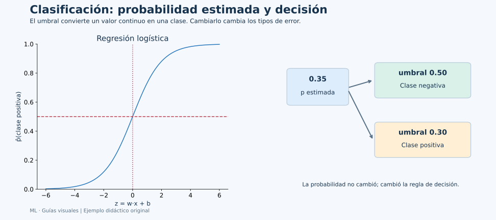
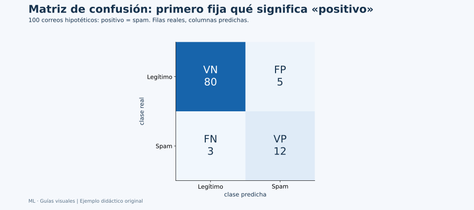
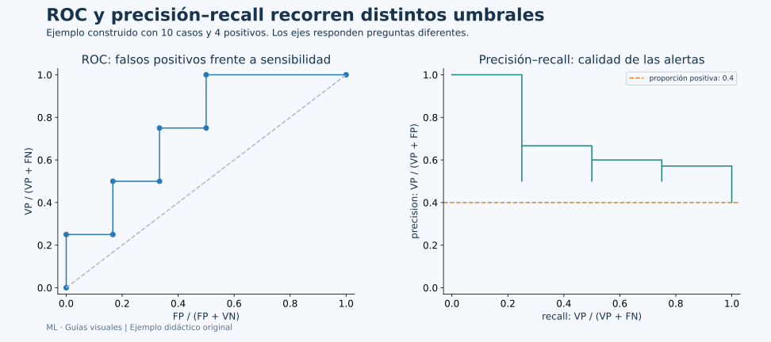

# Unidad 3: Modelos para clasificación

## Objetivo y ruta

Conservarás el flujo de evaluación de la unidad 1 y cambiarás el significado de la salida: ahora son clases. Los apartados 3.1–3.3 desarrollan regresión logística, probabilidades, umbrales y métricas. La palabra “regresión” en regresión logística no cambia su uso como clasificador.



**Cómo leerlo:** primero el modelo calcula un valor continuo entre 0 y 1; después una regla de umbral lo convierte en una decisión. Una estimación de 0.35 se clasifica como negativa con umbral 0.50 y como positiva con umbral 0.30. Cambió la decisión, no la estimación.

## 3.1. Entrenamiento y pruebas en clasificación

Define qué significa cada clase y, en una tarea binaria, cuál será la **positiva**. “Positivo” significa el evento de interés, no algo necesariamente bueno. En un filtro, podemos definir positivo=spam.

La **exactitud, accuracy**, es la proporción total de aciertos. En español “precisión” se usa a veces como traducción de accuracy, pero la métrica **precision** tiene otro denominador. Aquí diremos exactitud para accuracy y precisión positiva para precision.

Con 99 casos negativos y uno positivo, predecir siempre negativo obtiene 99 % de exactitud y detecta cero positivos. El resultado es aritméticamente correcto y puede ser inadecuado para el objetivo. Para comprenderlo necesitamos separar tipos de error.

Al repartir los datos, estratificar conserva aproximadamente proporciones de clases. Esto ayuda a evaluar cada clase, pero no sustituye suficiente información ni el respeto a grupos y tiempo. El mismo principio de no tocar test durante la elección de configuraciones sigue vigente.

## 3.2. Conceptos básicos de regresión logística

### De una suma ponderada a una probabilidad

Primero calculamos:

$$
z=b+\sum_{j=1}^{d}w_jx_j
$$

Después aplicamos la logística:

$$
\hat p=P_{\mathrm{modelo}}(Y=1\mid x)=\frac{1}{1+e^{-z}}
$$

z puede ser cualquier número real. La logística transforma ese número a (0,1). Para z=0 obtenemos 0.5; para z=2, aproximadamente 0.881; para z=−2, aproximadamente 0.119.

El valor ŷ de una regresión numérica y la probabilidad p̂ de un clasificador son objetos diferentes. Al elegir una clase mediante umbral t:

$$
\hat y=
\begin{cases}
1 & \hat p\ge t\\
0 & \hat p<t
\end{cases}
$$

La igualdad se define aquí como parte de la regla didáctica. Las convenciones exactas de desempate pueden variar entre implementaciones.

### Odds y log-odds

Las **odds** son p/(1−p), una razón entre probabilidad de ocurrir y de no ocurrir. Si p=0.8, las odds son 4; si p=0.5, son 1. No son la misma cantidad que p.

En el modelo logístico:

$$
\log\frac{p}{1-p}=b+\sum_jw_jx_j
$$

Un aumento de una unidad en xⱼ, manteniendo las otras entradas fijas, cambia el logaritmo de las odds en wⱼ y multiplica las odds por eʷʲ. No aumenta la probabilidad en una cantidad constante. Si se estandarizó xⱼ, esa “unidad” corresponde a una unidad de la variable transformada.

### Cómo se entrena

Para etiquetas yᵢ en {0,1}, una pérdida habitual es:

$$
L=-\frac1n\sum_i\left[y_i\log(\hat p_i)+(1-y_i)\log(1-\hat p_i)\right]
$$

Si el caso real es positivo, predicciones muy cercanas a cero reciben mucha penalización. Si es negativo, ocurre lo contrario. El modelo ajusta pesos para reducir esa pérdida, normalmente junto con regularización. Las bibliotecas utilizan procedimientos numéricos adecuados para trabajar con probabilidades extremas.

Una probabilidad calculada no está automáticamente bien **calibrada**. Si muchos casos reciben 0.8, una calibración razonable implica que aproximadamente 80 % de esos casos sean positivos en condiciones comparables. Ordenar bien los casos, estimar probabilidades fiables y elegir un buen umbral son objetivos relacionados pero distintos.

### Multiclase

Para más de dos clases, una formulación multinomial usa softmax: transforma un puntaje por clase en probabilidades que suman 1. Otra estrategia es entrenar decisiones una-contra-el-resto. Una fila con probabilidades [0.1,0.7,0.2] propone la segunda clase por ser la más probable; no significa que esa etiqueta tenga valor numérico 0.7.

## 3.3. Métricas de rendimiento

### Matriz de confusión: cuatro celdas, cuatro significados



El ejemplo tiene 100 correos: 85 legítimos y 15 spam. Las filas son reales y las columnas predichas; otras presentaciones invierten esos ejes, por lo que hay que leer sus etiquetas.

| Celda | Qué sucedió | Conteo |
| --- | --- | ---: |
| VP | Spam detectado como spam | 12 |
| FN | Spam que pasó como legítimo | 3 |
| FP | Correo legítimo marcado como spam | 5 |
| VN | Correo legítimo conservado como legítimo | 80 |

Un falso positivo y un falso negativo afectan procesos diferentes. Definir el evento positivo permite interpretar ambos sin memorizar una posición de la tabla.

### Los denominadores explican cada métrica

$$
\mathrm{accuracy}=\frac{VP+VN}{VP+VN+FP+FN}
$$

$$
\mathrm{precision}=\frac{VP}{VP+FP},\qquad
\mathrm{recall}=\frac{VP}{VP+FN},\qquad
\mathrm{especificidad}=\frac{VN}{VN+FP}
$$

| Métrica | Pregunta | Cuenta en el ejemplo |
| --- | --- | --- |
| Exactitud | De todos los correos, cuántos se clasificaron bien | 92/100=0.92 |
| Precisión positiva | De las alertas de spam, cuántas eran spam | 12/17≈0.706 |
| Recall o sensibilidad | Del spam real, cuánto detectamos | 12/15=0.80 |
| Especificidad | Del correo legítimo, cuánto conservamos | 80/85≈0.941 |
| Tasa de falsos positivos | Del correo legítimo, cuánto marcamos por error | 5/85≈0.059 |

F1 es la media armónica de precisión y recall:

$$
F1=\frac{2\,\mathrm{precision}\,\mathrm{recall}}
{\mathrm{precision}+\mathrm{recall}}
=\frac{2VP}{2VP+FP+FN}
$$

En el ejemplo, 24/(24+5+3)=0.75. F1 resume esos dos aspectos y no incorpora VN directamente. No es universalmente la mejor métrica. Si un denominador es cero, la interpretación exige una convención; zero_division en scikit-learn permite definirla explícitamente.

En multiclase, **macro** calcula cada clase y las promedia con igual peso; **weighted** pondera por su número de casos; **micro** agrega conteos antes de calcular. Un promedio puede ocultar resultados de una clase minoritaria, por lo que el reporte por clase sigue siendo útil.

### Cambiar el umbral y leer ROC y precisión–recall

Al bajar el umbral, más casos se predicen positivos. Sobre los mismos puntajes y casos, recall y tasa de falsos positivos no disminuyen. La precisión positiva puede subir o bajar según las etiquetas de los casos añadidos: no hay una caída estrictamente garantizada en cada paso.



La curva **ROC** coloca tasa de falsos positivos en x y sensibilidad en y. Cada punto corresponde a una regla de umbral. Su área resume capacidad de ordenar positivos por encima de negativos en el contexto evaluado; no es la exactitud de un umbral.

La curva **precisión–recall** mira calidad de las alertas frente a cobertura de los positivos. Puede ser especialmente informativa cuando el evento positivo es poco frecuente. La proporción de positivos ayuda a interpretar la referencia. Average precision y el área calculada por integración de una curva interpolada no son necesariamente idénticas.

Para dibujar estas curvas se usan **puntajes o probabilidades**, no solo etiquetas finales. Elegir un umbral por su curva de test vuelve a utilizar el test para decidir. El umbral debe elegirse con datos de desarrollo y evaluarse después.

### Ejemplo reproducible de principio a fin

Usamos Iris como problema binario: positivo significa virginica; negativo reúne las otras dos especies. Es una demostración educativa de métricas, no una regla botánica universal.

```python
import pandas as pd
from sklearn.datasets import load_iris
from sklearn.linear_model import LogisticRegression
from sklearn.metrics import (
    accuracy_score, average_precision_score, confusion_matrix,
    f1_score, precision_score, recall_score, roc_auc_score,
)
from sklearn.model_selection import GridSearchCV, StratifiedKFold, train_test_split
from sklearn.pipeline import Pipeline
from sklearn.preprocessing import StandardScaler

iris = load_iris(as_frame=True)
X = iris.data
y = (iris.target == 2).astype(int)
X_train, X_test, y_train, y_test = train_test_split(
    X, y, test_size=0.20, stratify=y, random_state=42
)
pipeline = Pipeline([
    ("escalar", StandardScaler()),
    ("modelo", LogisticRegression(max_iter=2000, random_state=42)),
])
search = GridSearchCV(
    pipeline, {"modelo__C": [0.1, 1.0, 10.0]}, scoring="f1",
    cv=StratifiedKFold(n_splits=5, shuffle=True, random_state=42),
)
search.fit(X_train, y_train)
model = search.best_estimator_
positive_column = list(model.classes_).index(1)
prob = model.predict_proba(X_test)[:, positive_column]
pred = (prob >= 0.50).astype(int)  # Umbral fijado antes de mirar test.

print("C elegido:", search.best_params_)
print("Matriz: filas reales y columnas predichas")
print(confusion_matrix(y_test, pred, labels=[0, 1]))
print("Accuracy:", accuracy_score(y_test, pred))
print("Precision:", precision_score(y_test, pred, zero_division=0))
print("Recall:", recall_score(y_test, pred, zero_division=0))
print("F1:", f1_score(y_test, pred, zero_division=0))
print("ROC AUC:", roc_auc_score(y_test, prob))
print("Average precision:", average_precision_score(y_test, prob))
print(pd.DataFrame({"real": y_test.to_numpy(), "prob": prob, "clase": pred}).head())
```

**Lectura:** classes_ indica qué clase corresponde a cada columna de predict_proba. Buscamos la columna de la clase 1 en vez de asumir silenciosamente su posición. La búsqueda de C maximiza F1 medio en desarrollo; el umbral 0.50 se fija previamente. Las métricas de test describen esos 30 casos y pueden variar con otro reparto.

Una probabilidad 0.9 y una 0.6 reciben la misma clase con ese umbral, pero contienen información de puntaje diferente. La matriz solo muestra las decisiones finales; ROC AUC y average precision utilizan ese orden de puntajes.

### Resultado comprobado del ejemplo

La ejecución seleccionó C=0.1 y produjo la matriz [[19,1],[2,8]]: VN=19, FP=1, FN=2 y VP=8. Es una matriz diferente del ejemplo didáctico de correos porque son otros datos; la lectura de los denominadores es la misma.

La exactitud fue 27/30=0.9; la precisión positiva, 8/9≈0.889; el recall, 8/10=0.8; y F1, 16/19≈0.842. ROC AUC fue 0.98 y average precision aproximadamente 0.962. Un buen orden de puntajes puede coexistir con errores del umbral elegido; por eso AUC y exactitud no son la misma medida.

## Conexión de las ideas

Un clasificador combina **representación, puntaje o probabilidad, regla de decisión y evaluación**. Entender qué cambió en cada etapa permite explicar por qué mejora una métrica mientras otra empeora. Elegir depende de la tarea y de los tipos de error, no de una cifra aislada.

## Fuentes

[Recursos de Canvas](https://udem.instructure.com/courses/36648/pages/recursos-didacticos-del-capitulo-5-2?module_item_id=5019830), unidad 3, diapositivas 140–189. Las cuentas y los diagramas son originales. Se aclaran la orientación de matrices, accuracy frente a precision y el efecto del umbral.

Referencias técnicas: [regresión logística](https://scikit-learn.org/stable/modules/linear_model.html#logistic-regression), [métricas de clasificación](https://scikit-learn.org/stable/modules/model_evaluation.html#classification-metrics), [ajuste del umbral](https://scikit-learn.org/stable/modules/classification_threshold.html) y [calibración de probabilidades](https://scikit-learn.org/stable/modules/calibration.html).
