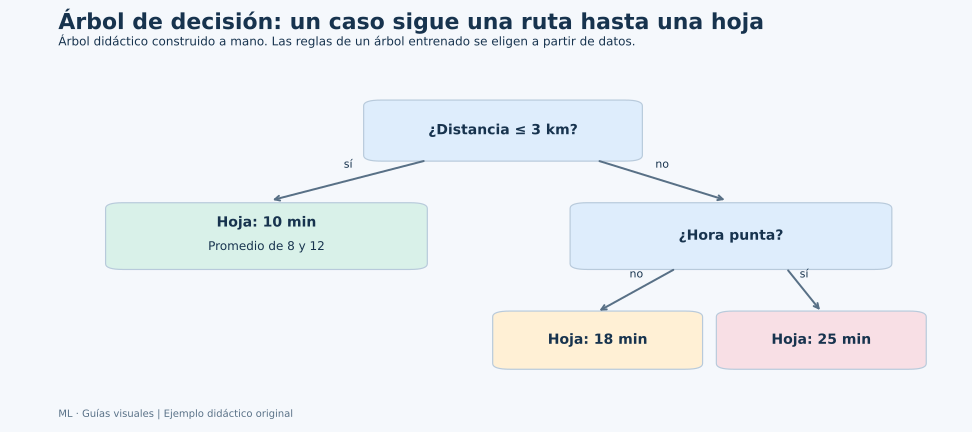
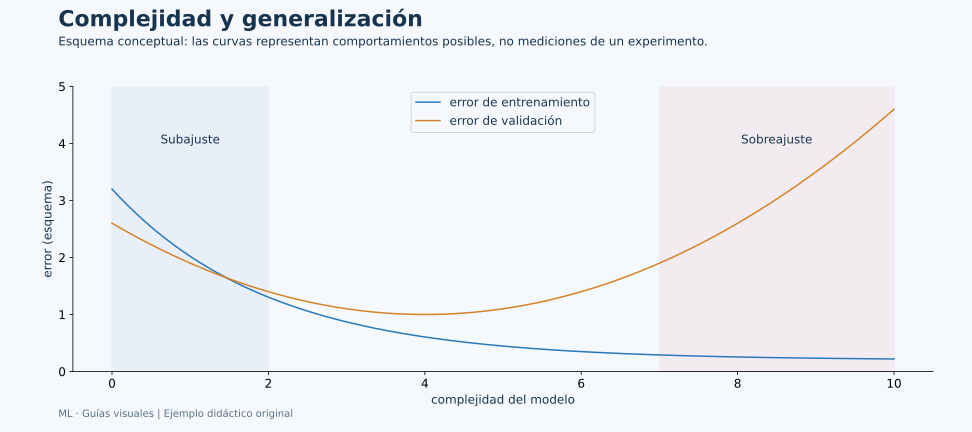

# Unidad 4: Árboles de decisión

## Objetivo y ruta

Entenderás cómo un árbol aprende preguntas, divide observaciones y produce una salida en una hoja. Se conserva el apartado 4.1 de la presentación, desarrollado en pasos. Los árboles sirven para clasificación y regresión; no necesitan una recta o una curva logística para representar el patrón.

## 4.1. Algoritmo de árbol

### Raíz, nodo, rama y hoja

Un árbol toma decisiones mediante una secuencia de reglas. La **raíz** es la primera pregunta. Un **nodo interno** hace otra pregunta. Una **rama** indica el resultado de esa pregunta. Una **hoja** termina el recorrido y produce una predicción.



**Lectura de un caso:** para distancia de 2 km, la primera condición se cumple y llegamos a la hoja de 10 minutos. Para 5 km no se cumple; si además es hora punta, la siguiente condición lleva a 25 minutos. No se recorren todas las hojas: un caso sigue una ruta.

El dibujo fue construido para explicar el procedimiento y es un árbol de regresión. En un árbol entrenado, las variables y umbrales se eligen utilizando los datos de entrenamiento. El objetivo y no se pregunta durante la inferencia: las condiciones usan características disponibles.

### Qué aprende una división

En una característica numérica, el algoritmo considera reglas como xⱼ≤umbral. Cada regla divide las filas del nodo en dos grupos. Una división conveniente deja grupos más homogéneos respecto del objetivo.

Para clasificación, **homogeneidad** significa que predominan ciertas clases; para regresión, que las respuestas se parecen según el criterio de error. El algoritmo busca mejorar un criterio, no entender causalmente la pregunta.

En los árboles CART habituales de scikit-learn las divisiones son binarias. Cada paso elige una mejora local y repite el proceso en los grupos. Este procedimiento **voraz** no garantiza encontrar el mejor árbol posible entre todas las estructuras.

### Gini: medir mezcla de clases

Si en un nodo las proporciones de clase son p₁,…,pₖ:

$$
G=1-\sum_{c=1}^{k}p_c^2
$$

Un nodo con una sola clase tiene G=0: está puro. Si hay dos clases a mitades, G=1−0.5²−0.5²=0.5. En más clases cambia el máximo posible; 0.5 no es el máximo universal.

Supongamos ocho casos, cuatro A y cuatro B. El Gini del padre es 0.5. Comparamos dos divisiones:

| Regla candidata | Hijo izquierdo | Hijo derecho | Impureza ponderada |
| --- | --- | --- | ---: |
| Regla 1 | 4 A y 0 B | 0 A y 4 B | 0 |
| Regla 2 | 3 A y 1 B | 1 A y 3 B | 0.375 |

En la regla 2, cada hijo tiene proporciones 0.75 y 0.25, por lo que G=1−0.75²−0.25²=0.375. Como ambos contienen cuatro casos, el promedio ponderado también es 0.375. La mejora es 0.5−0.375=0.125. La regla 1 mejora 0.5 y sería preferible entre esas dos.

En general:

$$
\Delta G=G_{\mathrm{padre}}-
\left(\frac{n_L}{n}G_L+\frac{n_R}{n}G_R\right)
$$

Los pesos importan: un hijo pequeño muy puro no debería evaluarse igual que uno enorme. Aquí contamos observaciones sin pesos especiales; con sample_weight la implementación utiliza cantidades ponderadas.

### Entropía y ganancia de información

Otro criterio es:

$$
H=-\sum_{c=1}^{k}p_c\log_2(p_c)
$$

Se utiliza la convención 0 log₂0=0. Un nodo puro tiene entropía cero. Dos clases a mitades tienen un bit. La **ganancia de información** es la entropía del padre menos la entropía ponderada de los hijos.

Gini y entropía son criterios diferentes para reducir mezcla. No requieren que las características tengan una distribución normal. Elegir uno no demuestra que el modelo completo sea mejor; se evalúa con datos reservados.

### Qué predice la hoja

En **clasificación**, una hoja suele proponer la clase con mayor frecuencia ponderada de entrenamiento. Las proporciones de clase en esa hoja sirven para estimar probabilidades. Una hoja con un solo ejemplo puede dar una proporción extrema y evidencia limitada de calibración.

En **regresión con error cuadrático**, la predicción de la hoja es la media de sus respuestas. Para [8,12], la media es 10 y el error cuadrático medio dentro de la hoja es ((8−10)²+(12−10)²)/2=4. Otros criterios pueden producir resúmenes diferentes, como mediana con error absoluto.

### Complejidad, sobreajuste y poda

Un árbol puede seguir dividiendo hasta crear hojas muy pequeñas y memorizar detalles del entrenamiento. Una puntuación perfecta en train no garantiza generalización.



| Configuración | Qué controla | Efecto al restringirla |
| --- | --- | --- |
| max_depth | Profundidad máxima | Menos secuencias de preguntas |
| min_samples_split | Casos mínimos para intentar dividir | Evita dividir nodos demasiado pequeños |
| min_samples_leaf | Casos mínimos en una hoja | Evita hojas con muy poco respaldo |
| ccp_alpha | Penalización de complejidad en poda | Valores mayores favorecen árboles más pequeños |

**Prepoda** limita el crecimiento; **pospoda** simplifica un árbol utilizando un criterio de complejidad. Sus valores se comparan en desarrollo. No se poda mirando qué árbol acierta mejor en el test final.

Un árbol normalmente no necesita estandarizar variables numéricas: los umbrales se adaptan a sus unidades. Eso no elimina la necesidad de revisar calidad, categorías y el tratamiento de ausencias compatible con el estimador. Una codificación numérica arbitraria de categorías puede imponer divisiones poco adecuadas.

### Ejemplo reproducible y lectura del árbol

```python
import matplotlib.pyplot as plt
from sklearn.datasets import load_iris
from sklearn.metrics import accuracy_score
from sklearn.model_selection import GridSearchCV, StratifiedKFold, train_test_split
from sklearn.tree import DecisionTreeClassifier, export_text, plot_tree

iris = load_iris(as_frame=True)
X = iris.data
y = iris.target
X_train, X_test, y_train, y_test = train_test_split(
    X, y, test_size=0.20, stratify=y, random_state=42
)
search = GridSearchCV(
    DecisionTreeClassifier(random_state=42),
    {
        "max_depth": [2, 3, 4, None],
        "min_samples_leaf": [1, 4],
    },
    scoring="accuracy",
    cv=StratifiedKFold(n_splits=5, shuffle=True, random_state=42),
)
search.fit(X_train, y_train)
model = search.best_estimator_
print("Configuración elegida:", search.best_params_)
print("Profundidad:", model.get_depth(), "Hojas:", model.get_n_leaves())
print("Accuracy train:", accuracy_score(y_train, model.predict(X_train)))
print("Accuracy test:", accuracy_score(y_test, model.predict(X_test)))
print(export_text(model, feature_names=list(X.columns)))

fig, ax = plt.subplots(figsize=(13, 7))
plot_tree(
    model, feature_names=list(X.columns),
    class_names=list(iris.target_names),
    filled=True, rounded=True, ax=ax,
)
fig.tight_layout()
plt.show()
```

En el dibujo del árbol generado, la primera línea de un nodo interno contiene una regla. samples indica cuántos ejemplos de entrenamiento llegan allí, value muestra sus conteos por clase en esta configuración y class indica la clase propuesta. Un color intenso suele reflejar mayor predominio de una clase, según la visualización.

Una comparación entre accuracy train y test puede sugerir problemas, pero 30 casos de test ofrecen una estimación variable. No conviene declarar sobreajuste únicamente por cualquier pequeña diferencia. Examina validación, tamaños y tipos de error.

### Ventajas y límites

Los árboles expresan reglas que pueden recorrerse y capturan interacciones sin especificarlas como productos en una fórmula lineal. Un pequeño cambio en datos puede producir reglas distintas. La estructura interpretable tampoco prueba que una variable cause la respuesta.

Las importancias basadas en reducción de impureza describen cómo el árbol utilizó entradas durante el ajuste. Pueden favorecer variables con muchas opciones de división y no deberían presentarse automáticamente como explicaciones causales. La importancia por permutación en datos reservados responde una pregunta distinta sobre desempeño.

### Resultado comprobado del ejemplo

Se seleccionaron max_depth=3 y min_samples_leaf=1. El árbol ajustado tiene profundidad 3 y cinco hojas; su exactitud fue aproximadamente 0.983 en train y 0.967 en test, equivalente a 29 aciertos de 30.

La primera regla impresa es petal length (cm) <= 2.45. Si se cumple, la hoja propone clase 0, que en este dataset es setosa. La medida está expresada en centímetros, no en una escala estandarizada. El umbral fue aprendido en desarrollo y no constituye una frontera universal para cualquier población de flores.

## Conexión de las ideas

Un árbol transforma **preguntas sobre características en grupos y grupos en predicciones**. La calidad de cada división y el límite de complejidad trabajan juntos. La unidad de conjuntos retomará esta idea al combinar árboles diversos para reducir parte de su inestabilidad.

## Fuentes

[Recursos de Canvas](https://udem.instructure.com/courses/36648/pages/recursos-didacticos-del-capitulo-5-2?module_item_id=5019830), unidad 4, diapositivas 190–209. El repositorio incluye el notebook de clase de árboles en notebooks/lectures/chapter_05/; esta guía es un desarrollo independiente.

Referencias: [árboles de decisión](https://scikit-learn.org/stable/modules/tree.html), [DecisionTreeClassifier](https://scikit-learn.org/stable/modules/generated/sklearn.tree.DecisionTreeClassifier.html) y [poda por complejidad](https://scikit-learn.org/stable/auto_examples/tree/plot_cost_complexity_pruning.html).
