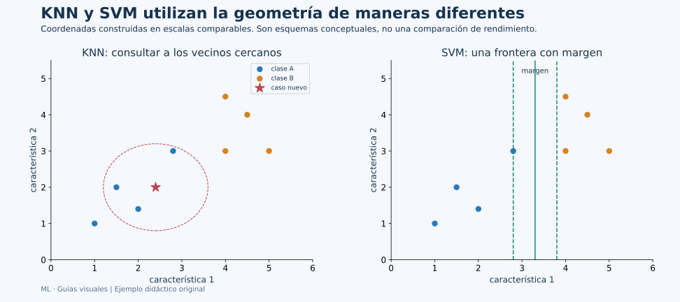
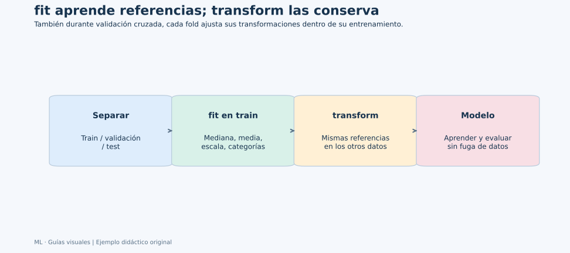

# Unidad 5: K vecinos más cercanos (KNN)

## Objetivo y ruta

Aprenderás cómo un modelo puede predecir consultando ejemplos cercanos en lugar de ajustar una ecuación global. Se conserva el apartado 5.1 de la presentación. Canvas reúne KNN y SVM en el tema 5.5; las diapositivas los desarrollan como unidades 5 y 6, y esta guía mantiene esa separación.

## 5.1. Algoritmo KNN

### Idea central: consultar casos parecidos

**KNN, k-nearest neighbors**, guarda los ejemplos de entrenamiento y, al llegar una entrada nueva, identifica k vecinos según una distancia. En clasificación combina sus clases; en regresión combina sus respuestas numéricas.



**Lee primero el panel izquierdo:** la estrella es un caso nuevo y los puntos de colores son ejemplos conocidos. El círculo ilustra una vecindad que incluye tres puntos de la clase A. Es una explicación geométrica; no una frontera entrenada ni un radio fijo para cualquier caso. En KNN el alcance necesario cambia según la densidad de ejemplos.

### Una predicción calculada a mano

Tomemos el caso nuevo q=(2,2) y estas entradas de entrenamiento:

| Caso | Coordenadas | Clase | Distancia a q |
| --- | --- | --- | ---: |
| 1 | (1,2) | A | 1 |
| 2 | (2,1) | A | 1 |
| 3 | (3,2) | B | 1 |
| 4 | (5,2) | B | 3 |
| 5 | (2,6) | B | 4 |

Con k=3, los tres vecinos más cercanos votan A,A,B y gana A. Con k=5, votan dos A y tres B: gana B. No cambió el caso nuevo; cambió la escala de la vecindad que influye en su respuesta.

La distancia euclidiana para d características es:

$$
d(x,q)=\sqrt{\sum_{j=1}^{d}(x_j-q_j)^2}
$$

Primero restamos características correspondientes, elevamos al cuadrado, sumamos y extraemos raíz. En dos dimensiones es Pitágoras; en cuatro o más se aplica el mismo cálculo aunque no podamos dibujarlo completo.

Otras métricas cambian el significado de “cerca”. La distancia Manhattan suma valores absolutos. La distancia de Minkowski contiene estas opciones mediante un parámetro p: p=1 corresponde a Manhattan y p=2 a euclidiana. Elegir una métrica requiere atender representación y contexto.

### Clasificación, regresión y pesos

En clasificación con pesos uniformes, cada vecino tiene un voto. Una estimación de probabilidad puede derivarse de las proporciones de esos votos. Dos de tres votos para A dan 2/3, pero esa fracción no garantiza por sí sola una probabilidad calibrada para otros casos.

En regresión uniforme, vecinos con respuestas [10,12,20] producen (10+12+20)/3=14. La salida puede no coincidir con la de un vecino porque es una combinación de respuestas.

Con weights="distance", los vecinos más cercanos pesan más. Conceptualmente se pueden usar pesos inversos a la distancia; una observación exactamente coincidente requiere tratamiento especial para evitar una división ordinaria entre cero. La biblioteca gestiona esa situación.

Un k impar reduce ciertos empates binarios de votos uniformes, pero no elimina todos los empates: puede haber más de dos clases o distancias empatadas en el borde de la vecindad. El orden y las reglas de desempate pueden importar en esos casos.

### Por qué escalar es parte del modelo

Una distancia combina diferencias numéricas. Si una columna se expresa en miles y otra en unidades, la primera puede dominar por sus unidades, aunque la segunda sea relevante. Expresar una misma longitud en metros o milímetros cambia los números y puede cambiar los vecinos si no se prepara la escala.

StandardScaler aprende media y desviación por característica en train. La distancia se calcula después en esas unidades transformadas. No decide automáticamente qué variables son útiles: una característica irrelevante puede seguir añadiendo ruido a las comparaciones.

El escalado debe estar dentro del Pipeline usado en validación cruzada. Ajustarlo con todos los datos antes del reparto utiliza información reservada.



### Elegir k y entender complejidad

- Con k=1, la predicción depende de un solo ejemplo y puede ser sensible al ruido.
- Con k mayor, se promedian más casos y la frontera suele suavizarse.
- Si k es demasiado grande, puede perder patrones locales y favorecer la clase predominante.

No existe un k universalmente correcto. Se compara con validación, junto a pesos y distancia. El k de vecinos y el número de folds de validación cruzada son configuraciones diferentes: pueden usar el mismo símbolo sin representar la misma idea.

KNN se llama **aprendizaje perezoso** porque pospone gran parte del trabajo a la consulta de vecinos. **Corrección del material:** sí se llama fit. Ese paso conserva entrenamiento, valida entradas y puede construir una estructura de búsqueda. Lo que no suele aprender es una ecuación paramétrica global como la regresión lineal.

Guardar muchos ejemplos consume memoria y consultar vecinos puede resultar costoso. Estructuras de búsqueda pueden ayudar según los datos; no garantizan búsquedas eficientes en cualquier dimensión. Con muchas características, distancias cercanas y lejanas pueden distinguirse peor y las entradas irrelevantes dificultan definir semejanza.

### Ejemplo reproducible y vecinos de una predicción

```python
import pandas as pd
from sklearn.datasets import load_iris
from sklearn.metrics import accuracy_score, f1_score
from sklearn.model_selection import GridSearchCV, StratifiedKFold, train_test_split
from sklearn.neighbors import KNeighborsClassifier
from sklearn.pipeline import Pipeline
from sklearn.preprocessing import StandardScaler

iris = load_iris(as_frame=True)
X = iris.data
y = iris.target
X_train, X_test, y_train, y_test = train_test_split(
    X, y, test_size=0.20, stratify=y, random_state=42
)
pipeline = Pipeline([
    ("escalar", StandardScaler()),
    ("modelo", KNeighborsClassifier()),
])
search = GridSearchCV(
    pipeline,
    {
        "modelo__n_neighbors": [1, 3, 5, 9, 15],
        "modelo__weights": ["uniform", "distance"],
    },
    scoring="f1_macro",
    cv=StratifiedKFold(n_splits=5, shuffle=True, random_state=42),
)
search.fit(X_train, y_train)
model = search.best_estimator_
pred = model.predict(X_test)
print("Configuración seleccionada:", search.best_params_)
print("F1 macro de validación:", search.best_score_)
print("Accuracy test:", accuracy_score(y_test, pred))
print("F1 macro test:", f1_score(y_test, pred, average="macro"))

query = X_test.iloc[[0]]
query_scaled = model.named_steps["escalar"].transform(query)
distances, positions = model.named_steps["modelo"].kneighbors(query_scaled)
neighbor_report = X_train.iloc[positions[0]].copy()
neighbor_report["clase_real"] = y_train.iloc[positions[0]].to_numpy()
neighbor_report["distancia_escalada"] = distances[0]
print(neighbor_report)
print("Clase predicha:", model.predict(query))
```

**Lectura:** se utiliza iloc porque kneighbors devuelve posiciones dentro de los ejemplos que recibió fit, no etiquetas del índice de pandas. El informe conserva las medidas originales para interpretar cada vecino y añade la distancia calculada en la escala transformada.

El ejemplo busca una configuración con F1 macro en desarrollo. Solo después calcula las métricas de test. Al examinar vecinos estamos explicando una predicción; no modificamos k según ese resultado reservado.

### KNN no es K-means

KNN utiliza respuestas conocidas y consulta vecinos para predecir. K-means forma grupos sin utilizar una respuesta objetivo por observación y aprende centros de grupos. Compartir una letra y utilizar distancias no los convierte en el mismo método.

### Resultado comprobado del ejemplo

Se seleccionaron tres vecinos con pesos uniformes. F1 macro de validación fue aproximadamente 0.967 y F1 macro de test, 0.933. Los tres vecinos consultados para la primera flor de test pertenecían a clase 0; sus distancias estandarizadas fueron aproximadamente 0.211, 0.231 y 0.347.

Por eso la predicción de ese caso fue clase 0. Las etiquetas originales de sus filas, 13, 8 y 3, no son sus distancias ni las posiciones que devuelve kneighbors. El uso de iloc recupera correctamente los registros antes de mostrar esas etiquetas.

## Conexión de las ideas

KNN hace explícita la dependencia entre **representación, escala y semejanza**. Una buena predicción requiere vecinos pertinentes, no solo un cálculo correcto de distancia. La siguiente unidad también usa geometría, pero aprende una frontera en lugar de consultar una votación local.

## Fuentes

[Recursos de Canvas](https://udem.instructure.com/courses/36648/pages/recursos-didacticos-del-capitulo-5-2?module_item_id=5019830), unidad 5, diapositivas 210–218. Ejemplos y cálculos originales; se precisa el significado de aprendizaje perezoso.

Referencias: [vecinos más cercanos](https://scikit-learn.org/stable/modules/neighbors.html), [KNeighborsClassifier](https://scikit-learn.org/stable/modules/generated/sklearn.neighbors.KNeighborsClassifier.html) y [escalado de características](https://scikit-learn.org/stable/modules/preprocessing.html#standardization-or-mean-removal-and-variance-scaling).
