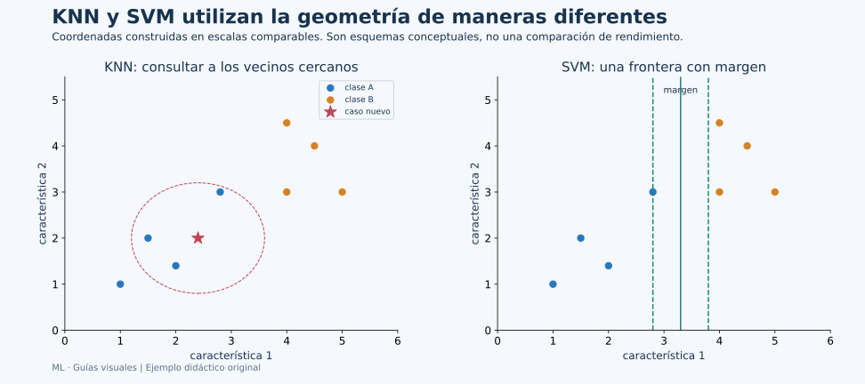

# Unidad 6: Máquinas de vectores de soporte (SVM)

## Objetivo y ruta

Comprenderás qué es una frontera, qué significa su margen y cómo un kernel permite construir fronteras no lineales. Esta unidad corresponde a las diapositivas 219–232 y al segundo algoritmo del tema 5.5 de Canvas. Se normaliza el apartado como 6.1; una portada de las diapositivas repite 5.1.

## 6.1. Algoritmo SVM

### De separar puntos a preferir una frontera

En dos dimensiones, una recta puede separar dos grupos de puntos. En tres, la separación puede ser un plano; en d dimensiones se habla de **hiperplano**.

Una frontera lineal se escribe:

$$
w^\top x+b=0
$$

w es una normal de la frontera: señala una dirección perpendicular. b modifica su ubicación. El signo de wᵀx+b indica de qué lado está un caso, según la convención de clases del modelo.



**Lee el panel derecho:** la línea central representa una frontera y las líneas discontinuas delimitan un margen conceptual. SVM busca una separación que tenga en cuenta ese espacio respecto de los casos relevantes. El esquema no es el resultado de entrenar un SVM con esos puntos y no debe utilizarse para leer coeficientes reales.

En una separación perfecta puede haber muchas rectas que no cometen errores de entrenamiento. La idea del margen elige entre ellas atendiendo la cercanía de los puntos a la frontera, en vez de considerar únicamente si quedaron en el lado correcto.

### Distancia y vectores de soporte

Para una frontera lineal no degenerada, la distancia de x al hiperplano es:

$$
d(x,\text{frontera})=\frac{|w^\top x+b|}{\|w\|_2}
$$

El numerador mide un puntaje y el denominador corrige su escala. Multiplicar w y b por una constante positiva cambia el puntaje, pero no la recta ni la distancia geométrica. Por eso puntaje y distancia no son automáticamente la misma cantidad.

En la formulación canónica separable, las superficies wᵀx+b=+1 y −1 delimitan una banda de ancho 2/‖w‖. Los **vectores de soporte** son casos que participan de forma relevante en la solución y tienen coeficientes duales no nulos. En un margen suave pueden encontrarse sobre el borde, dentro del margen o mal clasificados: no son siempre “todos los puntos más cercanos” en un sentido informal.

### Margen duro y margen suave

Un **margen duro** exige separación sin violaciones en el modelo separable. Si hay ruido o clases superpuestas, esa exigencia puede ser imposible o poco útil.

El **margen suave** permite violaciones y equilibra complejidad y penalización:

$$
\frac12\|w\|^2+C\sum_i\xi_i
$$

Aquí ξᵢ≥0 mide una violación de la restricción del margen, bajo la formulación usual, y C controla cuánto pesa penalizarla.

- Un C mayor penaliza más las violaciones y puede producir un ajuste más estricto.
- Un C menor permite más violaciones a cambio de mayor regularización.

No significa que C sea un porcentaje de errores permitido ni que cualquier C grande mejore test. Se elige con validación. Tampoco debe confundirse con alpha de Ridge: los parámetros no usan la misma dirección ni escala de regularización.

Un punto puede estar correctamente clasificado y aun así violar el margen si queda demasiado cerca de la frontera. “Error de clase” y “violación del margen” no son exactamente lo mismo.

### Kernels y fronteras no lineales

Algunas clases no pueden separarse bien mediante una recta en las características originales. Un kernel calcula ciertas semejanzas equivalentes a productos internos en otra representación, sin construir necesariamente todas sus coordenadas de forma explícita.

| Kernel | Idea | Configuraciones destacadas |
| --- | --- | --- |
| lineal | Frontera lineal en las entradas preparadas | C |
| polinómico | Relaciones equivalentes a términos y combinaciones polinómicas | degree, gamma, coef0 y C |
| RBF | Semejanza que disminuye con la distancia al cuadrado | gamma y C |

Un kernel RBF habitual es:

$$
K(x,x')=\exp(-\gamma\|x-x'\|^2)
$$

Para γ positivo, dos entradas iguales tienen semejanza 1; al separarse, la semejanza disminuye. gamma controla qué tan local es esa influencia. Un gamma grande puede crear detalles muy locales; uno pequeño produce influencias más amplias. Su efecto se interpreta junto con C y con la escala de los datos.

El “truco del kernel” no garantiza que cualquier transformación mejore la generalización. Permite representar otros tipos de frontera y añade configuraciones que debemos evaluar.

### Escalado, puntajes y probabilidades

SVM depende de distancias, productos internos y regularización, por lo que preparar escalas suele ser importante. StandardScaler va dentro del Pipeline y aprende su referencia solo en entrenamiento.

decision_function devuelve puntajes de decisión. No son probabilidades. La opción histórica probability=True de SVC activa una estimación adicional con costo de entrenamiento, pero no garantiza calibración. En scikit-learn 1.9, la versión del proyecto, esa opción está marcada como obsoleta; la documentación indica utilizar CalibratedClassifierCV. Si se calibra mediante validación cruzada, el escalado debe quedar dentro del estimador completo que recibe el calibrador para evitar información entre particiones. En cualquier caso, hay que evaluar la calidad de las probabilidades y el propósito de utilizarlas.

SVC puede trabajar con más de dos clases utilizando estrategias internas como uno-contra-uno. No hay que reducir necesariamente Iris a dos especies para utilizarlo. SVR es una variante de regresión: utiliza una formulación diferente orientada a cantidades y una tolerancia alrededor del ajuste.

### Ejemplo reproducible con búsqueda de kernel y C

```python
from sklearn.datasets import load_iris
from sklearn.metrics import accuracy_score, f1_score
from sklearn.model_selection import GridSearchCV, StratifiedKFold, train_test_split
from sklearn.pipeline import Pipeline
from sklearn.preprocessing import StandardScaler
from sklearn.svm import SVC

iris = load_iris(as_frame=True)
X = iris.data
y = iris.target
X_train, X_test, y_train, y_test = train_test_split(
    X, y, test_size=0.20, stratify=y, random_state=42
)
pipeline = Pipeline([
    ("escalar", StandardScaler()),
    ("modelo", SVC()),
])
parameter_grid = [
    {"modelo__kernel": ["linear"], "modelo__C": [0.1, 1.0, 10.0]},
    {
        "modelo__kernel": ["rbf"],
        "modelo__C": [0.1, 1.0, 10.0],
        "modelo__gamma": ["scale", 0.1, 1.0],
    },
]
search = GridSearchCV(
    pipeline, parameter_grid, scoring="f1_macro",
    cv=StratifiedKFold(n_splits=5, shuffle=True, random_state=42),
)
search.fit(X_train, y_train)
model = search.best_estimator_
pred = model.predict(X_test)
print("Configuración elegida:", search.best_params_)
print("F1 macro de validación:", search.best_score_)
print("Accuracy test:", accuracy_score(y_test, pred))
print("F1 macro test:", f1_score(y_test, pred, average="macro"))
print("Vectores de soporte por clase:", model.named_steps["modelo"].n_support_)
print("Forma de los puntajes:", model.decision_function(X_test).shape)
```

**Lectura del código:** la lista de diccionarios permite buscar gamma solo cuando tiene sentido en el kernel RBF. No se añade un parámetro sin efecto a la parte lineal. El Pipeline conserva la transformación y la aplica antes de cada predicción.

SVC utiliza gamma="scale" como una referencia calculada a partir de las características que recibe. En este ejemplo las recibe estandarizadas por el paso anterior. La búsqueda compara alternativas usando desarrollo; el test se evalúa después.

n_support_ informa cuántos vectores de soporte utiliza por clase. No es el conteo de errores ni un porcentaje de exactitud. Con varias clases, la forma y lectura de decision_function dependen de la estrategia de salida; una columna de puntajes no debe etiquetarse como probabilidad sin más.

### Ventajas y límites

SVM ofrece una forma de controlar margen y flexibilidad, y los kernels permiten patrones no lineales. El costo puede crecer mucho con el número de observaciones. Elegir kernel, escala y parámetros exige validación. Una frontera de buen margen sobre train no garantiza desempeño en poblaciones o condiciones distintas.

### Resultado comprobado del ejemplo

En esta búsqueda se seleccionó el kernel lineal con C=0.1. F1 macro medio de validación fue aproximadamente 0.975 y el de test, 0.933. n_support_ devolvió [6,28,22], conteos de vectores de soporte por clase. La matriz de puntajes tuvo forma (30,3): treinta casos y tres columnas de puntajes en la salida configurada.

Esos conteos no dicen que hubiera 6, 28 y 22 errores. Las diferencias entre clases reflejan la solución ajustada y su geometría. El ejemplo evita activar estimación de probabilidades porque su objetivo es explicar clasificación por frontera y puntajes.

## Conexión de las ideas

La normal del capítulo 2 describe la orientación de la frontera; la norma aparece en su distancia y margen; el preprocesamiento cambia la geometría; la validación compara la flexibilidad. SVM conecta así varias herramientas previas en un procedimiento de clasificación.

## Fuentes

[Recursos de Canvas](https://udem.instructure.com/courses/36648/pages/recursos-didacticos-del-capitulo-5-2?module_item_id=5019830), unidad 6, diapositivas 219–232. Diagramas y ejemplos originales.

Referencias: [máquinas de vectores de soporte](https://scikit-learn.org/stable/modules/svm.html), [SVC](https://scikit-learn.org/stable/modules/generated/sklearn.svm.SVC.html) y [funciones kernel](https://scikit-learn.org/stable/modules/metrics.html#pairwise-metrics-affinities-and-kernels).
