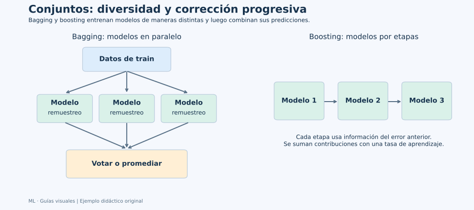

# Unidad 7: Algoritmos de conjunto

## Objetivo y ruta

Comprenderás cómo combinar modelos y por qué diversidad, entrenamiento y evaluación importan más que su cantidad. Se conservan los apartados 7.1–7.3 de la presentación. Canvas los reúne en el tema 5.6; varios pies de diapositiva dicen “unidad 08”, pero los índices y apartados corresponden a la unidad 7.



**Lee las flechas:** en bagging, varios modelos se ajustan sobre remuestreos y luego se agregan sus salidas. En boosting, las etapas utilizan información de los errores anteriores. La combinación final necesita reglas y entrenamiento definidos; juntar modelos no garantiza una mejora.

## 7.1. Concepto de conjunto y votación

Un **ensemble** combina predicciones de varios estimadores. Los estimadores base pueden ser del mismo tipo o de tipos diferentes. No todos tienen que ser modelos débiles: esa expresión depende del método y de su formulación.

La diversidad ayuda cuando los modelos no cometen exactamente los mismos errores. Si cinco modelos reproducen la misma regla equivocada, votar no crea información nueva. El beneficio depende de calidad, correlación de errores y forma de combinar.

### Votación dura

Cada clasificador propone una clase y se combinan sus votos, posiblemente con pesos. Si tres predicen A,B,B, gana B. Con pesos [3,1,1], el voto de A suma 3 y los de B suman 2, por lo que la decisión cambia.

Los pesos no deben elegirse mirando el test. También hay que definir qué sucede en empates y alinear el significado de las clases entre modelos.

### Votación suave

Se combinan probabilidades por clase y se elige la mayor. Para una clase A:

| Modelo | Probabilidad estimada de A | Clase con umbral 0.5 |
| --- | ---: | --- |
| 1 | 0.9 | A |
| 2 | 0.4 | B |
| 3 | 0.4 | B |

La votación dura elige B. La suave uniforme calcula (0.9+0.4+0.4)/3≈0.567 y elige A. La diferencia aparece porque conserva magnitudes de probabilidades en lugar de solo votos.

Esto exige estimadores que entreguen probabilidades comparables y clases alineadas. Un modelo excesivamente confiado puede dominar el promedio. Evaluar calibración y desempeño es parte de decidir si ese promedio tiene sentido.

En regresión se pueden promediar predicciones: 10,12 y 14 dan 12. El promedio suaviza variación, pero no elimina un sesgo compartido de todos los modelos.

## 7.2. Bagging y Random Forest

### Bootstrap: remuestrear con reemplazo

Partimos de n ejemplos de entrenamiento y extraemos n veces permitiendo repetir casos. Si los casos son [A,B,C,D], un remuestreo posible es [A,A,C,D]; otro, [B,C,C,D]. Se conservan las respuestas correspondientes a cada ejemplo elegido.

“Con reemplazo” significa que un caso puede aparecer varias veces; algunos no aparecen en un remuestreo. No es simplemente dividir train en grupos disjuntos ni duplicar toda la tabla sin cambiar nada.

Entrenamos un estimador sobre cada remuestreo y agregamos sus predicciones. Los modelos pueden ajustarse en paralelo, pero sus errores no son estrictamente independientes por compartir el origen de los datos. Reducir su correlación puede aumentar el beneficio de agregarlos.

Bagging suele ayudar a modelos inestables, como árboles que cambian bastante ante pequeñas variaciones del entrenamiento. Promediar reduce parte de esa variación, sin garantizar que el conjunto sea apropiado para cualquier problema.

### Qué añade Random Forest

Un bosque aleatorio combina árboles y añade aleatoriedad en las características candidatas de cada división, además del remuestreo cuando bootstrap está activado. Así intenta evitar que todos los árboles elijan siempre las mismas variables dominantes.

Al predecir, cada árbol recorre su ruta y el bosque combina salidas. En RandomForestClassifier de scikit-learn se promedian las probabilidades de clase de los árboles y se elige la clase más probable. La expresión informal “votan los árboles” describe la agregación, pero no siempre equivale exactamente a votar etiquetas duras.

| Configuración | Qué modifica |
| --- | --- |
| n_estimators | Cantidad de árboles |
| max_depth | Complejidad de cada árbol |
| min_samples_leaf | Respaldo mínimo por hoja |
| max_features | Características candidatas por división |
| bootstrap | Uso de remuestreo con reemplazo |
| random_state | Reproducibilidad de la aleatoriedad |

Más árboles pueden estabilizar el promedio a costa de tiempo y memoria. No sustituyen controlar el tamaño de cada árbol ni la calidad de entradas. **Corrección del material:** Random Forest sí puede sobreajustar y sigue necesitando evaluación. No es inmune al ruido, a la fuga de información ni a cambios entre train y uso.

### Fuera de bolsa: out-of-bag

Un caso que no apareció en el remuestreo de un árbol puede evaluarse con ese árbol. Al combinar árboles que dejaron fuera ese caso, obtenemos una estimación out-of-bag cuando el método y la configuración lo permiten.

Para n grande, la fracción esperada de casos ausentes de un remuestreo de n extracciones es aproximadamente e⁻¹≈36.8 %. Cada árbol deja fuera casos diferentes. OOB puede ser útil, pero no vuelve innecesario diseñar una evaluación acorde con grupos, tiempo y selección de configuraciones.

Las importancias por impureza del bosque heredan límites de las de los árboles. Correlación entre entradas y muchas opciones de división pueden afectar su interpretación. Importancia predictiva no equivale a efecto causal.

## 7.3. Boosting

Boosting construye una secuencia de estimadores y combina sus contribuciones. Cada etapa utiliza información de lo que aún se está haciendo mal. La información concreta depende del algoritmo: no todo boosting aplica la misma regla.

### AdaBoost: prestar más atención a errores

En una formulación binaria clásica:

1. Comenzamos con pesos iguales para los casos.
2. Ajustamos un clasificador base.
3. Medimos su error ponderado.
4. Calculamos su influencia en el conjunto.
5. Aumentamos el peso relativo de los casos mal clasificados y ajustamos otra etapa.

Para ilustrarlo, imaginemos diez casos con peso 0.1 y un clasificador que falla dos. El error ponderado es 0.2. En una formulación clásica, el peso de esa etapa es:

$$
\alpha=\frac12\log\frac{1-0.2}{0.2}\approx0.693
$$

Tras la actualización exponencial y normalización, cada caso mal clasificado puede quedar con peso 0.25 y cada correcto con 0.0625. Los dos errores reúnen ahora la mitad del peso total. El siguiente estimador presta más atención a ellos.

Es una explicación de la versión binaria clásica, no una fórmula única para todas las implementaciones multiclase. Los pesos de **casos** y los pesos de **estimadores** cumplen papeles diferentes. El ruido en etiquetas puede recibir atención creciente y dificultar el ajuste.

### Gradient Boosting: ajustar lo que falta

Para pérdida cuadrática, una intuición útil es ajustar un nuevo modelo a los residuos de la predicción actual y sumar una fracción de esa corrección:

$$
F_m(x)=F_{m-1}(x)+\eta\,h_m(x)
$$

Fₘ₋₁ es el conjunto anterior, hₘ la nueva contribución y η la tasa de aprendizaje. Para otras pérdidas se utilizan gradientes de la pérdida, no siempre residuos ordinarios.

Ejemplo construido: un caso real vale 15 y el modelo actual predice 10. El residuo es 5. Si una nueva etapa propone corrección 4 y η=0.1, la nueva predicción es 10+0.1×4=10.4. No salta directamente a 14 porque solo se incorpora una fracción.

Una tasa menor suele necesitar más etapas. Más etapas, árboles más profundos o una tasa excesiva pueden sobreajustar. La parada temprana utiliza validación para decidir cuándo dejar de añadir etapas; no debería usar el test final.

### XGBoost en el mapa del curso

XGBoost pertenece a la familia de boosting de árboles y desarrolla una implementación con objetivos regularizados y procedimientos de entrenamiento propios. No es sinónimo de Random Forest ni una opción automáticamente superior. El ejemplo de esta guía utiliza scikit-learn, ya presente en el proyecto; no necesita instalar XGBoost para comprender las familias.

### Comparar las tres formas de combinar

| Aspecto | Voting | Bagging / Random Forest | Boosting |
| --- | --- | --- | --- |
| Diversidad principal | Estimadores, configuraciones o representaciones | Remuestreos y, en el bosque, características candidatas | Etapas que atienden errores anteriores |
| Relación de ajuste | Puede ajustarse cada estimador por separado | Puede entrenarse en paralelo | Las etapas dependen de las previas |
| Combinación | Votos o probabilidades; promedios en regresión | Agregación de árboles o estimadores | Suma o combinación ponderada por etapas |
| Riesgo que permanece | Errores compartidos o probabilidades deficientes | Sesgo, complejidad, datos inadecuados | Sobreajuste, ruido y configuraciones inadecuadas |

### Ejemplo reproducible de selección entre familias

Comparamos un bosque, AdaBoost y Gradient Boosting utilizando la misma validación en desarrollo. Elegimos la familia por esa comparación y evaluamos solo la seleccionada en test. Así evitamos elegir por la mejor puntuación final reservada.

```python
import numpy as np
from sklearn.base import clone
from sklearn.datasets import load_iris
from sklearn.ensemble import (
    AdaBoostClassifier, GradientBoostingClassifier, RandomForestClassifier,
)
from sklearn.metrics import accuracy_score, f1_score
from sklearn.model_selection import StratifiedKFold, cross_val_score, train_test_split
from sklearn.tree import DecisionTreeClassifier

iris = load_iris(as_frame=True)
X = iris.data
y = iris.target
X_train, X_test, y_train, y_test = train_test_split(
    X, y, test_size=0.20, stratify=y, random_state=42
)
candidates = {
    "Random Forest": RandomForestClassifier(
        n_estimators=100, min_samples_leaf=2, random_state=42
    ),
    "AdaBoost": AdaBoostClassifier(
        estimator=DecisionTreeClassifier(max_depth=1, random_state=42),
        n_estimators=80, learning_rate=0.5, random_state=42,
    ),
    "Gradient Boosting": GradientBoostingClassifier(
        n_estimators=80, learning_rate=0.05, max_depth=2, random_state=42
    ),
}
cv = StratifiedKFold(n_splits=5, shuffle=True, random_state=42)
validation_means = {}
for name, estimator in candidates.items():
    scores = cross_val_score(
        estimator, X_train, y_train, cv=cv, scoring="f1_macro"
    )
    validation_means[name] = float(np.mean(scores))
    print(name, "F1 macro de validación:", round(scores.mean(), 3),
          "Desviación entre folds:", round(scores.std(), 3))

selected_name = max(validation_means, key=validation_means.get)
final_model = clone(candidates[selected_name]).fit(X_train, y_train)
pred = final_model.predict(X_test)
print("Familia elegida en desarrollo:", selected_name)
print("Accuracy test:", accuracy_score(y_test, pred))
print("F1 macro test:", f1_score(y_test, pred, average="macro"))
```

**Lectura:** cross_val_score clona y ajusta cada candidato dentro de cada fold; los objetos del diccionario no se convierten por ello en el modelo final ajustado. clone crea una copia de la configuración seleccionada, que se ajusta después con todo desarrollo.

Las configuraciones fueron fijadas para mostrar el procedimiento. Una búsqueda más amplia requeriría incorporar también sus parámetros a la validación. El ejemplo no demuestra que una familia sea superior en general; describe una selección concreta sobre Iris y estas particiones. La desviación entre folds no es una garantía probabilística del resultado futuro.

### Resultado comprobado del ejemplo

| Familia | F1 macro medio en validación |
| --- | ---: |
| Random Forest | 0.966 |
| AdaBoost | 0.941 |
| Gradient Boosting | 0.941 |

La regla de selección eligió Random Forest y después obtuvo aproximadamente 0.967 de exactitud y 0.967 de F1 macro en test. Son resultados de estas configuraciones y particiones. La tabla compara desarrollo; no se utilizó una tabla de resultados de test para escoger al ganador.

## Conexión de las ideas

Combinar modelos cambia cómo se aprende y cómo se agregan respuestas; se mantiene la necesidad de datos pertinentes, preparación correcta y evaluación reservada. El curso pasa de una regla individual a conjuntos, sin que eso elimine los límites estadísticos y de representación estudiados antes.

## Fuentes

[Recursos de Canvas](https://udem.instructure.com/courses/36648/pages/recursos-didacticos-del-capitulo-5-2?module_item_id=5019830), unidad 7, diapositivas 233–285. Ejemplos originales; se precisan bootstrap, regularización y límites del bosque.

Referencias: [conjuntos en scikit-learn](https://scikit-learn.org/stable/modules/ensemble.html), [VotingClassifier](https://scikit-learn.org/stable/modules/generated/sklearn.ensemble.VotingClassifier.html), [RandomForestClassifier](https://scikit-learn.org/stable/modules/generated/sklearn.ensemble.RandomForestClassifier.html), [AdaBoostClassifier](https://scikit-learn.org/stable/modules/generated/sklearn.ensemble.AdaBoostClassifier.html), [GradientBoostingClassifier](https://scikit-learn.org/stable/modules/generated/sklearn.ensemble.GradientBoostingClassifier.html) y [documentación de XGBoost](https://xgboost.readthedocs.io/en/stable/).
